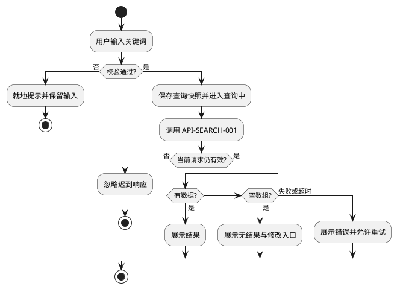

# AI 原型图与组件级文档说明标准 V3.0

**副标题：** 面向 AI 的原型与交付生成规范  
**版本：** V3.0  
**定位：** 面向 AI 的“已评审 PRD → 规范原型 HTML ＋ 9 份交付文档”生成标准；同时作为产品、设计、研发、测试的评审基线。  
**更新日期：** 2026-10-19  
**替代关系：** 本文件完整替代 V1.0～V2.2。使用时只提供本文件；旧版仅作历史留档。  
**主要输入：** 已评审 PRD（必需）＋ 本文件（必需）；已有接口、设计系统、竞品材料、澄清记录为可选输入。  
**主要输出：** 一个交付目录，包含 9 份 MD ＋ 1 份可离线运行的原型 HTML；验证证据放入 `_checks/`；构建源放入独立的 `_work/`，不进入交付目录。  
**适用对象：** 需要由 AI 一次性生成、并在多轮评审中持续维护的 APP、H5、小程序、桌面 Web 客户端与管理后台项目。  
**本文件性质：** 既规定“交付什么”，也规定 AI “按什么顺序、用什么数据模型、遵守哪些实现契约去生成”。它是生成规范，不是 PRD 的替代品，也不是后端实现文档。  
**给 AI 使用：** 将本文件与已评审 PRD 一并提供，按第 32 章的完整提示词执行；按第 4 章流水线推进，按第 31 章关卡自检。  
**给人使用：** 按下方阅读索引选择章节；评审时优先看第 0.2、31 章与附录 G。

**强制性用语：**

| 用语 | 含义 |
| --- | --- |
| **必须 / 不得** | 强制要求。违反即交付不合格，必须在交付前修复，或在 09 登记为经确认的例外。 |
| **应 / 不应** | 强推荐。偏离时必须在 00/09 记录理由、影响与替代方案。 |
| **可 / 可不** | 可选。按项目范围决定，不要求为了凑数而实现。 |
| **不适用** | 主题确实不适用。必须在归口章节写明依据与影响，不得留空、不得伪造内容。 |

---

## 阅读索引

| 需要完成的事 | 先读 | 再读 |
| --- | --- | --- |
| 让 AI 从 PRD 开始生成 | 第 0、4、5 章 | 第 32 章提示词 |
| 搭原型外壳与视觉 | 第 7、8、17 章 | 第 10～12 章 |
| 写后台页面 | 第 12、13、16 章 | 第 14、15 章 |
| 写客户端页面 | 第 10、11、13 章 | 第 14、15 章 |
| 写组件十节 | 第 9 章 | 第 22 章 |
| 写流程图、状态机、时序图 | 第 18 章 | 第 23、24 章 |
| 写测试与验证 | 第 26、27、29 章 | 第 31 章 |
| 处理评审修改 | 第 30 章 | 第 33 章反模式 |
| 做完自查后交付 | 第 31 章 | 附录 G |

---

## 0. AI 快速执行摘要

### 0.1 一条命令式工作流

```text
读取“已评审 PRD ＋ 本标准”
→ 建立需求/端/角色/业务对象模型
→ 建立流程、状态机、异常、接口、字段、权限模型
→ 拆页面、状态、组件、交互模式
→ 生成 00～09 文档骨架与追踪关系
→ 生成模拟数据与页面渲染器
→ 生成单文件离线 HTML
→ 构建、结构检查、逐状态渲染、真实浏览器交互验证
→ 修复并回归
→ 同步计数、变更记录、验证证据
→ 交付并声明完成状态与限制
```

### 0.2 十五条不可妥协的硬规则

1. **交付目录只保留 10 项主交付物**：00～09（9 份 MD ＋ 1 份 HTML）。默认不生成独立测试报告、需求追踪表、设计师 HTML、导入 ZIP、额外过程文档。证据放 `_checks/`，构建源放 `_work/`。
2. **02 必须是单文件、离线、自包含**：双击可开；不依赖 CDN、外部字体、外部图标库、后端服务或网络请求；图示在构建期渲染为 SVG 后内嵌。
3. **一切内容同源**：页面、状态、组件、接口、事件、用例只在一个归口定义；其他位置引用或由构建生成。禁止同一事实手写多份。
4. **编号稳定**：页面、组件、状态、流程节点、接口、用例、决策、变更编号一经使用不得改义；删除后标记废弃并保留编号，不得挪用给另一含义。
5. **页面状态不等于业务状态**：`LOADING` 不等于“支付确认中”，`已支付` 不等于“已交付”；业务状态以 04 为准，页面状态只描述界面。
6. **每个可见控件都必须产生真实可见结果**：输入、选择、提交、返回、关闭、复制、展开、重试、筛选、分页都要改变数据、画面、导航或反馈。禁止只弹一句“已点击”的空实现。
7. **原型可以模拟，但必须说明边界**：模拟接口、模拟 SDK、模拟支付、模拟供应商都可以；不得把模拟结果写成真实联调或测试通过。
8. **客户端与后台分别遵守各自规范**：客户端按第 10 章，桌面 Web 按第 11 章，后台按第 12 章；不得把后台表格硬塞进手机画布，也不得把手机交互照搬后台。
9. **后台不做业务埋点**：06 只定义客户端事件；后台组件第 8 节写不适用依据；后台审计与诊断在 05 定义，不进入 06。
10. **评审标注在画布之外**：编号、PRD 引用、设计理由、模拟说明、研发注释不得进入业务标题、按钮、卡片或列表文案；辅助描边不得改变布局与交互。
11. **组件十节必须完整且与 03 同源**：HTML 右侧说明展示完整十节，不得摘要化、不得“详见另一文件”、不得缺节。
12. **后台主列表必须是真表格**：表头、字段、多条模拟行、状态、操作列齐全；主列表控制在 7 个主列以内；1440px 与 1920px 下不得需要拖动底部横向滚动条。
13. **后台交互必须真实联动**：筛选、页签、分页、排序、行选择、批量、重置、刷新都要改变记录；草稿与已提交分离；迟到响应不得覆盖新状态。
14. **破坏性与高影响动作必须二次确认**：后台全部删除、移除、清空，以及上架/下架、启停、退款、发布、供应商调用等立即生效动作，先确认后执行；取消、Esc、遮罩关闭不得改变数据。
15. **验证必须基于最终产物**：脚本检查、逐状态渲染、真实浏览器点击与视觉检查分别记录；未执行就是未执行，不得用“脚本无语法错误”代替交互通过，也不得继承上一版本的通过记录。

### 0.3 十二步生成流水线

| 步骤 | 名称 | 主要产出 | 完成闸门 |
| --- | --- | --- | --- |
| S0 | PRD 归一化 | PRD 基线、范围、角色、端、约束、未知项 | 输入可追溯；阻断项已识别 |
| S1 | 需求建模 | REQ 映射、验收目标、排除项 | 需求无遗漏、无伪造编号 |
| S2 | 业务建模 | FL、SM、EX、规则编号 | 主路径与失败/取消/人工分支闭合 |
| S3 | 数据建模 | 对象、字段、权限、API、SEQ | 字段类型/空值/权限一致 |
| S4 | 页面与组件拆解 | PAGE、STATE、COMP、PAT、导航 | 每页有入口、状态、操作与返回 |
| S5 | 设计补充与决策 | DEC/TBD、设计建议、阻断清单 | 假设不写成已批准 |
| S6 | 文档骨架 | 00～09 可导航骨架 | 章节齐全、交叉引用可定位 |
| S7 | 模拟数据 | 可复现的数据集与状态覆盖 | 覆盖筛选、状态、空/错/边界 |
| S8 | 原型实现 | 渲染器、动作、后台引擎、评审外壳 | 页面/状态/组件可定位 |
| S9 | 构建 | 单文件 HTML、内嵌文档/图示/组件 | 构建报告与计数输出 |
| S10 | 验证 | 结构、语法、离线、渲染、交互、阅读器 | 实际结果与证据 |
| S11 | 修复与回归 | 缺陷、修复、复测 | 原缺陷关闭且无回归 |
| S12 | 定稿与交付 | 计数同步、CHG、08、09、00 | 交付闸门全过；限制可见 |

### 0.4 完成的定义

只有同时满足以下条件，才可声明“本轮交付完成”：

1. 10 项主交付物齐全，且每份文档的必要章节有实质内容；
2. PRD 本轮范围全部有页面/流程/状态/接口/用例落点，排除项与不适用项有依据；
3. 02 的全部页面与状态可打开、可渲染；核心操作可执行；后台列表与筛选真实联动；
4. 组件十节完整，HTML 与 03 同源；文档阅读器可读全部 MD 并下载原文；图示离线可见；
5. 结构检查、脚本语法、离线依赖、真实浏览器关键链路、窄屏与文档阅读均有实际记录；
6. 未验证项、失败项、阻塞项与待确认项均可见，未被包装成“通过”；
7. 所有派生计数以注册表/构建实测为准，并在 00、01、08 等出现处一致；
8. 本轮修改有 CHG 记录，受影响文件同步，旧编号保持稳定。

### 0.5 从最新原型提炼的标准化层

本版把参考实现中“可复用的实现结构”提炼为标准条款，而不是要求照抄某个业务模块。

| 参考实现结构 | 标准化后的规则 | 本文件位置 |
| --- | --- | --- |
| 页面注册表 `PAGES`（页面、端、状态、渲染器、说明） | 页面/状态/组件必须由注册表统一维护，02 与 01 同源 | 第 3、6、21 章 |
| 组件包装 `data-component`、组件选择器、辅助描边 | 组件定位、说明、描边统一契约；编号在画布外 | 第 8、9 章 |
| 全局评审状态 `RV`、页面运行时 `ADM_RT` | 评审状态与业务会话分开；每页草稿/分页/弹窗/请求版本独立 | 第 13 章 |
| 后台菜单 `ADM_MENU` 与页面配置 `ADM_CFG` | 菜单结构、列表页配置、渲染顺序、行动作、确认、toast 的标准 schema | 第 12、16 章 |
| 通用渲染器（筛选/页签/表格/分页/弹窗/空态） | 同类后台页面行为一致，只维护一套通用能力 | 第 12、14、16 章 |
| 二次确认引擎、toast/flash、滚动锁 | 破坏性动作、反馈、焦点与滚动的统一交互契约 | 第 12.10～12.12、13 章 |
| 评审外壳、状态块、独立滚动说明列 | 评审工具与业务画布分离、画布/说明对齐、窄屏降级 | 第 8 章 |
| 评审注释收集与画布清理 | 编号/PRD 引用/设计理由不得进入业务画布 | 第 8.7、9.6 章 |
| `COMP_DOCS` / `DIAGRAMS` / `DOCS` 注入与构建脚本 | 组件十节、图示、文档全文同源生成；离线单文件 | 第 17～19 章 |
| PlantUML 构建期渲染 SVG、图号前缀去重 | 图源/可视图/表格一致；运行时不依赖图源库 | 第 18 章 |
| 文档阅读器（目录、切换、返回、下载、焦点恢复） | 完整交付文件必须离线全文可读，并与 MD 同源 | 第 19 章 |
| 验证脚本（构建探针、语法、离线、计数、专项 survey、真实浏览器） | 结构/构建/渲染/交互/视觉分层验证，证据边界明确 | 第 29 章 |
| 89 轮 CHG 中反复出现的问题 | 提炼为 60 条反模式与硬性修复 | 第 33 章 |

### 0.6 历史变更沉淀

| 变更阶段 | 主要反馈/缺陷 | 沉淀为标准 |
| --- | --- | --- |
| CHG-0002～0017 | 图示语法、阅读器重复 ID、筛选不可用、画布位移、宽表撑宽、控件尺寸、后台宽度 | 唯一 ID、草稿/提交分离、`min-width:0`、容器查询、按端热区、后台铺开 |
| CHG-0018～0037 | 后台菜单配色、说明区吸顶/滚动、选择器、手机/PC 尺寸、购买链路、按钮无效 | 评审外壳结构、独立滚动、紧凑选择器、跨端取页、每个动作必须有结果 |
| CHG-0038～0053 | PlantUML 图源、PC 购买弹层/返回、搜索历史/不回填、订单三态、扫码支付、按端分流 | 图示构建期渲染、桌面 Web 规范、搜索规则、业务状态收敛、跨端链路 |
| CHG-0054～0062 | 后台菜单重设计、列表列宽、编辑弹窗、保存/关闭位置、删除确认、上传、toast、统一文案 | 后台菜单、7 列内表格、右上角动作、删除二次确认、通用确认引擎、toast/flash |
| CHG-0063～0081 | 供应商页移除、弹窗化编辑、商品多规格/素材、地区滚动、搜索推荐配置、订单用户/交付/退款 | 配置驱动列表、草稿与校验、嵌套滚动、拖拽排序、订单支付/交付分列、已支付数据口径 |
| CHG-0082～0089 | 供应商取码确认/审计、交付同步、未支付订单过滤、退款、支付核查移除、通知模板、协议版本、菜单权限 | 二次确认/脱敏审计、交付状态同步、数据源过滤、权限菜单化、发布即版本、富文本与角色权限 |

---

## 1. 使用边界、输入与规则优先级

### 1.1 最小输入

**必需输入只有两项：**

1. 用户声明“已评审”的 PRD；
2. 本标准。

用户声明已评审即可作为本轮设计前提，不要求提交签字、会议纪要或评审截图。AI 应从 PRD 中提取角色、端、范围、业务规则、数据、状态、异常与非功能约束，**不得要求用户先提供页面清单、组件编号、状态清单、接口参数、埋点表或测试步骤**——这些是本标准要求 AI 产出的内容。

**可选输入：**

| 输入 | 用法 | 缺失时 |
| --- | --- | --- |
| 已批准接口契约 | 作为 05 的正式契约来源 | 设计“建议契约”，标 `建议契约/待技术确认` |
| 设计系统/视觉规范 | 覆盖低保真基线中的字体、颜色、间距 | 使用第 7 章灰度基线 |
| 竞品截图/录屏 | 仅参考结构与交互，不自动成为需求 | 使用通用模式，记录为设计建议 |
| 需求澄清记录 | 作为决策依据写入 09 | 按缺口等级处理 |
| 真实数据样例 | 生成脱敏模拟数据 | 自行构造可复现模拟数据 |
| 品牌素材/图片 | 作为可选展示资源 | 使用文字占位块与缺失说明，不依赖外链 |

### 1.2 规则优先级

发生冲突时，按以下顺序裁决：

1. **用户最新明确决策**及本轮已确认范围；
2. **已评审 PRD**及其已确认补充；
3. 项目已批准的**接口、设计系统、目标平台硬性约束**；
4. **本标准**；
5. 竞品参考与 AI 设计建议。

裁决要求：

- 不得静默覆盖任何高优先级来源；必须在 00 的变更记录与 09 的决策台账中写明冲突点、原文出处、影响编号和处理结果。
- 法律、支付、实名、隐私、平台审核等硬性要求与业务决策冲突时，标记“需专项确认”，不得自行宣称合规。
- 竞品截图只能证明静态样式或结构，不能证明连续流程；不得把竞品行为直接写成需求。
- “用户没有回复”不等于同意；AI 的建议值不得升级为已批准规则。

### 1.3 缺口与设计补充

| 情况 | 处理方式 | 记录位置与标记 |
| --- | --- | --- |
| 与既有规则一致的低风险呈现细节 | AI 自主补齐并继续 | 09“AI 设计补充”，注明依据 |
| 不影响主流程的非关键缺口 | 给出可评审建议，继续无依赖部分 | 09 非阻断项；文档中写“建议值/待确认” |
| 影响资金、身份权限、核心状态、范围、不可逆动作的缺口 | 提出少量明确问题；只暂停依赖该决定的部分 | 09 阻断项，列出受影响 ID |
| 接口、第三方、性能阈值缺失 | 允许设计候选契约/候选指标，但不得伪造事实 | 05“建议契约”；09 待确认 |
| PRD 前后矛盾 | 以优先级裁决；无法裁决则登记阻断 | 00 冲突记录 ＋ 09 DEC |

**禁止：** 用“正式项目再接入”“后续补充”“详见开发”代替本轮应完成的拆解；也禁止为了消除缺口而虚构字段、状态、接口或业务规则。

### 1.4 三种完成状态

| 状态 | 判定条件 | 不能宣称 |
| --- | --- | --- |
| 设计评审稿 | 范围、页面、状态、原型、组件说明、用例已产出；假设与缺口可见 | 不等于业务/技术已批准 |
| 研发接收设计稿 | 本轮关键规则与依赖已确认；交付闸门通过；契约状态明确 | 不等于软件已实现或测试通过 |
| 执行验证材料 | 针对明确版本、环境、批次执行，有操作、结果与证据 | 原型模拟不能证明真实 SDK、支付、鉴权、采集成功 |

默认第一轮交付状态为“设计评审稿”。除非有真实执行记录，不得写“测试通过”“联调通过”“已上线”。

### 1.5 客户端、管理后台与采集边界

按**业务角色与用途**区分端，不按设备、文件名或实现语言区分：

| 范围 | 原型规范 | 组件说明 | 埋点 |
| --- | --- | --- | --- |
| 业务客户端（APP/H5/小程序/业务 Web） | 第 10 章及第 7～9 章共用规则 | 全部适用组件完整十节 | 按第 25 章设计客户端事件 |
| 管理后台 | 第 12 章及共用规则 | 全部适用组件完整十节 | **不设计业务事件**；06 写不适用依据 |
| 客户端＋后台 | 一份 02 按真实端切换，各端采用各自布局 | 一份 03，按端/页面组织 | 06 仅含客户端事件 |
| 仅后台 | 02 覆盖后台页面与状态 | 03 覆盖后台组件 | 06 保留，事件数为 0，说明不适用 |

**后台无埋点，不等于无审计：**

- 后台操作审计、技术诊断、状态回调记录属于 05 的数据/权限/日志契约，可由 03 引用；
- 不得把审计改名为“事件”后放进 06；
- 不得在原型中模拟后台业务事件上报；
- 服务端业务日志、数据库记录、埋点平台预置的公共属性，不自动成为客户端业务事件。

### 1.6 标准强制级别与例外

- 本标准中的“必须/不得”为交付闸门项；例外只能由用户明确确认，并写入 09（DEC）与 00（影响）。
- “应/不应”偏离时，必须在对应文档说明理由；未说明视为不合规。
- “不适用”不是免除拆解，必须给出适用性判断依据；例如：无持久业务对象才能不建状态机，无客户端才能不设计埋点。
- 先保证规则真实、结构完整，再追求视觉与文案打磨；不得用视觉细节掩盖业务逻辑缺失。

---

## 2. 唯一交付目录与文件职责

### 2.1 目录结构

```text
项目原型交付_Vx.y/
├── 00_交付说明与变更记录.md
├── 01_页面与状态说明.md
├── 02_低保真交互原型.html
├── 03_组件级文档.md
├── 04_业务流程与异常规则.md
├── 05_接口数据与权限说明.md
├── 06_埋点文档.md
├── 07_测试用例.md
├── 08_验证记录与验收映射.md
├── 09_待确认事项与设计决策.md
├── _checks/                     # 实际验证证据（附件，不新增主交付物）
│   └── 验证证据_YYYY-MM-DD.md
└── assets/                      # 仅在确有本地资源时存在
```

构建源（如 `_work/`、模板分片、PlantUML jar、构建脚本、缓存）**不得放入交付目录**。交付目录中的 02 不得引用 `_work/` 下的任何文件。

### 2.2 十项主交付物

| 文件 | 主要读者 | 必须回答的问题 | 唯一归口内容 | 详细规范 |
| --- | --- | --- | --- | --- |
| 00 | 全体评审人 | 交付了什么、怎么打开、评审顺序、完成与限制、改了什么 | 范围、导航、完成状态、CHG、影响 | 第 20 章 |
| 01 | 产品/设计/研发/测试 | 有哪些端/页面/组件/状态/导航/模式 | 页面、状态、组件实例、导航、模式 | 第 21 章 |
| 02 | 全体 | 界面长什么样、怎么操作、异常如何表现、组件说明是什么 | 唯一可操作原型、评审外壳、阅读器、图示入口 | 第 7～19 章 |
| 03 | 研发/设计/测试 | 每个组件的数据、逻辑、样式、状态、接口、事件、验收 | 组件完整十节 | 第 9、22 章 |
| 04 | 产品/业务/研发/测试/运营 | 业务怎么走、状态怎么变、异常怎么恢复 | FL、SM、EX、业务规则 | 第 23 章 |
| 05 | 研发/测试/数据 | 接口、字段、权限、时序、数据边界 | API、字段字典、权限、SEQ、留存 | 第 24 章 |
| 06 | 数据/研发/测试 | 客户端采集什么、怎么取值、如何去重 | 客户端事件与属性复用 | 第 25 章 |
| 07 | 测试/研发/验收人 | 怎么测、预期是什么、依赖什么 | 可执行用例与覆盖 | 第 26 章 |
| 08 | 全体 | 需求是否覆盖、验收条件是什么、实际验证了什么 | 需求覆盖、验收、实际验证、缺陷/未验证 | 第 27 章 |
| 09 | 产品/业务/技术 | 哪些未定、建议是什么、已确认依据是什么 | DEC/TBD 台账与关闭记录 | 第 28 章 |

### 2.3 附件与证据

- `_checks/` 用于保存验证脚本输出、浏览器操作记录、截图索引、关键命令结果；由 08 引用，不构成新增主交付物。
- `assets/` 仅在确需本地图片/字体时存在；02 必须能在保留该目录的情况下离线运行。默认不引入外部图片、字体与图标库。
- 构建期工具（Node、Python、PlantUML、模板）可存在，但不得成为打开 02 的前置条件。
- 不默认生成 Excel、PDF、独立图文档、测试报告、需求追踪表；用户明确要求时才从同源内容导出。

### 2.4 版本与批次

- 交付版本使用 `Vx.y`；批次使用 `BATCH-YYYY-MM-DD-NN`。
- 每份 MD 的文档头必须包含：标题、文档版本/交付批次、适用 PRD 版本及章节、适用端与范围、文档状态、关联文件、更新时间、编写方式、评审人与确认日期（未知留空）。
- 单个文件的修订号可以不同，但必须在 00 的版本清单中说明关系。
- 02 的标题区必须展示 PRD 基线、交付版本/批次、文档状态、模拟边界。
- 02 的内嵌文档头信息从 MD 原文读取，不得另写一套版本号。

### 2.5 文件头模板

```text
标题：
文档版本 / 交付批次：
适用PRD版本及来源章节：
适用端、模块与本轮范围：
文档状态：设计建议 / 待评审 / 已确认（仅有真实依据时填写）
关联文件：
更新时间：
编写方式：AI辅助 / 人工
评审人与确认日期：（未知留空）
```

---

## 3. 统一内容模型、编号与同源

### 3.1 标准实体模型

AI 在生成任何文档或页面之前，必须先在内部建立以下实体模型；交付物是这些实体的不同视图，不是九套互相独立的事实。

| 实体 | 含义 | 核心字段 | 归口 |
| --- | --- | --- | --- |
| PROJECT | 项目与交付批次 | 名称、PRD 版本、端、版本、批次、状态 | 00 |
| END | 客户端/后台端 | 端码、名称、目标容器 | 01 |
| ROLE | 业务角色 | 角色名、数据范围、可用动作 | 01、05 |
| REQ | 需求/验收目标 | PRD 出处、业务规则、优先级、覆盖状态 | 08（映射）；01/03/07 引用 |
| PAGE | 页面或独立弹层 | 页面ID、端、名称、目的、入口/出口、优先级 | 01 |
| STATE | 页面状态 | 状态ID、进入条件、展示、可操作、退出 | 01 |
| COMP | 组件实例/共享定义 | 组件ID、名称、职责、模式、数据、状态、定位 | 01、03 |
| PAT | 交互模式 | 模式ID、结构、行为、差异、验证点 | 01 |
| FL | 业务流程 | 流程ID、角色、开始/结束、节点、分支 | 04 |
| SM | 业务状态机 | 状态字典、迁移、守卫、终态 | 04 |
| EX | 异常 | 异常ID、触发、识别、文案、恢复、TC | 04 |
| API | 接口契约 | API ID、方法/路径、鉴权、请求/响应、错误 | 05 |
| FIELD | 字段/枚举 | 对象.字段、类型、来源、空值、权限 | 05 |
| SEQ | 时序 | SEQ ID、参与方、消息、超时/重试 | 05 |
| EVENT | 客户端事件 | 事件名、七列属性、触发、去重 | 06 |
| TC | 测试用例 | 编号、前置、数据、步骤、预期、阶段 | 07 |
| CHK | 验证检查 | 编号、对象、方法、结果、结论、证据 | 08 |
| DEF | 缺陷 | 编号、现象、根因、处置、复测 | 08 |
| DEC | 决策/待确认 | 编号、问题、影响、建议、状态、依据 | 09 |
| CHG | 变更 | 编号、原因、前后、影响、兼容、复核 | 00 |

### 3.2 编号规则

| 对象 | 推荐格式 | 示例 | 规则 |
| --- | --- | --- | --- |
| 需求 | 沿用 PRD；无编号时用 REQ-模块-序号 | REQ-SEARCH-001 | 新映射号须注明 PRD 版本与章节，不得冒称原编号 |
| 页面 | 端-模块-序号 | APP-SEARCH-01、ADM-ORDER-01 | 端码由项目定义，不固定 APP/WEB/ADM，但全项目统一 |
| 组件实例 | 页面号-C序号 | APP-SEARCH-01-C02 | 同一页面内唯一；删除后编号保留并标废弃 |
| 共享组件 | COM-端-序号 / ADM-COMMON-序号 | COM-CLIENT-C01、ADM-COMMON-C05 | 跨页面复用；每个页面实例仍保留自己的实例编号 |
| 页面状态 | 页面号::状态码 | APP-SEARCH-01::LOADING | 同名状态用所属对象限定 |
| 业务对象状态 | 对象::状态码 | ORDER::PAID | 与页面状态严格分开；以服务端/数据所有者为准 |
| 交互模式 | PAT-类别-序号 | PAT-TABLE-02 | 模式不是页面；同类模式语义稳定 |
| 流程/状态机/时序 | FL-/SM-/SEQ-模块-序号 | FL-ORDER-001 | 图源、可视图、节点/消息表逐字一致 |
| 节点/迁移/消息 | N-流程-序号、TR-状态机-序号、M-时序-序号 | N-ORDER-001-03 | 只追加，不复用，不重号 |
| 接口/异常 | API-/EX-模块-序号 | API-ORDER-004 | 接口 ID 不等于实际 URL；异常 ID 不等于错误码 |
| 测试/检查/缺陷/决策/变更 | TC-/CHK-/DEF-/DEC-/CHG-模块-序号 | TC-ORDER-003 | 编号稳定；删除后标记废弃，不挪用 |
| 事件 | 每个单词首字母大写并连续书写 | OrderSubmitResultEvent | 不用下划线、短横线、空格 |
| 事件属性 | 全小写，单词以 `_` 连接 | request_result | 不用驼峰、大写、短横线 |

### 3.3 保留命名空间

以下命名空间具有固定语义，**不得**用于其他含义：

| 命名空间 | 用途 | 规则 |
| --- | --- | --- |
| `ADM-COMMON-C01`～`C11` | 后台通用组件（菜单、顶栏、筛选、页签、表格、分页、弹窗、批量、导出、指标、空态） | 后台项目必须按第 14 章语义实例化；不使用的编号留空，不改成其他组件 |
| `COM-CLIENT-C01`～`C14` | 客户端共享组件（搜索输入、搜索动作、商品卡、卡片容器、排序、卡片列表、客服入口、标题栏、状态区、明细卡、状态页签、订单列表、登录失效、底部标签栏） | 客户端项目按语义复用；不使用的编号留空，不改成其他组件 |
| `ADM-COMMON-*` 之外的 `adm-*` | 后台动作前缀 | 所有以 `adm-` 开头的动作只能由后台分发器处理 |
| `sb-*` | 后台侧边菜单本地动作 | 不得流入后台业务动作分发器 |
| `APP-*` / `WEB-*` / `ADM-*` | 页面与实例命名空间 | 由项目端码决定；跨端共用链路不得写死某一端 |

### 3.4 同源原则

**同一事实只能有一个维护归口。**

| 内容 | 唯一归口 | 其他位置 |
| --- | --- | --- |
| 页面、组件实例、页面状态 | 01 | 02 使用同一注册表；08 检查覆盖 |
| 组件十节说明 | 03 | 02 构建时解析并展示，不另写摘要 |
| 业务规则、流程、状态机、异常 | 04 | 01 说明界面表现；03 说明组件执行；07 生成用例 |
| 接口、字段、枚举、权限、时序 | 05 | 03 引用关键字段；06 引用属性契约 |
| 客户端事件与属性关系 | 06；属性主定义在 05 | 03/02 只展示适用事件行 |
| 测试步骤与预期 | 07 | 03 给验收摘要与 TC 引用；08 引用执行 |
| 需求覆盖、验收、实际验证 | 08 | 00 汇总；07 引用批次 |
| 决策与待确认 | 09 | 其他文档只显示状态与 DEC 引用 |
| 变更与影响 | 00 | 其他文档只体现结果 |

**实施要求：**

- 页面/状态/组件注册表是 01 与 02 的共同来源；AI 应先生成注册表，再生成渲染器与文档。
- 组件十节由 03 唯一维护；02 的构建脚本解析 03，不另建第二份组件正文。
- 派生计数（页面数、状态数、组件实例/定义数、事件数、用例数、检查项数）必须从注册表或构建输出实测一次，并写入所有出现处；不得分别手写。
- 任一归口修改后，必须同步所有引用位置；无法同步时登记 DEF/GAP 并在 08 说明影响。

### 3.5 引用完整性

必须保证双向可追踪：

- 每个 REQ 至少有一个 PAGE/FL/API/TC 落点；每个 PAGE 至少有一个 REQ 来源；
- 每个 COMP 至少属于一个 PAGE 或共享定义；每个可操作 COMP 有 PAT、状态、动作和 TC；
- 每个 STATE 有进入条件与退出/终态；每个 EX 有界面表现、数据处置和恢复路径；
- 每个 API 有调用组件与错误映射；每个 EVENT 有触发组件与属性定义；
- 每个 TC 有依据（REQ/PAGE/COMP/FL/API/EVENT）；
- 每个 CHK 有验证对象、方法、实际结果、结论和证据位置；
- 所有 `SEQ-*`、`API-*`、`EX-*`、`TC-*`、`DEC-*` 引用必须能定位到定义。

### 3.6 编号与删除

1. 编号一经发布，不得因排序、重命名、移动文件而改变。
2. 删除组件、页面、状态、字段或事件时：
   - 在归口文档保留废弃行（可用删除线）；
   - 写明替代关系、替代编号、影响范围；
   - 原编号永不复用；
   - 同步检查 01/02/03/04/05/07/08 中对该编号的引用。
3. 拆分节点/流程时：保留原编号的原含义，为新分支追加新编号。
4. 跨文档重命名只能改显示名，不能顺便改编号或含义。
5. 构建脚本必须检查重复 ID、孤立引用与组件十节缺失。

### 3.7 计数口径

| 计数 | 口径 | 校验来源 |
| --- | --- | --- |
| 页面数 | `PAGES` 中唯一页面 ID 数（含独立弹层页面） | 02 注册表 |
| 状态数 | 每个页面的适用状态条目总数 | `PAGES[].states` |
| 组件实例数 | 01 注册表中唯一的页面组件实例数 | 01/02 的 `data-component` 实测 |
| 组件定义数 | 03 中唯一组件小节数（含共享定义） | 03 构建解析 |
| 事件数 | 06 中唯一事件名数，不按属性行计 | 06 |
| 用例数 | 07 索引表中 `TC-` 行唯一编号数 | 07 |
| 检查项数 | 08 中 `CHK-` 表格行唯一编号数 | 08 |
| 图示数 | 04/05 中唯一 PlantUML 图源数 | 构建解析 |

所有计数必须在 00、01、06、07、08 中一致。发现不一致时，以注册表/构建输出重算，不保留“历史正确值”。

---

## 4. AI 生成流水线（详细）

### S0 PRD 归一化

**输入：** PRD 全文与版本。  
**动作：**

1. 记录 PRD 名称、版本、日期、状态、章节来源；
2. 提取端、角色、目标容器、业务范围、排除项；
3. 提取业务对象、核心状态、支付/交付/权限/通知/第三方依赖；
4. 提取非功能约束（性能、安全、合规、平台限制）；
5. 标记未提供、冲突、待确认、不可验证项。

**输出：** 内部 `PROJECT_INTAKE` 与 00 的基线章节。  
**闸门：** 不依赖用户补充页面/组件清单；阻断项已归类。

### S1 需求建模

**动作：**

1. 将 PRD 条目映射为 REQ；保留原编号或建立 `REQ-模块-序号`；
2. 每个 REQ 写业务规则、验收目标、优先级、范围状态；
3. 建立“需求 → 页面/流程/接口/用例”的初始追踪；
4. 识别范围外但容易被误实现的内容，写入 00 排除项。

**输出：** 08 需求覆盖映射初稿；01 页面候选；09 缺口清单。  
**闸门：** 每个本轮需求有落点或明确缺口。

### S2 业务建模

**动作：**

1. 识别业务对象与持久状态；
2. 画主流程与关键失败/取消/人工分支（PlantUML）；
3. 写状态字典、迁移表、终态/禁止迁移；
4. 建立异常矩阵：输入、网络、超时、拒绝、无权限、并发、重复、乱序、部分成功、过期、第三方不可用；
5. 定义恢复、补偿、人工介入和用户反馈。

**输出：** 04 的 FL/SM/EX。  
**闸门：** 主路径闭合；失败有恢复；状态与页面状态分离。

### S3 数据、接口、权限建模

**动作：**

1. 建立数据对象与字段字典（类型、单位、来源、空值、脱敏、权限、留存）；
2. 定义 API 目录与逐接口契约（请求/响应/错误/重试/幂等/分页/并发）；
3. 定义角色、菜单/对象权限、服务端校验；
4. 画关键时序图（正常＋异常）；
5. 接口未批准时标“建议契约”。

**输出：** 05 的 API/FIELD/ROLE/SEQ。  
**闸门：** 每个数据交互组件有 API 或本地处理说明；字段一致。

### S4 页面、状态、组件、模式拆解

**动作：**

1. 按端拆页面；独立操作流程的弹层登记为页面或页面状态；
2. 为每页列出入口、出口、返回目标、角色与权限；
3. 逐页判断适用状态（默认、编辑、焦点、校验失败、加载、提交中、成功、业务拒绝、网络失败、超时、空数据、无权限、过期、取消、降级、项目特殊状态）；
4. 为每个组件登记组件 ID、职责、模式、数据、状态、HTML 定位；
5. 建立导航表与动作流转表；
6. 识别共享组件与实例关系。

**输出：** 01 页面/组件/状态/导航/模式。  
**闸门：** 无无来源页面、无无原型页面、无找不到说明的操作组件。

### S5 设计补充与决策

**动作：**

1. 对低风险细节自主补齐，记录“设计建议”；
2. 对非阻断缺口给建议值，标“待确认”；
3. 对阻断项列影响 ID，暂停依赖部分；
4. 不把建议写成已批准；不编造接口、阈值、合规结论。

**输出：** 09 初稿；00 的范围与限制。  
**闸门：** 每个假设有来源、状态、落点。

### S6 文档骨架

**动作：**

1. 按第 20～28 章建立 00～09 固定章节；
2. 填入已知事实、表格表头、追踪编号；
3. 不生成无内容模板充数；不写“详见后续”。

**输出：** 可导航的文档骨架。  
**闸门：** 每份文档必要章节齐全，交叉引用可定位。

### S7 模拟数据

**动作：**

1. 为每个列表准备足以验证筛选、状态、详情、分页的多条脱敏模拟行；
2. 覆盖有数据/无数据/错误/无权限/超时/边界；
3. 让不同记录具有不同 ID 与内容，避免“详情永远第一条”；
4. 让部分筛选组合故意无结果，以验证空态；
5. 不写入真实个人信息、完整口令码、完整手机号、姓名、身份证号、好友链接原文（除非用户明确要求模拟展示，且仍用明显模拟数据）。

**输出：** 02 内数据与 03 的数据来源说明。  
**闸门：** 每条业务状态与筛选选项都有可复现样本。

### S8 原型实现

**动作：**

1. 按第 17 章建立单文件模块结构；
2. 实现评审外壳、页面注册表、渲染器、动作分发、后台引擎；
3. 每个页面/状态可渲染；每个动作有结果；
4. 实现草稿、提交、异步失效、确认、弹窗、滚动锁、焦点恢复；
5. 组件 `data-component` 与 01/03 对齐；
6. 评审注释移出画布；
7. 不引入外部依赖。

**输出：** 02 的模板/构建源。  
**闸门：** 41/全部页面 × 状态渲染成功；控制台无未处理错误。

### S9 构建

**动作：**

1. 拼接模板；
2. 解析 03 为组件十节字典；
3. 提取 04/05 的 PlantUML 图源并渲染 SVG；
4. 内嵌 9 份 MD 全文与下载内容；
5. 注入页面计数、组件字典、图示、文档；
6. 输出构建报告（页面/状态/组件/图示/文档/大小）。

**输出：** 单文件 02。  
**闸门：** 无外链、无外部脚本/样式、语法检查通过。

### S10 验证

**动作：**

1. 文件齐备与文档头检查；
2. ID 唯一、引用可定位、十节完整；
3. 逐页面逐状态渲染；
4. 真实浏览器打开：控制台、布局、核心操作、后台筛选/页签/分页/弹窗/确认、阅读器、图示；
5. 窄屏与桌面视口；1440/1920 后台铺开；
6. 记录方法、环境、结果、证据、限制。

**输出：** 08 第 3 章与 `_checks/`。  
**闸门：** 所有 P0 检查通过或明确未验证；失败项有处置。

### S11 修复与回归

**动作：**

1. 缺陷登记 DEF，写现象、根因、处置；
2. 修复后复测原缺陷；
3. 跑同类回归（相关页面、状态、交互、文档计数）；
4. 不掩盖失败，不删除历史记录。

**输出：** 08 缺陷表与复测记录。  
**闸门：** 无未处置的 P0 缺陷；无因修复引入的新失败。

### S12 定稿与交付

**动作：**

1. 以注册表/构建输出重算所有计数；
2. 同步 00/01/06/07/08 的计数与版本；
3. 记录 CHG（原因、前后、影响、兼容、复核）；
4. 更新 09 状态与 00 完成状态；
5. 生成交付清单、打开方式、限制、证据索引；
6. 报告未完成/未验证/阻断项。

**输出：** 最终 10 项交付物与证据。  
**闸门：** 第 31 章交付关卡全过。

---

## 5. PRD 解析与需求建模规范

### 5.1 PRD 接收检查单

在生成页面前，逐项确认：

| 项 | 必须提取的内容 | 缺失处理 |
| --- | --- | --- |
| 版本 | PRD 名称、版本、日期、状态、章节 | 无法确认版本→阻断，不开始 |
| 端 | APP/H5/小程序/Web/后台、容器、平台差异 | 端不明→按业务角色提问；不得猜 |
| 角色 | 用户、运营、客服、财务、管理员等 | 角色不明→影响权限与页面；登记待确认 |
| 范围 | 本期、排除、后续、待评审 | 范围不明→不能自行扩大 |
| 业务对象 | 商品、订单、支付、交付、退款、协议、通知等 | 对象不明→先建领域模型 |
| 状态 | 每个对象的业务状态、权威来源、迁移 | 状态缺失→不能伪造终态 |
| 规则 | 校验、时限、配额、优先级、异常处理 | 关键阈值不明→09 阻断/建议 |
| 数据 | 输入/输出、字段、枚举、脱敏、留存 | 字段不明→建建议契约 |
| 权限 | 角色、菜单、数据范围、敏感动作 | 权限不明→至少定义可拒绝路径 |
| 第三方 | 支付、实名、供应商、通知、SDK | 能力不明→标待商务/技术确认 |
| 非功能 | 性能、并发、可用性、合规、平台限制 | 无阈值→不得虚构；标待确认 |
| 验收 | 业务目标、可判定标准、责任人 | 缺失→AI 建议验收条件，标待确认 |

### 5.2 需求抽取表（AI 内部/08 初稿）

| 字段 | 说明 |
| --- | --- |
| REQ ID | PRD 原编号或映射号 |
| PRD 出处 | 版本＋章节/段落 |
| 需求陈述 | 用可验证的语言改写，不改变原意 |
| 业务规则 | 条件、动作、结果、例外 |
| 角色/端 | 谁在什么端使用 |
| 关联对象 | 页面/流程/状态/接口/事件 |
| 优先级 | P0/P1/P2，并说明依据 |
| 本轮范围 | 完整/部分/排除/不适用 |
| 验收目标 | 可判定标准 |
| 缺口/DEC | 不清楚或有冲突的点 |

### 5.3 覆盖判定

覆盖状态只使用：

- **完整：** 有页面/组件/状态/接口/用例的完整落点，关键分支已定义；
- **部分：** 有落点但存在待确认规则、未实现状态或依赖外部能力；
- **缺失：** 本轮应有但没有任何落点；
- **不适用：** 有依据说明为什么不适用。

不得因为“有文件名”“页面上有入口”“文档里提过”就判完整。

### 5.4 PRD → 页面原型映射

| PRD 内容 | 标准页面原型 | 必须拆出的状态 |
| --- | --- | --- |
| 浏览/首页配置 | HOME | 默认、加载、空、失败、无目标 |
| 搜索/筛选 | SEARCH_DEFAULT + SEARCH_RESULTS | 默认、输入、结果、无结果、加载、失败、末页 |
| 商品/内容详情 | DETAIL | 可售、资料缺失、下架/售罄、处理中、展开、失败 |
| 选择/购买 | BUY_PANEL | 打开、校验失败、协议提示、提交中、成功 |
| 身份/协议/绑定 | AUTH_MODAL / AGREEMENT / BINDING | 展示、未满足、成功、失败、返回 |
| 下单/支付 | CHECKOUT / PAY_RETURN / RESULT | 待支付、提交中、查询中、成功、失败、超时、结果未知 |
| 订单查看 | ORDER_LIST / ORDER_DETAIL | 有数据、空、加载、失败、会话失效、详情 |
| 个人中心 | PROFILE | 已登录、未登录、状态未知 |
| 客服/外部唤起 | SERVICE | 正常、无订单、无法唤起 |
| 后台列表 | ADM_LIST | 有数据、空、加载、失败、无权限、详情/编辑 |
| 后台配置/表单 | ADM_FORM | 默认、编辑、校验失败、保存中、成功、失败 |
| 后台统计 | ADM_STATS | 有数据、空、加载、失败 |

### 5.5 非功能与平台约束

必须把以下内容从 PRD 提取到 05/09，不能默认忽略：

- 支付/交付/通知的时限与重试；
- 并发、幂等、重复回调、乱序；
- 数据保留、脱敏、访问权限；
- 平台 SDK 能力与降级路径；
- 性能/容量阈值（未知则标待确认）；
- 审核/合规/协议版本要求；
- 国际化、时区、货币、单位；
- 可访问性与键盘操作。

### 5.6 AI 的提问边界

只在以下情况提问，且一次集中提出：

1. 无法确定端/角色，导致无法拆分页面；
2. 资金、权限、不可逆动作的规则冲突；
3. 关键业务对象/状态缺失，无法建立主流程；
4. 外部依赖决定原型能否演示；
5. 用户明确要求确认设计方向。

其他情况应自主补齐并记录为设计建议，不得反复询问“页面要多不多”“按钮放哪里”。

---

## 6. 页面、状态与交互建模

### 6.1 标准页面原型（STD-PAGE）

页面原型是拆解起点，不是固定菜单。项目按 PRD 选用，缺失的原型不生成空页面；同一原型可在不同端有不同页面编号。

| 原型码 | 名称 | 必备结构 | 常见状态 |
| --- | --- | --- | --- |
| STD-PAGE-HOME | 首页/工作台 | 标题、导航、主内容区、主要入口、加载/空/失败 | DEFAULT、LOADING、EMPTY、ERROR、OFFLINE |
| STD-PAGE-SEARCH | 搜索默认页 | 输入、提交、搜索发现/历史、热门内容 | DEFAULT、EDITING、EMPTY、ERROR |
| STD-PAGE-RESULTS | 结果页 | 结果数量、查询快照、结果列表、继续加载/分页 | RESULTS、LOADING、EMPTY、ERROR、END |
| STD-PAGE-DETAIL | 详情页 | 媒体、标题、关键信息、正文、操作栏、返回 | DEFAULT、PARTIAL、UNAVAILABLE、EXPANDED、ERROR |
| STD-PAGE-BUY | 购买/选择面板 | 商品摘要、规格、数量、交付方式、支付方式、协议、主操作 | OPEN、VALIDATION_ERROR、SUBMITTING、CLOSED |
| STD-PAGE-AUTH | 身份/资格引导 | 原因、信息范围、主次操作、返回 | SHOWN、LAUNCHING、UNAVAILABLE、UNKNOWN |
| STD-PAGE-AGREEMENT | 协议/条款查看 | 标题、版本、生效时间、正文、返回 | DEFAULT、ERROR、STALE |
| STD-PAGE-BIND | 绑定/授权引导 | 原因、绑定入口、备用路径、返回 | SHOWN、LAUNCHING、UNAVAILABLE |
| STD-PAGE-CHECKOUT | 确认订单/结算 | 订单号、明细、金额、支付方式、协议、提交 | DEFAULT、SUBMITTING、EXPIRED、ERROR |
| STD-PAGE-PAYRET | 支付返回确认 | 询问、查询中、无结论、重新查询 | SHOWN、QUERYING、TIMEOUT |
| STD-PAGE-RESULT | 支付/交付结果 | 支付状态、交付状态、下一步、客服 | DELIVERED、ISSUING、EXCEPTION、CONFIRMING、ERROR |
| STD-PAGE-ORDER-LIST | 订单列表 | 状态页签、订单卡/表格、操作、空/失败 | RESULTS、LOADING、EMPTY、ERROR、SESSION_EXPIRED |
| STD-PAGE-ORDER-DETAIL | 订单详情 | 订单、支付、交付、售后、操作记录 | DEFAULT、ISSUING、EXCEPTION、REPLACED、ERROR |
| STD-PAGE-PROFILE | 个人中心 | 账号、资格状态（脱敏）、订单/客服入口 | LOGGED_IN、GUEST、UNKNOWN |
| STD-PAGE-SERVICE | 客服/外部唤起 | 渠道、订单号、复制、备用提示 | WITH_ORDER、NO_ORDER、FALLBACK |
| STD-PAGE-NOTICE | 提醒/公告弹层 | 标题、说明、主次操作、关闭 | SHOWN、CLOSED |
| STD-PAGE-CONTAINER | 容器/兼容异常 | 原因、影响、替代路径 | EXTERNAL、UNSUPPORTED |
| STD-PAGE-ADM-LOGIN | 后台登录 | 账号、密码、错误、锁定 | DEFAULT、ERROR、LOCKED |
| STD-PAGE-ADM-LIST | 后台列表 | 标题、筛选、指标、页签、批量、表格、分页、弹窗 | RESULTS、LOADING、EMPTY、ERROR、NO_PERM |
| STD-PAGE-ADM-DETAIL | 后台详情 | 对象基本信息、关联记录、审计/操作 | OPEN、ERROR |
| STD-PAGE-ADM-FORM | 后台新增/编辑 | 表单分组、必填、校验、保存/取消、草稿 | DEFAULT、EDITING、VALIDATION_ERROR、SAVING、ERROR |
| STD-PAGE-ADM-CONFIG | 后台配置页 | 固定配置块、保存/重置、最后操作人/时间 | DEFAULT、SAVING、SUCCESS、ERROR |
| STD-PAGE-ADM-STATS | 后台统计 | 指标卡、表格/图表替代、口径说明 | LOADING、RESULTS、EMPTY、ERROR |
| STD-PAGE-ADM-RBAC | 权限管理 | 账号/角色页签、菜单权限、分配角色 | RESULTS、EMPTY、DRAWER |
| STD-PAGE-ADM-AUDIT | 操作记录 | 筛选、表格、详情 | RESULTS、EMPTY、ERROR |

### 6.2 页面状态词汇表

页面状态码使用大写英文，语义固定；项目可增加特殊状态，但不得改变以下语义。

| 状态码 | 含义 | 进入条件 | 必须表现 |
| --- | --- | --- | --- |
| DEFAULT | 默认/正常 | 首次进入或有有效数据 | 完整业务内容与主操作 |
| EDITING | 编辑中 | 用户修改输入/选择 | 草稿状态、保存/取消、未保存提示 |
| FOCUS | 焦点态 | 控件获得焦点 | 可见焦点环；不改变布局 |
| VALIDATION_ERROR | 校验失败 | 输入不合法或必填缺失 | 错误就近展示、保留输入、明确修正方式 |
| LOADING | 加载中 | 发起读取且无可用旧数据 | 骨架/进度、保留筛选结构、防重复 |
| SUBMITTING | 提交中 | 写操作已发起 | 按钮文案变化并禁用、防重复、可取消规则明确 |
| SUCCESS | 成功 | 权威操作完成 | 成功文案、下一步、数据同步 |
| BUSINESS_REJECT | 业务拒绝 | 服务端业务规则拒绝 | 原因、保留现场、可修正/重试 |
| ERROR | 请求/系统失败 | 网络、服务、解析失败 | 错误原因、保留条件、重试/恢复 |
| TIMEOUT | 超时/未决 | 请求超时或结果未知 | 不得判定失败；提供重新查询，不盲目重试写操作 |
| EMPTY | 空数据 | 请求成功但无记录 | 空态原因、清除/修改/新建入口 |
| NO_PERM | 无权限 | 角色/对象权限不足 | 说明原因；服务端拒绝；提供申请/切换角色路径（如适用） |
| SESSION_EXPIRED | 会话失效 | 登录态过期 | 清除旧数据、重新登录、返回原流程 |
| EXPIRED | 数据过期 | 价格/库存/协议/订单失效 | 明确过期对象、刷新/重新确认路径 |
| PARTIAL | 部分成功 | 批量或多资源部分失败 | 成功/失败清单、可重试项、不重复成功项 |
| CANCELLED | 已取消 | 用户取消 | 取消结果、数据保留/回滚、可重新开始 |
| DEGRADED | 降级 | 第三方/能力不可用 | 替代路径、能力边界、不得伪装成功 |
| OFFLINE | 离线 | 无网络 | 离线说明、可用的本地内容、恢复后刷新 |
| DRAWER / OVERLAY | 弹层/抽屉 | 用户主动打开 | 遮罩、焦点、关闭、滚动锁、返回恢复 |
| STATIC_PREVIEW | 静态预览 | 状态预设直接进入 | 明确标记“静态预览”，不声称经过真实提交 |

### 6.3 状态适用性判断

逐页判断，不得给所有页面套同一排状态：

1. **读取型页面：** DEFAULT、LOADING、EMPTY、ERROR、NO_PERM（适用时）、OFFLINE。
2. **表单/编辑页面：** DEFAULT、EDITING、FOCUS、VALIDATION_ERROR、SUBMITTING、SUCCESS、BUSINESS_REJECT、ERROR、CANCELLED。
3. **列表页面：** DEFAULT、LOADING、EMPTY、ERROR、NO_PERM、分页边界、批量部分失败。
4. **详情页面：** DEFAULT、ERROR、EXPIRED、不可用/已下架。
5. **支付/交易页面：** DEFAULT、SUBMITTING、SUCCESS、BUSINESS_REJECT、TIMEOUT、EXPIRED、CANCELLED、SESSION_EXPIRED。
6. **外部能力页面：** DEGRADED、UNAVAILABLE、UNKNOWN。
7. **后台页面：** 额外要求 NO_PERM、查询失败、查询超时、无匹配、详情不可访问。

每个适用状态必须有：

- 可到达的原型入口（状态预设或实际操作）；
- 页面与组件展示；
- 可操作/禁用项及原因；
- 数据保留/清除；
- 退出条件与目标；
- 对应用例。

### 6.4 状态明细表

```markdown
| 状态ID | 进入条件/事件 | 页面与组件展示 | 可操作/禁用项及原因 | 数据保留/清除 | 退出条件/目标 | 对应用例 |
| --- | --- | --- | --- | --- | --- | --- |
```

要求：

- 状态 ID 使用 `页面ID::状态码`；
- 状态不是“文案变体”，必须有进入条件与退出路径；
- 静态预览态不能覆盖真实点击后的状态机；
- 页面加载状态不得写进 04 的业务状态机。

### 6.5 用户动作流转表

```markdown
| 动作ID | 当前页面/状态 | 触发组件与动作 | 校验/守卫条件 | 系统动作/接口 | 成功目标 | 失败目标 | 返回与取消 | 重复操作处理 |
| --- | --- | --- | --- | --- | --- | --- | --- | --- |
```

要求：

- 每个可操作组件至少有一个动作；
- 每个动作有成功、失败、取消/返回路径；
- 写操作必须说明防重复、幂等或查询依据；
- 动作导致的页面切换必须带当前端页面编号；
- 跨端流程不得写死某一端的页面。

### 6.6 异步、定时与并发

对倒计时、轮询、自动刷新、轮播、推送、前后台切换、分页加载：

- 启动条件；
- 时间来源与依据；
- 间隔、有效期、停止条件；
- 清理时机（离页、关闭、切换筛选、取消）；
- 并发/乱序响应处理；
- 失败与重试策略；
- 用户可见反馈。

**硬性规则：**

- 不得只写“自动刷新”；
- 未确认的阈值（有效期、轮播间隔、重试次数）必须写待确认，并关联 DEC；
- 迟到响应不得覆盖新页面/新查询/新账号；
- 支付类结果未确定时只提供重新查询，不提供再次支付；
- 计时器在页面切换或组件销毁时必须清理。

### 6.7 导航与返回恢复

导航表必须覆盖：

| 起始页面 | 触发组件/动作 | 前置条件 | 目标页面/弹层 | 携带数据 | 返回后的数据保留/清除 | 无权限或目标不可用处理 |
| --- | --- | --- | --- | --- | --- | --- |

规则：

- 一级页面之间用标签栏/顶栏切换；二级页面用返回；
- 返回搜索默认页时输入框为空，不回填上次关键词（除非 PRD 明确要求）；
- 返回详情来源页时，来源端必须与当前端一致；
- 关闭弹窗/抽屉后恢复：列表查询、页码、滚动位置、触发焦点；
- 成功后返回列表时，列表数据应同步更新；
- 无权限目标不展示入口；直链访问时展示 NO_PERM 并由服务端拒绝；
- 目标已下线/失效时就地提示，不进入空白页。

### 6.8 跨端一致

同一业务步骤在不同端有页面时：

- 页面编号按当前端取；
- 数据来源、字段含义、状态口径一致；
- 交互形态可按平台差异调整，但不得改变业务结果；
- 端间差异登记在 01；
- 共用链路不得写死 `APP-*` 或 `WEB-*`。

---

## 7. 设计系统：低保真视觉基线

### 7.1 设计令牌

| 令牌 | 值 | 用途 |
| --- | --- | --- |
| `--bg` | `#f3f4f6` | 页面背景 |
| `--panel` | `#ffffff` | 面板/卡片背景 |
| `--ink` | `#20242a` | 主文字 |
| `--muted` | `#6b7280` | 辅助文字 |
| `--line` | `#c9cdd3` | 边框/分隔线 |
| `--primary` | `#2f343b` | 主操作/深色 |
| `--error` | `#a33b3b` | 错误/危险 |
| `--success` | `#356b4d` | 成功 |
| `--warning` | `#8a641e` | 提醒 |
| 后台菜单 | `#353a40` 深灰底、白字、当前项浅底深字 | 侧边导航 |
| 禁用背景 | `#e8eaed` | 禁用输入/按钮 |
| 焦点环 | `#526477`，2px，offset 2px | 键盘可见焦点 |

### 7.2 字体与排版

- 正文字体：`"Microsoft YaHei", Arial, sans-serif`；不加载外部字体。
- 正文 14px；辅助 12～13px；页面标题 20px/500；组件标题 16～18px。
- 行高 1.6～1.9；长表格内容顶部对齐、允许换行。
- 金额、数量、时间使用统一格式：金额两位小数并带币种/单位；时间写明时区或采用统一本地格式；计数带单位。
- 长文本 `overflow-wrap:anywhere`；不在表格中把中文逐字拆行。

### 7.3 控件与热区

| 端 | 最小高度 | 说明 |
| --- | --- | --- |
| 移动客户端 | 44px | 主要交互热区至少 44×44 CSS 像素 |
| 桌面客户端 | 36～40px | 按目标平台与信息密度选择 |
| 管理后台 | 40px；紧凑表格操作可为 34px | 焦点与点击热区必须明确 |
| 评审控件 | 40px | 不进入业务画布 |

规则：

- 按钮为矩形，主按钮深灰白字、次按钮白底灰边；
- 状态/筛选按钮为可换行矩形，不是胶囊；
- 选中态唯一，使用 `aria-pressed`/`aria-current`；
- 禁用必须有原因说明，不得用禁用掩盖缺失逻辑；
- 输入框白底、1px 灰边、错误 2px 红边＋文字；
- 复选框/单选框交给原生控件，不拦截默认行为；
- 图标使用内联 SVG，`currentColor` 随文字变色；不引外部图标库。

### 7.4 画布与布局

| 端 | 评审外壳 | 业务画布 |
| --- | --- | --- |
| 移动客户端 | 最大宽 1440px；左画布列约 384px、右说明列 1fr；间距 24px | 320px 手机框，最小高 610px，2px 边框，22px 圆角，内边距 14px |
| 桌面 Web | 最大宽 1480px；画布通栏，说明在下方 | 宽屏多列，容器内边距 24px，内容最大宽 1200～1280px |
| 管理后台 | 最大宽 1480px；画布通栏，说明在下方 | 左侧菜单 220px（收起 64px）＋右侧工作区，最小宽 0 |

通用：

- 所有网格/弹性子项设 `min-width:0`，允许收缩；
- 主列表不靠 `overflow-x:hidden` 裁列；
- 窗口/画布宽度变化时使用容器查询，不只看视口；
- 桌面/后台在 1440px 与 1920px 检查无必须拖动的底部横向滚动条；
- 业务画布内滚动区域不绘制多余滚动条；评审说明列独立滚动时只在悬停/聚焦显形。

### 7.5 卡片、空态与反馈

- 卡片：1px 灰边、白底、标签＋值；不堆叠装饰阴影。
- 空态：虚线/浅边框、原因、下一步操作；不得只显示“暂无数据”。
- 错误：就近显示，说明可执行动作；不暴露内部错误码/凭证/堆栈。
- 成功：工作区内 toast/提示条 + 列表/数据同步；不只写控制台。
- 表格：表头清晰，数字/金额/时间格式统一；空值用 `—`，不等同于 0。
- 加载：骨架或进度，保留筛选与页面结构；不以空白页替换整个工作区。

### 7.6 可访问性

- 所有交互控件可用键盘操作；焦点可见；
- 弹窗打开后焦点进入层内，关闭后恢复触发元素；
- 图标按钮有 `aria-label`/`title`；
- 状态变化使用 `role="status"`/`aria-live`；
- 遮罩/弹层不得让背景可聚焦；
- 颜色不是唯一信息载体，错误/成功/警告同时配文字。

---

## 8. 评审外壳规范

### 8.1 固定结构

```text
顶部标题区：项目名、PRD基线、交付版本/批次、文档状态、模拟说明
评审控制区：端 / 页面 / 状态预设 / 模拟结果 / 业务操作或重置
可选：模拟身份/环境控制（评审工具）
第一行通栏：当前状态 / 数据来源 / 下一步 / 页面级评审注释
第二行：
  左：业务画布
  右：组件选择器 + 所选组件完整十节说明
底部：流程与图示入口区、完整交付文件入口区
弹层：图示查看、MD 阅读器
```

### 8.2 评审控制

| 控件 | 行为 |
| --- | --- |
| 端 | 只列项目真实存在的端；“全部端”显示全部；切换后清理旧组件、旧状态与旧回调 |
| 页面 | 按端过滤；页面切换后标题、画布、状态列表、组件列表、说明同步 |
| 状态预设 | 随页面同步；当前页不适用状态不出现；瞬态状态在切页/切状态时清除 |
| 模拟结果 | 至少支持正常/失败/超时/空数据（按项目适用性）；影响模拟接口与页面状态 |
| 业务操作 | 执行真实模拟提交，产生处理态与结果；不能与“状态预设”混淆 |
| 重置 | 清除输入、错误、计时器、处理中、选中记录，回到明确初始态 |
| 描边 | 默认关闭；只描当前所选组件；不改变布局、不拦截业务操作 |
| 流程与图示 | 打开图示入口区或弹层，不改变业务状态 |
| 完整交付文件 | 打开 MD 阅读器，不改变业务状态 |

### 8.3 当前状态块

必须展示：

- 页面名称与页面 ID；
- 当前状态码与中文名；
- 模拟结果；
- 数据来源（模拟/真实/建议契约）；
- 下一步建议；
- 页面级评审注释（画布外，按归属收集）。

不得把状态块塞进右侧说明列导致画布与说明错位；它必须在画布上方通栏。

### 8.4 画布与说明列

**客户端布局：**

- 第二行左画布（约 384px 列）、右说明；两块同起一行、纵向起点一致；
- 画布块在视口内吸顶并限高，自身可滚动；说明列独立滚动并吸顶；
- 窄屏（容器宽 <760px）改为上下布局，取消吸顶与独立滚动。

**桌面 Web / 后台布局：**

- 业务画布通栏在上，完整说明移到画布下方两栏；
- 说明列限高并独立滚动；画布不完全被说明列挤窄；
- 后台在 ≤900px 时说明移到下方；≤700px 侧栏转为横向可滑动条，不得整块隐藏。

**滚动策略：**

- 全界面只保留页面级滚动条；业务画布内部滚动不绘制滑块；
- 评审说明列悬停/聚焦时显形；
- 文档阅读器的宽表/代码/图示各自局部滚动，不撑宽整页。

### 8.5 组件选择器

- 采用紧凑下拉/选择器，默认收起；
- 选项格式：`组件名称（完整编号）`；
- 按画布中自上而下出现顺序排列；
- 显示当前页组件实例数；
- 选择后立即更新：选中高亮、`aria-pressed`、当前组件 ID、完整十节说明；
- 当前状态未展示该组件时，说明区提示“该组件在当前状态下未展示”，保留定义；
- 选择器不触发页面导航、不改变业务状态、不重置输入或滚动。

### 8.6 辅助描边

- 使用 `outline` 或独立覆盖层；
- 不新增占位元素、不改变 border/padding/margin/宽高/布局；
- 覆盖层不接收指针事件；业务组件本体不设 `pointer-events:none`；
- 仅描当前组件；重复列表项可描当前已渲染的同类实例，并在说明中写明范围；
- 关闭描边后保留选择与说明；
- 描边与键盘焦点相互独立。

### 8.7 评审注释收集

画布内只保留用户会看到的业务内容。以下内容必须移出画布：

- `.hint` 设计说明；
- 含 PRD/规则/接口/用例引用、模拟说明、静态预览、待确认、设计理由的文字；
- 显式标记的评审注释节点。

实现要求：

- 渲染后收集并移出节点，按 `data-annot-owner` 或最近 `data-component` 归属；
- 页面级注释进入状态块，组件级注释进入该组件的十节说明；
- 保留在画布内的文字仍去除编号引用；
- 不因移除注释而改变业务布局或文案含义。

### 8.8 图示与阅读器入口

- 图示区默认只列入口，不平铺全部图；
- 阅读器入口列出全部已交付 MD；
- 两者都在业务画布之外，不改变原型状态；
- 关闭后恢复原页面、滚动位置与触发焦点。

### 8.9 评审工具隔离

评审控件不得：

- 触发业务接口或写入业务对象；
- 进入埋点；
- 改变业务画布的尺寸、字体、控件文案；
- 与业务动作共用同一状态键导致冲突；
- 在业务画布内显示“评审”“模拟”等标签（模拟说明放画布外）。

---

## 9. 组件编号、标注与同源说明

### 9.1 `data-component`

每个可操作、数据展示、反馈或状态承载单元必须有稳定的 `data-component="组件ID"`。

- 纯装饰元素可不建组件；
- 同一内容换宿主渲染时，由外层统一标注，不重复写空 ID；
- 组件选择器、描边、文档解析都依赖该属性，不得只在文字中写编号；
- 共享组件定义使用 `COM-*`/`ADM-COMMON-*`；页面实例仍使用页面组件 ID。

### 9.2 组件包装

参考实现使用统一包装函数：

```text
C(id, innerHtml, tag, className, style) → 带 data-component 的 HTML
```

规则：

- `id` 为空时不写 `data-component`；
- 属性值必须转义；
- 不把编号拼进可见标题、按钮文案或卡片内容；
- 组件编号只出现在画布外选择器、说明区与 03。

### 9.3 说明区

- 展示完整十节，不摘要、不默认折叠、不以“详见 03”替代；
- 允许局部滚动，但不能只显示第一屏；
- 组件当前未展示时给出提示；
- 组件缺十节时明确报错，不静默降级；
- HTML 与 03 同源，不得手写第二份。

### 9.4 数据来源写法

「来源及字段路径」列必须写：

```text
谁产生 ＋ 真实字段路径
```

示例：

- `平台容器可信环境；订单 source`
- `商城服务端商品目录；catalog.products[].id`
- `可售库存服务；skus[].stock`
- `后台运营配置；home.banners[]`

不得写：

- `API-PRODUCT-001 → product.image`（这是文档归属，不是来源）
- `详见接口文档`
- `后端`（过于笼统）

同一字段多处引用时写实际提供方，不写引用方。此规则同样适用于交互逻辑、界面反馈中的字段注释。

### 9.5 共享组件与实例

- 共享定义只写一次完整十节；实例写所属页面、实例差异、引用章节；
- 实例 ID 稳定，不因复用共享定义而消失；
- 共享组件的状态、动作、事件必须在实例处说明差异；
- 删除一个实例不影响共享定义；删除共享定义必须检查所有实例。

### 9.6 评审标注边界

| 内容 | 位置 |
| --- | --- |
| 页面名称/编号/版本/状态 | 画布外标题与控制区 |
| 组件名称/完整编号 | 画布外选择器与说明 |
| 字段名、接口名、规则引用、设计理由 | 画布外说明区 |
| 按钮文案、业务标题、图片、标签、列表、反馈 | 画布内 |
| 辅助描边 | 仅评审开关开启时，画布内但不占布局 |

禁止：

- 把编号作为标题/按钮的普通文本子元素；
- 为塞入编号而缩小字号、拉高卡片、修改按钮文案；
- 删除编号后失去文档映射；
- 把 `.hint` 留在画布内挤动业务内容。

---

## 10. 客户端原型规范（APP/H5/小程序）

### 10.1 画布与导航

- 移动端默认 320px 手机画布，最小高 610px；内容超高时画布内滚动，底部主操作常驻可见；
- 显示业务状态栏/导航/内容/底部操作/安全区；
- 一级页面数量按 PRD；若为两个一级页面，用底部标签栏切换，二级页面不显示标签栏，用返回回上级；
- 返回按钮放在业务标题左侧，不放进站点级顶栏；
- 返回后恢复列表滚动、搜索条件、草稿；清空策略在 01 写明。

### 10.2 输入与搜索

- 使用真实输入框、清除、焦点、校验、提交；
- 搜索默认页输入框默认空；返回默认页不回填上次关键词（除非 PRD 明确要求）；
- 结果页持有本次查询的关键词快照，可修改并重新提交；
- 搜索历史：本人提交词去重、置顶、上限、单条删除/清空、空态不渲染空壳；管理态热区满足 44px；
- 不采集关键词原文，除非用户明确要求并完成合规评估；
- 结果页不重复提供排序组件；排序属于检索条件，提交前确定（除非 PRD 另有规定）。

### 10.3 列表与卡片

- 根据任务选择列表行/卡片/网格；移动端常用双列卡片；
- 模拟数据完整可读，详情按被点击记录 ID 读取；
- 分页/加载更多、刷新、无结果、失败可操作；
- 操作列按记录状态给出可执行动作，不留空占位；
- 卡片信息不堆砌编号、接口、规则说明；
- 长名称换行/截断规则统一，价格精度一致。

### 10.4 详情与媒体

- 媒体轮播支持图片/视频（按 PRD）；有左右切换、序号、缩略图时热区满足 44px；
- 单图不渲染无意义箭头/指示点；
- 正文为空时整块隐藏，不回退到固定假文案；
- 可展开/收起长文，展开后保持滚动位置合理；
- 不可售/已下架状态明确，主操作禁用并说明原因；
- 详情页只保留 PRD 要求的正文区块，不重复同义内容。

### 10.5 购买/选择面板

- 商品摘要、规格、交付方式、支付方式、协议、主操作齐全；
- 选项来自真实配置，不提供未配置的选项；
- 价格、限制随规格/方式联动；
- 协议默认不勾选；未勾选提交时展示购买须知，不以 Toast 代替；
- 数量未确认时固定为 1 并说明，不提供假加减；
- 面板打开时遮罩、关闭、焦点、滚动锁、返回现场明确；
- 提交中防重复，按钮文案替换并禁用；
- 校验优先级按 PRD（如实名/成年 → 协议 → 手机号 → 创建订单）。

### 10.6 支付、返回与结果

- 支付方式只展示 PRD 确认的渠道；
- 支付返回询问的两个选项都触发服务端查询，不按用户自述改状态；
- 查询中防重复；
- 结果未知时只提供重新查询，不提供再次支付；
- 支付状态与交付状态分开展示，不把“已支付”写成“已交付”；
- 结果页按交付类型分支（自动发码/人工赠送），不套同一文案；
- 口令码/链接等敏感内容按权限展示与脱敏；未返回时不伪造。

### 10.7 订单列表与详情

- 状态页签取值、顺序、计数同源；
- 支付状态与交付状态分开；未支付订单交付显示 `—`；
- 未支付订单可继续支付（如 PRD 支持）；已支付/已完成可查看详情；
- 详情包含订单、支付、交付、售后/操作记录中 PRD 要求的字段；
- 详情按订单号读取，不得固定展示第一条；
- 返回保留查询条件、页签、页码、滚动位置；
- 会话失效时给出重新登录路径，不展示旧账号数据。

### 10.8 弹层、反馈与权限

- 信息型弹层：遮罩可关、右上角关闭、焦点管理；
- 决策型弹窗：遮罩不可误关，主次操作明确；
- 底部面板：关闭保留现场，不遮挡主操作；
- 加载/空/失败/无权限/超时都有恢复路径；
- 权限拒绝不得伪装成空数据；无权限入口不渲染；
- 外部唤起失败给备用路径，不只提示“失败”。

### 10.9 状态与筛选按钮组

- 取值集合在目标画布宽度内完整可见：一行放不下时优先收窄内边距或横向滚动，不折行、不裁切；
- 窄屏无法容纳时改用下拉等容器，并在 01 记录；
- 同一状态集合出现在多处时（列表页签、个人中心快捷入口、筛选下拉），取值、顺序、计数同源；
- 选中态唯一。

### 10.10 触控与适配

- 主要交互热区 ≥44×44 CSS 像素；
- 长文案换行、底部内容可见，弹层不遮挡主操作；
- 不模拟原生键盘/手势时，在 00/01 说明限制；
- 自动轮播：悬停/聚焦暂停、页面不可见暂停、手动切换后重新计时；间隔按项目确认。

---

## 11. 桌面 Web 客户端规范

### 11.1 外壳与顶栏

- 桌面 Web 使用宽屏画布，不放进手机框；
- 顶栏采用主流三段式：左侧标识/内容导航，中部（如 PRD 要求）搜索，右侧用户区；
- 导航项名称与去向一致；搜索只保留一种形态，不重复；
- 二级页面返回入口贴在业务标题左侧，不放进站点级顶栏；
- 顶栏不承载页面级操作。

### 11.2 内容布局

- 正文容器居中，最大宽约 1200～1280px；
- 首页/结果页商品网格按可用宽度自适应列数；
- 详情页左资料右购买卡，购买卡可吸顶；
- 确认订单页分栏：左侧明细、右侧结算；
- 宽表/长文不撑宽整页。

### 11.3 搜索与结果

- 搜索默认态与结果态可在同页切换；
- 默认态输入框为空；
- 结果页有结果数、关键词快照、分页；
- 结果页不重复排序组件（除非 PRD 要求）；
- 无结果/失败/末页有明确反馈。

### 11.4 详情与购买弹层

- 详情页购买按钮打开居中弹层；
- 弹层宽约 600px，内容超高时弹层内滚动；
- 面板内容与 APP 同源，字段/规则一致；
- 未实名/未绑定手机时就地提示，不跳转到移动端页面；
- 关闭弹层返回详情，保留选择现场。

### 11.5 扫码支付弹窗

必须三态可辨：

1. **待扫码**：二维码、金额、订单号、提示；
2. **确认中**：用户已扫码，等待渠道回调；防重复、说明不要重复支付；
3. **支付成功**：成功文案、可关闭、凭证/订单入口。

硬性规则：

- 支付方式在上一页选定，弹窗内不重复展示、不提供第二次选择；
- 二维码用占位块表示，不加载外部图片；
- 用户关闭后不得改变订单状态；
- 结果未确定时只提供重新查询，不提供再次支付；
- 弹窗打开锁住背景滚动。

### 11.6 订单列表与详情

- 桌面使用表格/列表混合，字段与移动端同口径；
- 点操作列「查看」打开详情抽屉/弹窗，不点整行；
- 详情按记录 ID 读取；
- 关闭详情保留查询、页码、滚动与焦点；
- 1440/1920 无横向拖动。

### 11.7 响应式

- 使用容器查询判断画布宽度；
- 窄窗口下允许导航折叠、网格减少列数、说明下移；
- 不得因评审外壳换行而改变业务画布内部结构；
- 移动端规则不自动套用到桌面，反之亦然。

---

## 12. 管理后台原型规范

### 12.1 布局

```text
左侧业务菜单（220px / 收起64px）
右侧工作区：
  顶部账号栏
  页面标题 + 页面级操作
  筛选区
  指标卡（可选）
  状态页签 / 汇总
  批量操作条
  数据表格
  分页
  弹窗/抽屉
```

- 菜单深灰、工作区浅灰、卡片白底细灰边；
- 页面编号与说明在画布外；
- 工作区内边距约 20px；标题 20px/500，正文 14px，标签 12～13px；
- 后台控件最小高 40px，紧凑表格操作可 34px；
- 主列表优先铺开，不靠横向滚动。

### 12.2 侧边菜单

**结构：** 品牌区（标记＋产品名＋折叠按钮）→ 菜单搜索 → 分组 → 菜单项。

| 项 | 要求 |
| --- | --- |
| 品牌区 | 高约 56px；折叠按钮可在 220px/64px 间切换 |
| 菜单搜索 | 菜单项约 12 项以上时提供；支持模块名与编号；即时过滤 |
| 分组 | 可折叠/展开，默认展开；搜索时强制展开；清空后恢复原展开状态 |
| 菜单项 | 图标＋名称；有待处理时附角标；当前项唯一高亮（整行＋左侧标线＋白字） |
| 角标 | 仅表示待处理条数；口径在 01/03 写明；不改变页面筛选；无待处理不显示 |
| 收起 | 只显示图标；名称、角标、分组、搜索隐藏；`title` 提示；不改变当前页与草稿 |
| 窄屏 | ≤700px 转为横向可滑动的图标＋名称条，不得整块隐藏 |
| 权限 | 无权限模块不渲染，不放禁用灰项；菜单可见不代表可执行敏感操作 |

菜单、分组、搜索、收起都是本地视图状态，不触发接口、不写业务对象。

### 12.3 列表页组成

按顺序渲染：

1. 页面标题＋说明（说明属于评审注释，画布外）；
2. 操作结果提示（成功/失败）；
3. 筛选区＋高级筛选；
4. 指标卡（仅 PRD 要求）；
5. 状态页签/数据源页签；
6. 批量操作条（有选择能力时）；
7. 表格或加载/空/错误/无权限；
8. 分页；
9. 详情/编辑弹窗；
10. footer 说明（画布外）；
11. 页面级覆盖层（如商品选择）。

### 12.4 筛选引擎

- **草稿与已提交分离**：输入/选择只更新草稿；点击查询或按 Enter 才提交；
- 提交统一去除首尾空格；空值/“全部”含义按 05；
- 日期区间校验：起止顺序、边界包含规则；
- 高级筛选展开/收起不丢草稿；已提交条件可查看；重置清除全部条件；
- 每个可见可编辑字段都必须参与筛选，禁止假字段；
- 查询进入 LOADING，保持筛选结构，不把工作区替换为空框；
- 无匹配为 EMPTY，失败为 ERROR，超时为 TIMEOUT，且都保留条件；
- 查询失败不得显示 0 条成功；
- 刷新保留已提交条件；重置恢复默认页签、页码、数据范围；
- 查询/页签/分页变化时明确行选择清理或保留策略。

### 12.5 页签与计数

- 页签即时查询，唯一选中态；
- 页签计数取“其他已提交筛选条件下各状态的数量”，不重复应用当前状态约束；
- 页签不是状态分组而是数据源切换时，由配置提供计数；
- 存在同状态下拉时，明确页签与下拉的同步/清除策略；
- 计数与列表必须同源；不得写死数字。

### 12.6 表格

**硬性规则：**

1. 使用真实 HTML `<table>`，有 `<thead>`/`<tbody>`；
2. 表头、字段名、多条模拟行、状态文本、操作列齐全；
3. 主列控制在 **7 列以内**；次要字段移入详情；
4. `table-layout:fixed`；未设宽度的列平分剩余宽度；表头允许换行；
5. 单元格内边距 10×8px（可微调）；数字/金额/时间格式统一；
6. 操作列按状态给动作，不留空占位；
7. **不点整行进入详情/编辑**：统一走操作列按钮，避免误触；
8. 每行有稳定记录 ID（`data-rowid`），详情/编辑按该 ID 读取；
9. 选中/打开行用高亮，不使用静态提示冒充状态；
10. 长文本换行，不逐字拆行；空值统一 `—`；
11. 1440/1920 下不得出现必须拖动的底部横向滚动条；
12. 字段确实多时，优先扩宽画布、说明下移、列优先级裁剪；局部横向滚动仅在已确认的复杂表格需求下使用，并记录 DEC。

### 12.7 操作列

操作分两类：

| 类型 | 行为 | 示例 |
| --- | --- | --- |
| entry | 打开独立弹窗/抽屉 | 编辑、查看、配置、分配角色 |
| direct | 就地执行，通常需二次确认 | 上架/下架、启停、重试、同步、退款 |

规则：

- 按钮文案来自业务语义，不用“操作1/按钮A”；
- 同行多个动作换行排列，不撑破列；
- 动作按行状态显示/隐藏；不适用时不显示；
- 删除类动作必须二次确认；
- 保存/提交/关闭类动作统一在弹窗右上角；
- 关闭默认用 `✕`；PRD/评审要求时可用文字“关闭”；同一项目保持一致。

### 12.8 分页、选择与批量

- 页码、上一页/下一页、每页条数、总数真实驱动列表；
- 只有一页时禁用无效翻页，不造第 2 页；
- 查询/排序变化后回第 1 页；
- 全选/半选、选择计数、清除选择正确；
- 批量操作显示范围（当前页/跨页）与结果；
- 部分失败列出成功/失败对象，可重试失败项；
- 跨页选择策略必须明确；原型默认“仅当前页”时在 01/03 写明。

### 12.9 弹窗/抽屉

- 居中弹窗，宽 `min(920px, 100%)`，最大高约 86vh；
- 标题、记录 ID/元信息、右上角动作区（保存/发布/提交/关闭）；
- 关闭为 `✕` 或文字按钮，始终在动作区最后；
- 正文区独立滚动，`overscroll-behavior:contain`；
- 打开时锁住背景滚动；
- 焦点进入弹窗，Tab 在层内循环；关闭后恢复触发按钮焦点；
- 保存成功：关闭弹窗、清空草稿、回到列表、显示 toast、同步记录；
- 保存失败：留在弹窗内、就地标红、保留草稿；
- 记录不存在/不可访问：展示错误态，提供刷新，不崩溃；
- 查看类弹窗不提供编辑动作；编辑类弹窗不展示只读详情冒充编辑。

### 12.10 二次确认引擎

**适用：**

- 所有删除、移除、清空；
- 上架/下架、启用/停用、冻结/解冻；
- 退款、发布、调用供应商、批量操作等立即生效或高影响动作；
- 任何不可逆或影响外部系统的动作。

**触发：**

- 点击带 `data-confirm` 的按钮不执行原动作；
- 将动作名与全部 `data-*` 参数暂存；
- 弹出确认层；
- 用户确认后原样重放动作；取消/关闭不执行。

**确认层内容：**

1. 标题（如“删除该条广告？”）；
2. 后果说明（是否可恢复、何时生效、影响范围）；
3. 操作对象（名称与编号）；
4. 主次按钮（取消/确认）；
5. 语气：删除类用危险色；普通立即生效可用普通主按钮；
6. 备注：草稿类操作与立即生效操作的说明不同。

**交互：**

- 取消、Esc、遮罩关闭后数据不变；
- 取消后焦点回到触发按钮；
- 确认层打开时背景不可滚动/不可聚焦；
- 批量删除说明影响条数与范围；
- 有条件依赖时先说明依赖，不静默连带删除；
- 实现为通用能力，不逐按钮写死。

### 12.11 保存语义

| 动作类型 | 成功后 | 失败后 |
| --- | --- | --- |
| 提交类（保存、发布、提交处理、完成确认、退款审核） | 清空草稿、关闭弹窗、回列表、toast、同步记录 | 留在弹窗、保留草稿、就地错误 |
| 就地类（立即同步、发起查询、重试、记录核查） | 保持弹窗打开、更新状态/记录、toast | 保持弹窗、错误提示、可重试 |
| 查看类 | 不写数据、不关闭原列表 | 错误提示 |

统一文案示例：

- 成功：`配置已保存成功！`
- 失败：`配置保存失败！` + 具体原因
- 不使用“操作成功”这种无信息文案。

### 12.12 提示与反馈

- 工作区内 toast：浮在画布上方、居中、约 3 秒消失；成功深色、失败错误色；
- 评审外壳 flash：在说明列，供评审者看到，不替代工作区 toast；
- 行内错误：就近、可读、保留输入；
- 加载：不阻塞整个工作区；
- 状态变化：列表/计数/详情同步更新；
- 不使用 Toast 替代关键决策（删除、支付、协议、发布）。

### 12.13 权限

- 权限校验以服务端为准，前端隐藏不作为安全保障；
- 无权限页面/动作：不渲染入口；直链展示 NO_PERM；
- 菜单权限与操作权限分别定义；账号通过角色获得菜单可见范围；
- 敏感动作（查码、导出、退款、权限变更、供应商调用）需明确授权与审计；
- 权限变更后当前会话的生效方式在 05/09 说明；
- 不在前端伪造“有权限”结果。

### 12.14 后台不做业务埋点

- 不设计查询、页签、查看、编辑、导出、批量等业务事件；
- 不在 06、03 第 8 节、05 埋点字典、07 埋点测试中出现后台事件；
- 03 后台组件第 8 节统一写：

```text
业务埋点：不适用。依据本标准第 1.5 与第 25.1 节，管理后台不进行业务埋点设计，
独立 06 仅包含客户端事件。
```

- 操作审计/诊断按 05 定义，写清用途、字段、访问权限、留存；不得包装成埋点七列。

---

## 13. 交互运行时契约

本章规定生成 HTML 时必须具备的状态与行为契约。实现语言不限，但语义必须一致。

### 13.1 全局评审状态（RV）

至少包含：

```text
end                 当前端
pageId              当前页面
state               当前页面状态
sim                 模拟结果（ok/fail/timeout/empty）
selectedComponent   当前所选组件
outline             描边开关
from                来源页面（返回用）
notes               评审注释（按页面/组件归属）
readerOpen          阅读器开关
readerDoc           当前文档
readerHist          文档历史
readerScroll        阅读位置
session             业务会话（登录、实名、绑定、订单、搜索历史等，仅内存）
```

规则：

- 评审状态与业务会话分开；
- 切换端/页面时清理不适用的旧状态；
- 业务会话默认只在内存中，不写 localStorage、不落盘；
- 状态预设进入瞬态后，切页/切状态要清除瞬态。

### 13.2 页面运行时（ADM_RT）

每个后台页面独立维护：

```text
draft          草稿字段
committed      已提交筛选
tab            当前页签
page           页码
size           每页条数
sel            当前选择
loading        查询中
error          查询失败
noperm         无权限
drawer         弹窗开关
drawerId       当前记录 ID
msg/msgKind    工作区提示
reqVer         请求版本（迟到响应作废）
advOpen        高级筛选展开
exportState    导出状态
```

页面专属草稿（如商品编辑、协议编辑、角色权限、退款、通知模板）放入同一运行时对象，关闭弹窗时清理。

### 13.3 动作分发

- 所有可点击动作通过统一的 `data-act` 分发；
- `adm-` 前缀是后台动作保留命名空间，必须整体转交后台分发器；
- 侧边菜单本地动作使用 `sb-` 前缀；
- 页面导航使用 `go`/`data-to`；
- 返回使用 `back`，按当前端与来源解析；
- 动作处理必须：

```text
读取参数 → 校验前置 → 修改草稿/状态 → 同步 DOM 或重渲染 → 反馈 → 导航/关闭
```

- 无匹配动作必须显式失败（开发期报错），不得静默吞掉；
- 禁止只改提示、不改数据的空动作。

### 13.4 事件绑定顺序

1. 点击事件先处理二次确认：带 `data-confirm` 且不是确认层自身的动作，拦截并打开确认层；
2. 复选框/单选框必须交浏览器默认行为，不得 `preventDefault`；
3. 其他动作再 `preventDefault` 并分发；
4. 筛选输入由 `change`/`input` 更新草稿，点击查询或 Enter 才提交；
5. 弹窗内滚动由独立容器处理，背景滚动锁定；
6. Esc 按优先级关闭：确认层 → 图示弹层 → 阅读器 → 业务面板 → 后台弹窗。

### 13.5 输入与草稿

- 输入事件只更新内存草稿，**不整页重渲染**，避免丢焦点与光标；
- 搜索子层只替换结果列表，不重建搜索框；
- 数字/金额输入即时清洗非法字符，但不擅自四舍五入；
- 选择/多选/拖拽后可直接重渲染，但需保留滚动位置；
- 关闭/取消时按规则保留或清除草稿；提交成功必须清空；
- 未保存退出提示按 PRD/01 决定。

### 13.6 异步与迟到响应

- 每次查询递增请求版本；
- 回调只处理版本一致的请求；
- 切换页面、端、账号、筛选、重置时，旧回调必须失效；
- 超时不等于服务端失败；写操作重试前需查询/幂等依据；
- 处理中禁用重复提交；按钮文案切换为“提交中…”；
- 需要在本地模拟延迟时，使用明确的模拟状态，不阻塞浏览器。

### 13.7 重置与瞬态

- 重置清除：普通/高级条件、错误、选中记录、页码、弹窗、行选择，恢复默认页签与数据范围；
- 切页/切状态预设清除瞬态（NO_PERM/ERROR/LOADING 等），避免“切走再回来仍在错误态”；
- 刷新保留已提交查询上下文，重新请求；
- 页签/分页/筛选变化时按规则清理选择。

### 13.8 滚动锁与嵌套滚动

- 弹窗/抽屉打开时，从画布向上查找可滚动祖先并锁定，关闭后还原；
- 兜底使用 `html` 级 `overflow:hidden`；
- 弹窗正文自身可滚，`overscroll-behavior:contain`；
- 滚轮落在遮罩/头部/底部时，不允许背景滚动；
- 子层（如地区选择器）有自己的滚动容器时，向上查找最近可滚动祖先，不写死 class；
- 关闭弹窗后恢复背景滚动位置与焦点。

### 13.9 计时器与轮播

- 所有计时器/轮播有启动、停止、清理；
- 页面切换、端切换、重置、弹层关闭时清理；
- 自动轮播在悬停、键盘聚焦、页面不可见时暂停；
- 手动切换后重新计时；
- 同一时间只允许一个轮播计时器；
- 不在定时器回调中引用已卸载页面的状态。

### 13.10 提示与焦点

- 工作区 toast 与评审 flash 分离；
- 成功/失败提示必须有可读文本，不只用颜色；
- 删除/确认取消后焦点回到触发按钮；
- 弹窗关闭后焦点回到触发入口；
- 阅读器关闭后恢复触发入口与页面滚动；
- 焦点样式与描边样式独立。

### 13.11 HTML 安全

- 所有用户/模拟数据输出前转义；
- 富文本发布时清洗 `<script>` 与内联事件，再入库/展示；
- Markdown 渲染不执行原始 HTML/脚本；
- 链接协议只允许 `http:`、`https:`、`mailto:`、`#`；本地绝对路径不外跳；
- 图片缺失显示替代文本，不加载外链；
- 不把敏感数据写入 DOM 之外的可持久化位置。

### 13.12 无死代码与无死动作

- 删除功能后清理对应动作分支、数据、样式、文档引用；
- 保留但不展示的旧页面要标注“页库保留/侧栏已移除”，并确保不参与当前导航；
- 不保留“点了没反应”的按钮；
- 不保留从未被任何渲染读取的状态字段；
- 不保留重复监听器/重复计时器。

---

## 14. 标准组件库

本章定义跨项目复用的标准能力与保留编号。项目可按 PRD 选用、增加页面专属组件，但不得把保留编号用于其他语义。

### 14.1 客户端共享组件（COM-CLIENT-C01～C14）

| 编号 | 名称 | 必须表达的职责 | 关键状态 | 标准模式 |
| --- | --- | --- | --- | --- |
| COM-CLIENT-C01 | 搜索输入框 | 输入、清空、焦点、提交、长度/空值校验；结果页显示当前查询快照 | DEFAULT、EDITING、FOCUS、INVALID | PAT-INPUT-01 |
| COM-CLIENT-C02 | 搜索提交动作 | 校验后提交；空关键词不查询；提交后进入结果态并写历史 | IDLE、SUBMITTING、DISABLED | PAT-INPUT-01、PAT-ACTION-01 |
| COM-CLIENT-C03 | 商品/内容卡片 | 媒体占位、名称、价格/关键属性、类型标签、点击详情 | DEFAULT、UNAVAILABLE | PAT-CARD-01、PAT-LIST-01 |
| COM-CLIENT-C04 | 卡片列表容器 | 双列/单列布局、空态、长名称换行、点击对象一致 | RESULTS、EMPTY | PAT-LIST-01 |
| COM-CLIENT-C05 | 排序/筛选栏 | 选项完整可见、选中唯一、真实改变顺序；窄屏可横向滚动或改下拉 | DEFAULT、CHANGED | PAT-FILTER-01 |
| COM-CLIENT-C06 | 商品卡片列表（首页/结果复用） | 每页条数、加载更多/分页、热门排序、无结果/失败 | RESULTS、LOADING、EMPTY、ERROR、END | PAT-LIST-01、PAT-PAGE-01 |
| COM-CLIENT-C07 | 客服入口 | 带订单号/不带订单号；复制订单号；无法唤起时给备用路径 | WITH_ORDER、NO_ORDER、FALLBACK | PAT-EXTERNAL-01 |
| COM-CLIENT-C08 | 顶部标题栏 | 返回、标题、副标题、右侧动作；一级页面不显示返回 | DEFAULT | PAT-NAV-01 |
| COM-CLIENT-C09 | 加载/空/失败状态区与继续加载 | 原因、下一步、重试、末页提示；保留列表上下文 | LOADING、EMPTY、ERROR、END | PAT-FEEDBACK-01、PAT-PAGE-01 |
| COM-CLIENT-C10 | 商品明细卡 | 商品、规格、数量、单价、交付方式、适用限制 | DEFAULT、EXPIRED | PAT-CARD-01 |
| COM-CLIENT-C11 | 状态筛选页签 | 取值/顺序/计数同源；唯一选中；真实过滤 | DEFAULT、EMPTY | PAT-FILTER-02 |
| COM-CLIENT-C12 | 订单卡片列表 | 订单号、商品、金额、时间、支付/交付状态；按状态给操作 | RESULTS、LOADING、EMPTY、ERROR | PAT-LIST-03 |
| COM-CLIENT-C13 | 登录失效引导 | 说明会话失效、重新登录、返回原流程 | SESSION_EXPIRED | PAT-FEEDBACK-02 |
| COM-CLIENT-C14 | 底部标签栏 | 一级页面切换；当前项唯一；二级页面不显示 | DEFAULT | PAT-NAV-02 |

**扩展规则：**

- 新增共享组件使用新的 `COM-CLIENT-Cxx`，不得占用已废弃编号；
- 共享组件只写一次十节；实例注明差异；
- 共享组件的状态不得被实例私自改变语义。

### 14.2 后台通用组件（ADM-COMMON-C01～C11）

| 编号 | 名称 | 必须表达的职责 | 关键状态 | 标准模式 |
| --- | --- | --- | --- | --- |
| ADM-COMMON-C01 | 左侧业务菜单 | 品牌、搜索、分组、图标菜单、角标、选中、收起、权限裁剪、窄屏横滑 | DEFAULT、COLLAPSED、SEARCHING、NO_MATCH | PAT-NAV-04 |
| ADM-COMMON-C02 | 顶部账号栏 | 账号、角色、数据范围、退出 | DEFAULT | PAT-NAV-04 |
| ADM-COMMON-C03 | 筛选区 | 普通/高级条件、查询/重置/刷新/导出；草稿与已提交分离 | DEFAULT、ADVANCED、LOADING、ERROR | PAT-FILTER-03 |
| ADM-COMMON-C04 | 状态页签 | 唯一选中、即时查询、计数同源；单页签/数据源页签也保持选中态 | DEFAULT、LOADING | PAT-FILTER-02 |
| ADM-COMMON-C05 | 数据表格 | 真表格、表头、模拟行、状态、操作列；行 ID；无横向拖动 | RESULTS、LOADING、EMPTY、ERROR | PAT-TABLE-02 |
| ADM-COMMON-C06 | 分页 | 页码、每页条数、总数、无效页禁用、筛选后回第一页 | FIRST、MID、LAST、EMPTY | PAT-PAGE-02 |
| ADM-COMMON-C07 | 详情/编辑弹窗 | 右上角动作、关闭、记录 ID、焦点、滚动锁、错误态 | OPEN、CLOSED、ERROR | PAT-DRAWER-01/02 |
| ADM-COMMON-C08 | 行选择与批量 | 全选/半选、计数、清除、确认、部分失败、范围说明 | NONE、SELECTED、PARTIAL_FAIL | PAT-BATCH-01 |
| ADM-COMMON-C09 | 导出动作 | 范围、字段、权限、任务结果、失败重试 | IDLE、RUNNING、DONE、ERROR | PAT-EXPORT-01 |
| ADM-COMMON-C10 | 指标汇总卡 | 名称、数值、单位、口径、时间范围、加载/失败；不臆造指标 | LOADING、RESULTS、ERROR | PAT-CARD-04 |
| ADM-COMMON-C11 | 空态/错误/无权限区 | 保留上下文、说明原因、提供恢复路径 | EMPTY、ERROR、NO_PERM、TIMEOUT | PAT-FEEDBACK-01 |

### 14.3 页面级基础组件

以下能力可页面专属，但语义必须统一：

| 能力 | 必备内容 | 不得出现 |
| --- | --- | --- |
| 导航/标题栏 | 返回、标题、副标题、右侧操作 | 把页面编号拼进标题 |
| 输入框 | 标签、占位、焦点、清除、校验、错误、只读/禁用 | 用静态文本冒充输入 |
| 选择器 | 当前值、选项、确认/取消、不可选值 | 假下拉或无选项数据 |
| 主/次按钮 | 文案、处理中、禁用原因、点击结果 | 只弹“已点击” |
| 状态标签 | 文字＋语义色 | 仅靠颜色表达状态 |
| 弹窗 | 标题、对象、内容、主次操作、关闭、焦点 | 遮罩不可控、背景可滚 |
| 空态 | 原因、下一步 | 仅“暂无数据” |
| 表格 | 表头、字段、行、状态、操作 | 用 div 拼假表格 |
| 时间线 | 时间、操作人、动作、结果 | 只展示最新一条 |
| 富文本编辑器 | 工具栏、选区保持、清洗、发布 | 保存草稿与发布混淆 |

### 14.4 组件必备属性

每个组件定义/实例必须登记：

```text
组件ID、名称、所属页面、职责、模式ID、适用端
数据来源与字段路径
操作与校验
状态清单
成功/失败/取消反馈
关联 API/事件/TC
样式与热区
```

缺少任一项，不得视为“完整组件”。

---

## 15. 标准交互模式库（PAT）

### 15.1 命名与登记

- `PAT-类别-序号`，类别固定使用：NAV、INPUT、CHOICE、CHECK、ACTION、MODAL、CODE、CARD、LIST、GRID、FILTER、TABLE、PAGE、DRAWER、GALLERY、EXPAND、CAROUSEL、COUNTDOWN、COPY、TIMELINE、NOTICE、FEEDBACK、EXTERNAL、BATCH、EXPORT。
- 每个组件在 01 登记模式 ID；允许项目新增，但需写结构、行为、差异与验证点。
- 优先使用已确认模式；不得为同一行为发明多个模式。

### 15.2 导航模式

| 模式 | 结构/行为 | 验证点 |
| --- | --- | --- |
| PAT-NAV-01 | 移动端顶部返回/标题/右侧动作；返回恢复现场 | 返回手势、标题过长、焦点 |
| PAT-NAV-02 | 移动端一级入口/底部标签栏；二级页不显示 | 当前项唯一、切换不叠层 |
| PAT-NAV-03 | 桌面顶栏：标识＋导航（＋按需搜索）＋用户区 | 名称与去向一致、窄屏折行 |
| PAT-NAV-04 | 后台左侧菜单＋顶部账号栏 | 搜索、分组、角标、收起、窄屏横滑、权限 |

### 15.3 输入与选择模式

| 模式 | 结构/行为 | 验证点 |
| --- | --- | --- |
| PAT-INPUT-01 | 普通输入：标签、占位、清除、焦点、长度/格式校验 | 输入法组合、空值、错误位置 |
| PAT-INPUT-02 | 结构化输入：格式校验、锁定、只读 | 非法格式、付款后锁定、修改拦截 |
| PAT-INPUT-03 | 后台表单：标签、必填、错误、保存/取消、草稿 | 未保存退出、失败保留草稿 |
| PAT-CHOICE-01 | 规格/选项单选（标签或列表） | 切换后价格/限制/数据联动 |
| PAT-CHOICE-02 | 支付/交付方式单选 | 只展示已确认选项、默认值、切换反馈 |
| PAT-CHECK-01 | 协议勾选，默认不勾选 | 未勾选拦截、返回保留现场 |
| PAT-CHECK-02 | 后台菜单权限/多选 | 至少一项、全选/半选、权限范围 |
| PAT-TAG-02 | 可管理标签组（搜索历史等） | 去重置顶、上限、删除、空态 |

### 15.4 动作模式

| 模式 | 结构/行为 | 验证点 |
| --- | --- | --- |
| PAT-ACTION-01 | 主/次按钮组；处理中替换文案并禁用 | 连点、禁用原因、焦点 |
| PAT-ACTION-02 | 底部固定操作栏 | 安全区、与键盘/滚动冲突 |
| PAT-ACTION-03 | 高影响提交（支付、发布、保存） | 金额/影响确认、防重复、结果查询 |
| PAT-ACTION-04 | 状态类动作（上下架、启停、重试、同步） | 二次确认、失败恢复、部分失败 |
| PAT-BATCH-01 | 批量操作 | 范围、计数、半选、部分失败 |
| PAT-EXPORT-01 | 导出 | 字段、范围、权限、任务结果 |
| PAT-COPY-01 | 复制文本 | 成功提示、权限拒绝替代 |

### 15.5 弹层模式

| 模式 | 结构/行为 | 验证点 |
| --- | --- | --- |
| PAT-MODAL-01 | 信息型弹层：遮罩可关、右上角关闭、焦点 | 点内容区不误关、关闭恢复 |
| PAT-MODAL-02 | 底部/居中操作面板（购买、筛选） | 滚动、关闭保留现场、不遮挡主操作 |
| PAT-MODAL-03 | 决策型弹窗（二选一/确认） | 遮罩不可误关、防重复、主次明确 |
| PAT-DRAWER-01 | 后台详情弹窗 | 按记录 ID、关闭恢复查询/滚动/焦点 |
| PAT-DRAWER-02 | 后台编辑/配置弹窗 | 草稿、校验、保存成功关闭、失败保留 |
| PAT-DGM-01 | 图示查看弹层 | 缩放、图源折叠、关闭恢复 |
| PAT-READER-01 | 文档阅读弹层 | 全文、目录、切换、下载、关闭恢复 |

### 15.6 内容与列表模式

| 模式 | 结构/行为 | 验证点 |
| --- | --- | --- |
| PAT-CARD-01 | 卡片（标签＋值） | 长文案、金额精度 |
| PAT-CARD-02 | 状态摘要卡（多状态并列） | 支付/交付/售后分开 |
| PAT-CARD-03 | 个人中心信息卡 | 脱敏、状态未知 |
| PAT-CARD-04 | 后台指标卡 | 口径、单位、加载/失败 |
| PAT-LIST-01 | 双列商品卡列表 | 长名称、图片缺失、点击对象 |
| PAT-LIST-02 | 排行/关键词/热门列表 | 空块隐藏、排序来源 |
| PAT-LIST-03 | 订单卡片列表 | 状态文案、长订单号换行 |
| PAT-LIST-04 | 桌面订单表格 | 1440/1920、字段口径 |
| PAT-GRID-01 | 响应式多列网格 | 列数变化、图片比例 |
| PAT-TABLE-01 | 客户端明细表 | 金额对齐、精度 |
| PAT-TABLE-02 | 后台记录表格 | 7 列内、表头换行、无横向拖动 |
| PAT-GALLERY-01 | 图片/视频轮播 | 首图、缩略图、缺失替代 |
| PAT-EXPAND-01 | 长文展开/收起 | 展开后滚动、收起锚点 |
| PAT-CAROUSEL-01 | 自动轮播/单图广告 | 暂停、重新计时、单图无指示器 |
| PAT-COUNTDOWN-01 | 条件倒计时 | 可信时间来源、到期行为 |
| PAT-TIMELINE-01 | 记录时间线 | 空态、按时间倒序 |
| PAT-NOTICE-01 | 行内提示条 | 与主操作不冲突 |
| PAT-FEEDBACK-01 | 加载/空/失败状态区 | 恢复路径、保留上下文 |
| PAT-FEEDBACK-02 | 会话失效引导 | 清缓存、重登、回原流程 |
| PAT-EXTERNAL-01 | 外部唤起（客服/支付/SDK） | 无能力时备用路径 |

### 15.7 模式选型表

```markdown
| 模式ID | 名称与目标平台 | 适用页面/组件 | 参考来源与可查位置 | 采用理由 | 项目差异 | 需要验证的状态 |
| --- | --- | --- | --- | --- | --- | --- |
```

要求：

- 每个业务组件至少登记一个模式；
- 参考来源写清可查位置；无竞品时写“通用模式/设计建议”；
- 差异必须写，不能只写“参考竞品”；
- 验证点必须可执行。

---

## 16. 后台配置驱动引擎（ADM_CFG）

### 16.1 设计原则

后台页面应由“数据 + 配置 + 通用渲染器”生成，而不是每个页面手写一套表格、筛选、分页、弹窗。

目标：

- 同类页面行为一致；
- 新增页面只增加配置与少量专属渲染；
- 通用交互只实现一次；
- 便于自动检查与回归。

### 16.2 页面配置 Schema

| 键 | 类型 | 必填 | 说明 |
| --- | --- | --- | --- |
| `title` | string | 是 | 页面标题 |
| `adm` | string | 是 | 后台模块编号 |
| `perm` | string | 否 | 页面权限标识 |
| `sub` | string | 否 | 页面说明；属于评审注释，画布外展示 |
| `filters` | array | 否 | 普通筛选字段 |
| `advanced` | array | 否 | 高级筛选字段 |
| `tabs` | array | 否 | 页签列表；默认 `['全部']` |
| `customTabs` | bool | 否 | 页签不是“全部＋状态”时置 true；单页签/数据源页签必须设置 |
| `tabField` | function(row) | 否 | 页签状态字段 |
| `tabCounts` | function(rt, rows) | 否 | 自定义计数（数据源页签必须提供） |
| `tabAction` | function(rt, counts) | 否 | 页签右侧动作 |
| `columns` | array/function | 是 | 表格列定义 |
| `rows` | function | 是 | 数据源 |
| `actions` | array | 否 | 操作列通用动作（编辑/查看） |
| `extraActions` | array | 否 | 按行额外动作；`n` 可为函数返回空隐藏 |
| `batch` | bool | 否 | 是否开启行选择 |
| `batchActions` | array | 否 | 批量动作 |
| `metrics` | bool | 否 | 是否显示指标卡 |
| `metricDefs` | function(rows) | 否 | 指标定义 |
| `export` | bool | 否 | 是否显示导出 |
| `drawer` | function(row, rt) | 否 | 详情/编辑弹窗正文 |
| `drawerTitle` | function(row, rt) | 否 | 弹窗标题 |
| `drawerMeta` | function(rt, row) | 否 | 弹窗元信息（记录 ID 等） |
| `drawerHead` | function(row, rt) | 否 | 右上角动作区（保存/发布等） |
| `draftRow` | function(rt) | 否 | 新增模式的占位记录 |
| `overlay` | function(rt) | 否 | 页面级覆盖层（如商品选择） |
| `rowAttrs` | function(row) | 否 | 行级属性（高亮/禁用） |
| `noFilters` | bool | 否 | 不渲染筛选 |
| `noTabs` | bool | 否 | 不渲染页签 |
| `noDrawer` | bool | 否 | 不渲染弹窗 |
| `loginPage` | bool | 否 | 登录页专用 |
| `formPage` | bool | 否 | 固定表单页专用 |
| `footerNote` | string | 否 | 画布外页脚说明 |
| `closeText` | string | 否 | 用文字关闭替代 `✕` |

### 16.3 列定义

```text
{ k: 字段名, t: 表头, w: 宽度, sec: 是否次要列, fmt: 格式化函数, raw: 原始 HTML }
```

规则：

- `raw` 只用于受控 HTML（拖拽手柄、标签组、缩略图），必须自行转义数据；
- `sec` 列在窄屏可收起，但详情必须可查；
- 宽度用百分比或省略；省略时平分剩余宽度；
- 操作列固定 `k:'_op'`。

### 16.4 行动作定义

```text
actions: ['编辑', '查看']
extraActions: [{
  n: row => row.state === 'ON' ? '下架' : '上架',
  direct: true/false,
  confirm: '说明',
  confirmTitle, confirmObj, confirmOk, confirmNote, confirmTone,
  confirmFn: row => ({...})
}]
```

规则：

- `n` 返回空字符串时不渲染该动作；
- `direct:true` 就地执行；否则打开弹窗；
- `confirm`/`confirmFn` 触发统一二次确认；
- 立即生效动作使用自己的说明与语气；
- 删除类动作必须确认，且默认危险色。

### 16.5 渲染顺序

```text
读取配置与运行时
→ 无权限? 渲染 NO_PERM
→ 登录页/固定表单页? 走专用渲染
→ 计算已提交筛选后的行、页签计数
→ 标题/说明
→ 工作区提示
→ 筛选区（noFilters 可跳过）
→ 指标卡
→ 页签（noTabs 可跳过）
→ 批量条
→ LOADING / ERROR / TIMEOUT / EMPTY / 表格+分页
→ 详情/编辑弹窗
→ 页脚说明
→ 页面级覆盖层
→ 后台外壳（菜单+顶栏+确认层+toast）
```

### 16.6 页面类型示例

**列表页：**

```text
filters + tabs + columns + rows + actions + drawer
```

**配置页：**

```text
formPage / 自定义表单 + 右上角保存/重置 + 固定配置块
```

**登录页：**

```text
loginPage + 账号/密码 + 错误 + 登录中
```

**权限管理：**

```text
tabs（账号/角色）+ 角色列表/账号列表 + 配置权限/分配角色弹窗
```

### 16.7 扩展与禁止

允许：

- 增加页面专属弹窗内容/覆盖层；
- 增加行级确认函数；
- 增加自定义页签计数/页签动作。

禁止：

- 另写一套不走通用分页/筛选的表格；
- 在渲染器里写死某业务模块；
- 用固定数字替代真实计数；
- 只改配置文案但数据不参与筛选；
- 在通用引擎中混入客户端逻辑或评审逻辑。

---

## 17. HTML 单文件架构与构建

### 17.1 产物约束

02 必须是：

- 单个 `.html` 文件；
- 双击可打开；
- 不依赖网络、CDN、外部字体/图标/图片；
- 不依赖本地服务；
- 不发起真实业务请求；
- 内含全部页面、状态、组件说明、图示、交付文档；
- 推荐 Chrome/Edge/Firefox 较新版本。

### 17.2 模块分层

| 层 | 内容 | 职责 |
| --- | --- | --- |
| L0 | 样式与令牌 | 页面背景、评审外壳、客户端/后台布局、组件样式、阅读器、图示 |
| L1 | 评审外壳 | 标题、控制区、模拟身份、状态块、画布、说明列、图示/阅读器入口 |
| L2 | 核心工具 | DOM 选择、转义、金额、Markdown 渲染、安全 URL、图示查表 |
| L3 | 客户端渲染 | 移动端/桌面端页面渲染函数、共享 UI 组件 |
| L4 | 后台数据 | 菜单、订单、商品、角色、字典、模拟数据 |
| L5 | 后台配置与引擎 | 运行时、筛选、页签、表格、分页、弹窗、确认、toast |
| L6 | 启动与分发 | 页面注册表、路由、动作分发、后台动作、输入监听、初始化 |
| L7 | 注入数据 | 组件十节、图示 SVG/图源、文档全文/下载 |

**依赖方向：** 上层可调用下层；下层不得依赖上层业务页面。客户端与后台尽量隔离，避免共享全局变量造成冲突。

### 17.3 模板分片建议

```text
01-head.html        样式与设计令牌
02-shell.html       评审外壳（标题/控制/状态/画布/说明/图示/阅读器）
03-core.js          基础工具、Markdown、图示查表
04-client-a.js      客户端共享件与前半页面
05-client-b.js      客户端后半页面
06-web.js           桌面 Web 页面
07-admin-data.js    后台数据与菜单
08-admin.js         后台运行时、通用函数与第一组页面配置
09-admin-b.js       后台第二组页面配置与专属渲染
10-admin-render.js  后台通用渲染器
11-boot.js          页面注册表、路由、评审控制、动作分发、初始化
```

分片不是强制的，但必须保证：

- 页面注册表集中维护；
- 通用渲染器与数据分离；
- 动作与渲染无循环依赖；
- 构建后脚本顺序正确、无重复定义。

### 17.4 构建步骤

1. 读取模板分片并按顺序拼接；
2. 从页面注册表统计页面数，注入标题区（不得写死）；
3. 解析 03 的组件标题与十节，生成 `COMP_DOCS`；
4. 从 04/05 提取 `plantuml` 图源，构建期渲染为 SVG；
5. 清洗 SVG 内部 ID，按图号加前缀，保证全文档唯一；
6. 读取 9 份 MD，解析版本/批次，生成 `DOCS`；
7. 注入 `COMP_DOCS`、`DIAGRAMS`、`DOCS`；
8. 输出 HTML 与构建报告；
9. 执行语法/离线/渲染检查。

### 17.5 内嵌注册表

```text
window.COMP_DOCS  = { 组件ID: { id, name, sections: [{n,title,md}], source } }
window.DIAGRAMS   = [ { id, title, from, src, svg, w, h } ]
window.DOCS       = [ { file, md, ver, batch } ]
```

要求：

- 组件十节必须完整；缺节时报构建告警并阻断交付；
- 图示必须有图源与 SVG；缺图时给明确占位；
- 文档必须有原文与版本信息；下载内容必须是原始 MD；
- 注入 JSON 时转义 `</`，避免提前闭合脚本标签。

### 17.6 离线与安全

- 不引用 `http(s)` 资源；
- 不引用外部脚本/样式；
- 不加载外部图片；缺失图片用文字占位；
- Markdown 渲染不执行原始 HTML/脚本；
- 链接只允许安全协议；本地绝对路径不跳转；
- 富文本发布前清洗脚本与内联事件；
- 不在原型中持久化敏感测试数据。

### 17.7 性能与容量

- 单文件宜控制在可双击打开的合理大小（参考实现约 5.7 MB）；
- 内嵌 SVG/文档较多时，避免重复字符串与重复 ID；
- 大图/长文档按需打开，不平铺在主页；
- 渲染函数避免每次输入都整页重建；
- 页面切换后清理计时器与旧回调。

### 17.8 构建源不交付

以下内容不得进入交付目录：

- `_work/` 模板与脚本；
- PlantUML jar 与渲染缓存；
- 临时检查脚本、备份文件、对比文件；
- 旧版本分片。

构建脚本应在 00 中说明“构建期使用、不随交付提供”，但不得要求评审者运行脚本才能打开原型。

### 17.9 设计师共用

- 默认只交付一份 02，产品、研发、设计师共用；
- 02 必须保留页面/状态/组件稳定 ID（页面注册表、`data-component`），便于设计师脚本抽取；
- 不默认生成设计师专属 HTML、单画面 HTML、独立画面映射、导入 ZIP 或交接 ZIP；用户明确要求时才从同源定义导出；
- 设计师自行处理脚本抽取、Figma 导入、可编辑图层与连线，不属于默认验收任务；
- 原型本身的交互与布局错误仍须修复，不能归因于设计师脚本；
- 页面/组件变化后同步更新同一份 02 与相关 MD；
- 如需本地字体/图片，在 00 说明所需目录；不得因“只有一份 HTML”而遗漏依赖或改成联网；
- 若实际协助验证了脚本/Figma，须单独记录工具、方法与结果，不能把浏览器通过写成 Figma 通过。

---

## 18. 图示规范

### 18.1 图源语言

- 唯一使用 **PlantUML**（flowchart / activity / state / sequence）；
- 不使用 Mermaid，不使用自研图源解析器；
- MD 中保留完整图源围栏；图源编号与标题在围栏前；
- 构建期渲染为 SVG；运行时只查表显示，不解析图源、不加载渲染库。

### 18.2 图示类型

| 类型 | 前缀 | 用途 | 必须包含 |
| --- | --- | --- | --- |
| 业务流程 | FL | 主路径与分支 | 泳道/角色、开始/结束、判断条件、人工/系统、异常分支 |
| 状态机 | SM | 业务对象生命周期 | 状态、迁移、守卫、终态、禁止迁移 |
| 时序 | SEQ | 接口/第三方交互 | 参与方、消息、同步/异步、超时/重试、回调 |

### 18.3 编号与一致性

- 图源编号、可视图标题、节点表/迁移表/消息表逐字一致；
- 同一流程节点编号唯一；拆分节点时保留原编号，为分支追加新编号；
- 同一文档多图渲染时，SVG 内部 ID 加图号前缀；
- 图源、SVG、表格三者不得互相矛盾。

### 18.4 图示入口

默认以入口列表呈现，不平铺：

- 每项包含：类型标签、编号与标题、来源文档号（04/05）；
- 标题区显示总数与分类计数；
- 按流程 → 状态机 → 时序排序，同类按编号升序；
- 无图时显示空态与原因。

### 18.5 图示弹层

点击入口后在弹层查看：

- 头部：标题、编号、来源文档、渲染方式说明（构建期离线渲染）；
- 缩放：至少“适应宽度”与 100%，可加 50%～200%；
- 图源：可折叠查看/复制；
- 关闭：按钮与 Esc；关闭后恢复触发前页面、滚动与焦点；
- 大图不裁节点、不缩到不可读；过小自动切 100% 并允许滚动。

### 18.6 失败与缺失

- 构建失败/缺失 SVG 时，显示“该图未内嵌 SVG，请查看图源”；
- 不得用空白块或伪造图片代替；
- 图源存在但 SVG 缺失必须在 08 记录为未验证/失败。

### 18.7 图示验收

- 每张图有唯一入口、可视图、图源；
- 缩放/滚动可用；
- 图与节点/迁移/消息表一致；
- 文档阅读器内同样可显示，ID 不冲突；
- 不依赖网络。

---

## 19. 完整交付文件阅读器

### 19.1 入口与列表

- 02 底部提供“完整交付文件”入口区；
- 列出全部已交付 MD（默认 9 份）；实际提供的 PRD 等也应纳入；
- 显示文件名、标题/版本/批次；
- 点击任一文档在阅读器中打开全文，不跳转外部。

### 19.2 阅读器布局

```text
左侧：文档列表（窄屏为下拉）
右侧：标题/元信息 + 返回上一文档 + 下载 MD + 关闭
      正文目录（桌面左侧或正文顶部）
      正文全文
```

- 阅读区是评审工具，不进入业务画布，不触发埋点；
- 桌面与窄屏都可操作；
- 长表/代码/图示局部滚动，不撑宽整页。

### 19.3 Markdown 渲染

必须支持：

- 标题层级；
- 段落、粗体、斜体、行内代码；
- 有序/无序列表及嵌套；
- 表格（表头、边框、换行、局部横向滚动）；
- 代码块（保留缩进/换行/特殊字符，不执行）；
- 引用、分隔线；
- 链接（安全协议、正确目标）；
- 图片（缺失时明确提示）；
- PlantUML 图源→内嵌 SVG；
- 组件十节中的逐行说明按硬换行显示。

不得：

- 把 Markdown 源码当正文；
- 隐藏列、截断长文、只显示第一屏；
- 执行原始 HTML/脚本；
- 让宽表撑宽整页。

### 19.4 切换、历史与定位

- 文档列表/下拉切换后：标题、正文、目录、选中项、下载目标同步；新文档从开头显示；
- 支持“返回上一文档”，恢复上一文档阅读位置与目录展开状态；
- 章节目录点击定位到对应标题；
- 文内指向已交付 MD 的链接优先在阅读器内切换；指向原型的链接可关闭阅读器回原型；
- 无效链接提示“文件/章节不存在”，不静默失败。

### 19.5 下载

- “下载 MD”使用原文件名；
- 内容必须是原始 Markdown，不是渲染后 HTML/纯文本；
- 修订后重新构建，下载内容与阅读正文同步更新；
- 文件名与文档列表一致。

### 19.6 焦点与上下文

- 打开时焦点进入阅读器；
- 模态阅读区内焦点不进入背景；
- 支持关闭按钮与 Esc；
- 关闭后恢复触发入口焦点与原页面滚动位置；
- 阅读、切换、下载不改变原型输入、所选组件、业务状态或模拟数据；
- 阅读器内滚动不带动背景。

### 19.7 内容同步

- MD 是唯一来源；阅读器由构建生成；
- 任一文档修改后，重建 HTML，更新正文、目录、下载、版本信息；
- 不得保留旧版内嵌文档；
- 文档中的图源在阅读器内渲染为 SVG；ID 全局唯一。

### 19.8 阅读器验收

- 断网/阻断网络后直接打开，9 份 MD 均可读；
- 每份文档全文、表格、代码、图示完整；
- 文档列表、窄屏下拉、文内链接三种切换方式均可用；
- 返回上一文档恢复位置；
- 下载文件与源 MD 一致；
- 打开/关闭阅读器不改变原型上下文；
- 无控制台错误、无整页横向溢出。

---

## 20. 00_交付说明与变更记录

### 20.1 固定章节

1. 项目与需求基线；
2. 本轮范围与排除项；
3. 文件及版本清单；
4. 建议评审路线；
5. 运行与演示方法；
6. 完成情况与限制；
7. 评审记录；
8. 版本变更与影响；
9. 历史文件迁移映射（适用时）。

### 20.2 项目与需求基线

必须包含：

| 项 | 内容 |
| --- | --- |
| 项目 | 项目名称与业务定位 |
| 需求基线 | PRD 名称、版本、日期、状态、唯一来源 |
| 交付标准 | 本标准版本 |
| 端与入口 | 各端、容器、角色 |
| 补充输入 | 接口、设计系统、竞品、澄清记录；注明用途与边界 |
| 交付批次 | `BATCH-...` |
| 完成状态 | 设计评审稿/研发接收设计稿/执行验证材料 |

如存在来源冲突，必须写明：

- 冲突来源与原文；
- 裁决优先级；
- 最终实现；
- 影响编号；
- 是否需回写 PRD。

### 20.3 范围与排除项

**本轮范围：** 按端列出页面、模块、流程、接口、事件、用例规模。

**排除项至少分四类：**

1. PRD 明确排除；
2. 竞品有但未采纳；
3. PRD 标待确认、未进入首期承诺；
4. 本轮未验证的真实能力（SDK、支付、真机、性能等）。

排除项必须在原型中**不伪装为已实现入口**；页库保留的旧页面要标注“侧栏已移除/仅供对照”。

### 20.4 文件清单

```markdown
| 文件 | 文档版本 | 主要内容 | 适用性 | 生成状态 | 检查状态 | 入口/定位 | 遗留项 |
| --- | --- | --- | --- | --- | --- | --- | --- |
```

状态：

- 生成状态：未开始/进行中/已产出/不适用；
- 检查状态：未检查/通过/失败/部分完成。

“已产出”不等于“已评审/已通过”。

### 20.5 统计口径

必须列出并注明来源：

| 项 | 数量 | 口径 |
| --- | --- | --- |
| 页面 |  | 按端拆分，含独立弹层页面 |
| 页面状态 |  | 每页适用状态总数 |
| 组件实例/定义 |  | 实例数与 03 唯一小节数 |
| 业务流程/状态机/异常 |  | 04 计数 |
| 接口/时序 |  | 05 计数 |
| 客户端事件 |  | 唯一事件名；后台 0 |
| 测试用例 |  | 07 唯一 TC 编号 |
| 主交付物 | 10 | 9 MD + 1 HTML |

数字必须与 01/06/07/08 一致；不一致时先重算，不先写说明。

### 20.6 评审路线

默认顺序：

```text
范围与排除项
→ 业务流程/状态机/异常
→ 页面与状态
→ 组件/接口/权限
→ 客户端埋点（如适用）
→ 测试与验收
→ 待确认项与决策
```

每一步写：参与方、打开方式、关注点、需要确认的问题。

### 20.7 运行与演示

必须写清：

- 双击打开 02；推荐浏览器；
- 是否需要网络/服务（应为否）；
- 页面/端/状态切换方式；
- 模拟数据范围；
- 失败/超时/空数据如何切换；
- 后台筛选/页签/分页/弹窗如何操作；
- 组件说明如何查看；
- 流程图如何查看；
- 完整文档如何阅读与下载；
- 已知限制（窄屏、真机、性能、第三方）。

### 20.8 完成情况与限制

必须分开：

- 已完成；
- 部分完成；
- 未执行/未验证；
- 阻断项；
- 明确不能宣称的内容（如“原型模拟不等于真实支付成功”）。

不得写“基本完成”“应该可用”等模糊结论。

### 20.9 版本变更表

```markdown
| CHG编号 | 日期/版本 | 来源与变更原因 | 变更前 | 变更后 | 影响REQ/页面/组件/状态 | 影响API/事件/TC/文档 | 是否兼容及迁移 | 确认状态/依据 | 完成与复核 |
| --- | --- | --- | --- | --- | --- | --- | --- | --- | --- |
```

规则：

- 首版记录基线建立；
- 后续每次反馈/修复都登记，不只记大功能；
- 写清受影响文件、编号、计数与回归；
- 不兼容变更必须写迁移方式；
- 不能只改截图或只改 MD；
- 旧版本不删除。

### 20.10 完成检查

- 10 个主文件齐全；
- 02 可直接打开；
- 文件链接/定位有效；
- 范围与实际内容一致；
- 未执行项未被写成通过；
- 所有本轮反馈有处置状态。

---

## 21. 01_页面与状态说明

### 21.1 固定章节

1. 角色及平台；
2. 页面总表；
3. 组件注册表；
4. 导航关系；
5. 交互模式选型；
6. 本期/后续边界；
7. 状态适用矩阵；
8. 状态明细；
9. 操作流转；
10. 定时/异步；
11. 返回恢复。

### 21.2 角色与平台

必须写清：

- 端码、名称、目标容器、平台差异；
- 业务角色、数据范围、可用动作；
- 哪些角色/端不在本轮；
- 客户端与后台的边界；
- 一级页面与信息架构（如有）。

### 21.3 页面总表

```markdown
| 需求ID | 端/角色 | 页面ID | 页面名称 | 业务目的 | 进入条件与入口 | 退出/返回目标 | 优先级 | 本轮范围 | 关联流程/状态 | 原型定位 |
| --- | --- | --- | --- | --- | --- | --- | --- | --- | --- | --- |
```

要求：

- 每个页面有需求来源；
- 独立操作流程的弹层须登记；
- 页面 ID 唯一、稳定；
- 原型定位写清 02 中的端/页面/状态入口；
- 范围外项不登记为已实现。

**02 页面注册表最小字段：**

```text
{
  id: 'APP-SEARCH-01',        // 页面ID，唯一、稳定
  end: 'APP',                 // 端码
  name: '搜索默认页',          // 页面名称
  render: rSearchHome,        // 渲染函数（按 (page, state, sim) 返回 HTML）
  note: '搜索输入、发现与历史', // 画布外说明，不进入业务画布
  states: [                   // 适用状态；第一项为默认
    ['DEFAULT', '默认'],
    ['EDITING', '输入中'],
    ['EMPTY', '内容为空'],
    ['ERROR', '加载失败']
  ]
}
```

- 页面状态顺序与 01 状态矩阵一致；
- 状态码用于状态预设与渲染分支；
- 页面切换时必须清理旧组件的选中态与旧回调；
- 页面注册表是页面数与状态数的唯一来源。

### 21.4 组件注册表

```markdown
| 页面ID | 组件ID | 名称 | 职责 | 模式ID | 是否可操作 | 关联数据/接口 | 适用状态 | HTML定位 | 03章节 |
| --- | --- | --- | --- | --- | --- | --- | --- | --- | --- |
```

规则：

- 每个可操作/展示/反馈单元都有组件；
- 共享定义与实例都要登记；
- 组件职责不重叠、不遗漏；
- 一个组件只承担一类职责；
- 删除的组件保留废弃行。

### 21.5 导航关系

```markdown
| 起始页面 | 触发组件/动作 | 前置条件 | 目标页面/弹层 | 携带数据 | 返回后的数据保留/清除 | 无权限或目标不可用处理 |
| --- | --- | --- | --- | --- | --- | --- |
```

- 覆盖所有页面入口与出口；
- 弹层/页面分类统一；
- 返回恢复策略明确；
- 无权限/失效目标有处理。

### 21.6 模式选型

```markdown
| 模式ID | 名称与目标平台 | 适用页面/组件 | 参考来源与可查位置 | 采用理由 | 项目差异 | 需要验证的状态 |
| --- | --- | --- | --- | --- | --- | --- |
```

- 每个业务组件有 PAT；
- 竞品只作参考；
- 未采用的竞品模式可登记，避免后续误扩展。

### 21.7 状态适用矩阵

```markdown
| 页面ID | 状态ID | 名称 | 适用/不适用 | 依据或不适用原因 | 原型入口 | 关联业务状态/异常 |
| --- | --- | --- | --- | --- | --- | --- |
```

- 逐页判断，不套模板；
- 适用状态必须有 02 入口；
- 未实现的适用状态标缺失；
- 不适用必须写原因。

### 21.8 状态明细与操作流转

状态明细：

```markdown
| 状态ID | 进入条件/事件 | 页面与组件展示 | 可操作/禁用项及原因 | 数据保留/清除 | 退出条件/目标 | 对应用例 |
| --- | --- | --- | --- | --- | --- | --- |
```

操作流转：

```markdown
| 动作ID | 当前页面/状态 | 触发组件与动作 | 校验/守卫条件 | 系统动作/接口 | 成功目标 | 失败目标 | 返回与取消 | 重复操作处理 |
| --- | --- | --- | --- | --- | --- | --- | --- | --- |
```

### 21.9 定时、异步与返回恢复

必须覆盖：

- 倒计时/轮播/轮询/自动刷新；
- 时间来源、间隔、停止/清理；
- 并发/乱序；
- 返回后的滚动、筛选、草稿、页码；
- 会话失效/账号切换；
- 跨端返回。

### 21.10 完成检查

- 无无来源页面；
- 无无原型页面；
- 无找不到说明的操作组件；
- 无不可达导航；
- 每个状态可达且有退出；
- 每个动作有反馈；
- 计数与 02 注册表一致；
- 组件实例数=页面组件实例唯一数，定义数=03 小节数。

---

## 22. 03_组件级文档

### 22.1 组织方式

按端/页面组织：

- 每页先写业务目的、入口出口、角色、组件列表、关联流程；
- 随后逐组件写完整十节；
- 共享组件集中定义，实例注明差异；
- 不出现“其他组件同上”。

### 22.2 十节固定顺序

```text
1. 功能/组件名称
2. 数据来源
3. 功能交互逻辑
4. 界面反馈与体验表现
5. 组件样式
6. 状态变更
7. 数据流转与接口
8. 埋点和日志
9. 测试与验收条件
10. 待确认项
```

节名与顺序不得改变。

### 22.2.1 构建可解析格式

为保证 HTML 能自动解析 03 并展示十节，组件正文必须采用稳定格式：

```markdown
### APP-SEARCH-01-C02 查询按钮

**1. 功能/组件名称：** ……

**2. 数据来源：** ……

**3. 功能交互逻辑：** ……

**4. 界面反馈与体验表现：** ……

**5. 组件样式：** ……

**6. 状态变更：** ……

**7. 数据流转与接口：** ……

**8. 埋点和日志：** ……

**9. 测试与验收条件：** ……

**10. 待确认项：** ……
```

规则：

- 组件标题使用 `### 组件ID 名称`（允许 3～5 个 `#`），组件 ID 与名称之间用空格；
- 节标题使用 `**数字. 节名：**`，数字 1～10 连续；
- 同一组件内不得重复节号；不得缺节；
- 节内可以使用表格、列表、代码块，但不得再使用组件级 `###` 标题打断解析；
- 页面级标题不得误写成组件 ID 格式；
- 构建解析结果必须报告每个组件的节数与缺节清单。

### 22.3 第 1 节：功能/组件名称

必须写：

- 组件 ID；
- 中文名称；
- 所属页面；
- 需求来源；
- 业务目的；
- 模式 ID；
- 适用端；
- 职责范围；
- 不承担什么（必要时）。

**写法：** 一行一点，标签＋内容，便于阅读与构建解析。不得把多个点写成一大段。

### 22.4 第 2 节：数据来源

```markdown
| 字段/对象 | 类型与格式 | 来源及字段路径 | 获取/刷新时机 | 必填/可编辑 | 默认与空值 | 校验/过期 | 脱敏/权限 | 字典引用 |
| --- | --- | --- | --- | --- | --- | --- | --- | --- |
```

- 来源写“谁产生＋真实字段路径”；
- 多来源写优先级；
- 纯动作控件写“无业务数据”；
- 不写文档编号/接口编号冒充来源；
- 空值、默认值、过期规则明确；
- 敏感字段写脱敏与权限。

### 22.5 第 3 节：功能交互逻辑

```markdown
| 操作/触发 | 前置与校验 | 系统处理/接口 | 数据及状态变化 | 成功/失败去向 | 幂等、重复或取消规则 |
| --- | --- | --- | --- | --- | --- |
```

按顺序：

```text
触发 → 前置 → 校验 → 系统动作 → 数据写入 → 成功 → 失败 → 跳转/返回 → 重复/并发/定时
```

- 写清每个分支；
- 不把“失败”统一成一句提示；
- 写清迟到回调、取消、防重复；
- 写清成功后哪些数据同步更新。

### 22.6 第 4 节：界面反馈与体验表现

```markdown
| 状态/场景 | 具体文案 | 展示位置/形式 | 可操作项 | 禁用项及提示原因 | 焦点/键盘/滚动/关闭 | 恢复或下一步 |
| --- | --- | --- | --- | --- | --- | --- |
```

- 写实际文案，不只写“显示错误”；
- 动态文案标出占位字段与来源；
- 不向用户暴露内部错误码/凭证；
- 覆盖加载、空、失败、成功、无权限、超时、取消；
- 说明焦点/滚动/关闭行为。

### 22.7 第 5 节：组件样式

必须写：

- 类型、布局、尺寸、间距；
- 字体、边框、颜色；
- 状态差异（默认/选中/禁用/错误/加载）；
- 适配与长文案；
- 点击热区；
- 是否使用基线/项目差异。

编号、描边、评审开关不属于生产样式；不写进业务样式定义。

### 22.8 第 6 节：状态变更

```markdown
| 当前状态 | 触发事件 | 守卫条件 | 目标状态 | 界面变化 | 数据变化 | 禁止操作 | 关联01/04 |
| --- | --- | --- | --- | --- | --- | --- | --- |
```

- 不用箭头串替代复杂条件；
- 与 01/04 一致；
- 写清处理中取消、过期响应、终态；
- 页面状态与业务状态分开。

### 22.9 第 7 节：数据流转与接口

必须写：

- API 编号；
- 触发时机；
- 请求字段来源与关键值；
- 响应到界面的映射；
- 错误到 EX 编号的映射；
- 缓存/时效；
- 鉴权；
- 重试/幂等；
- 无接口时的本地处理与数据清理。

接口未批准时写“建议契约”。完整字段可引用 05，但本组件的关键输入输出不得省略。

### 22.10 第 8 节：埋点和日志

| 组件范围 | 填写要求 |
| --- | --- |
| 客户端有事件 | 完整展示 06 中该组件的七列事件行 |
| 客户端无事件 | 说明无采集需求及依据，不虚构事件 |
| 所有后台组件 | 写“业务埋点：不适用”，引用第 1.5/25.1 节；不附事件表 |

审计/诊断日志如适用，另写用途、触发、字段、脱敏、访问、留存，引用 05；不进入 06。

### 22.11 第 9 节：测试与验收条件

- 可判定的正确行为；
- 关联 TC 编号；
- 覆盖正常、异常、边界、权限、重复、恢复；
- 这是摘要与映射，完整步骤在 07；
- 未实测不写“已通过”。

### 22.12 第 10 节：待确认项

- 引用 DEC 编号；
- 写待定内容、影响、依赖；
- 无待确认写“无”；
- 不得用本节推迟本应完成的常规拆解。

### 22.13 完成检查

- 01 全部注册组件都有十节；
- HTML 十节与 03 同源、无缺节；
- 字段/事件/职责一致；
- 共享组件实例有差异说明；
- 不出现“同上”；
- 构建解析组件定义数=03 实际小节数。

---

## 23. 04_业务流程与异常规则

### 23.1 固定章节

1. 范围与业务规则；
2. 核心业务流程及节点表；
3. 业务对象状态机及迁移表；
4. 异常处理矩阵；
5. 恢复、补偿与人工介入；
6. 适用性与待确认项。

### 23.2 流程目录

```markdown
| FL编号 | 名称 | 需求来源 | 参与角色/端 | 触发与前置 | 成功结束 | 其他结束/退出 | 关联页面/SM/SEQ |
| --- | --- | --- | --- | --- | --- | --- | --- |
```

### 23.3 节点说明

```markdown
| 节点ID | 执行角色/系统 | 输入/动作 | 判断条件与分支值 | 输出/状态变化 | 下一节点 | 异常与补偿 | 关联组件/API/TC |
| --- | --- | --- | --- | --- | --- | --- | --- |
```

要求：

- 图与节点表一致；
- 分支有明确条件值；
- 循环有退出；
- 异步等待说明等待事件；
- 人工介入有触发与回写；
- 节点编号只追加。

### 23.4 状态机

状态字典：

```markdown
| 对象/状态码 | 中文名与业务含义 | 权威来源/写入方 | 进入条件 | 可执行动作 | 是否终态 | 各端显示 | 退出规则 |
| --- | --- | --- | --- | --- | --- | --- | --- |
```

迁移表：

```markdown
| 迁移ID | 当前状态 | 触发事件/发起者 | 守卫条件 | 原子处理/数据变化 | 目标状态 | 通知及界面刷新 | 重复/乱序/超时处理 | 禁止迁移及反馈 | TC |
| --- | --- | --- | --- | --- | --- | --- | --- | --- | --- |
```

规则：

- 页面加载/按钮禁用不等于业务状态；
- 不同对象分别建状态机；
- 终态与禁止迁移明确；
- 取消/成功竞态、重复回调、迟到结果有处理；
- 无持久对象的模块可写不适用，但要有依据。

### 23.5 异常矩阵

```markdown
| EX编号 | 需求/页面/组件 | 场景与触发条件 | 识别来源/信号 | 当前业务/页面状态 | 用户文案及位置 | 允许/禁止操作 | 数据保留/清理 | 恢复、重试与停止条件 | 后台/人工处理 | 目标状态 | API/事件/TC |
| --- | --- | --- | --- | --- | --- | --- | --- | --- | --- | --- | --- |
```

必须按适用性覆盖：

- 输入错误；
- 断网/弱网；
- 失败/超时；
- 无数据；
- 权限拒绝/撤回；
- 会话失效；
- 并发更新；
- 重复点击/回调；
- 请求乱序；
- 数据过期；
- 第三方不可用；
- 取消与成功竞态；
- 部分成功；
- 金额/状态不一致。

### 23.6 恢复与人工介入

必须写：

- 触发条件；
- 用户可见信息；
- 系统自动恢复/停止；
- 后台/人工可见信息与处理动作；
- 结果回写；
- 用户反馈；
- 未确定时限/阈值的待确认项。

不得用“联系客服”代替完整恢复路径；无人工处理的异常写不适用原因。

### 23.7 完成检查

- 主路径、失败、取消、重试、人工分支闭合；
- 图/节点/迁移表一致；
- 每条迁移有触发与守卫；
- 禁止迁移可识别；
- 每条异常有界面表现、数据处置、TC；
- 未批准建议未画成既定规则。

---

## 24. 05_接口数据与权限说明

### 24.1 固定章节

1. 数据交互范围及契约状态；
2. 接口目录与逐接口契约；
3. 数据对象、字段及枚举字典；
4. 角色/系统权限；
5. 数据边界与留存；
6. 接口及第三方服务时序图；
7. 消息说明及待确认依赖。

### 24.2 接口目录

```markdown
| API编号 | 名称/用途 | 消费端与提供方 | 方法/路径或SDK动作 | 触发页面/组件 | 鉴权 | 契约状态及来源 | 关联SEQ/EX |
| --- | --- | --- | --- | --- | --- | --- | --- |
```

契约状态：

- 已批准（有真实依据）；
- 建议契约（待技术确认）；
- 待提供；
- 不适用（本地处理）。

### 24.3 逐接口契约

每个接口必须包含：

1. 业务目的；
2. 调用条件；
3. 请求字段；
4. 响应字段；
5. 错误与恢复；
6. 数据映射；
7. 超时/重试/幂等；
8. 缓存/分页/并发；
9. 权限与敏感信息；
10. 第三方依赖；
11. 示例；
12. 待确认项。

请求/响应字段模板：

```markdown
| 字段路径 | 类型/格式/单位 | 必填/可空 | 来源/生产方 | 枚举/限制 | 默认/缺失处理 | 示例 | 敏感级别及处理 | 本文件字典引用 |
| --- | --- | --- | --- | --- | --- | --- | --- | --- |
```

错误模板：

```markdown
| 传输结果/业务码 | 含义 | 是否可重试及前置条件 | 前端状态/提示 | 服务端数据是否改变 | 后续查询/补偿 | EX/TC |
| --- | --- | --- | --- | --- | --- | --- |
```

### 24.4 接口约束

- 区分 HTTP 成功、业务成功与最终结果未知；
- 超时不得直接推断服务端失败；
- 支付/创建类写操作不盲目重试；
- 标明幂等依据、重复提交/回调处理、状态查询、取消竞态；
- 鉴权写角色、对象范围、字段可见性；
- 不能只靠前端隐藏保证权限；
- 分页写排序稳定性、页码/游标、去重、末页、筛选重置；
- 金额/时间写单位、精度、时区/时间源；
- 第三方接口未确认时写“候选/待确认”，不编造 SDK 能力；
- 示例只用模拟数据。

### 24.5 字段字典

```markdown
| 对象.字段 | 中文含义 | 类型/格式/单位/精度 | 来源/所有者 | 必填/可空/默认 | 取值与校验 | 读写/脱敏 | 缓存/有效期/留存依据 | 使用页面/API |
| --- | --- | --- | --- | --- | --- | --- | --- | --- |
```

- 同名字段含义一致；
- 枚举列实际值、中文含义、生效条件；
- 金额、时间、空值、权限可实现；
- 未知期限/阈值有 DEC；
- 客户端埋点属性主定义也在此维护（写明“客户端埋点属性”），但事件级触发在 06。

### 24.6 枚举与配置

```markdown
| 字典/配置项 | 实际值 | 中文含义 | 生效条件 | 默认值及依据 | 修改权限 | 生效时机/历史影响 | 待确认项 |
| --- | --- | --- | --- | --- | --- | --- | --- |
```

### 24.7 角色与权限

```markdown
| 角色 | 对象/数据范围 | 可查看字段 | 可操作动作 | 条件及服务端校验 | 禁止项与拒绝反馈 | 审计要求 | 关联组件/TC |
| --- | --- | --- | --- | --- | --- | --- | --- |
```

系统权限（OS/SDK）：

```markdown
| 目标平台/权限 | 业务用途与必要性 | 申请时机 | 未询问/允许/拒绝/永久拒绝表现 | 手动替代 | 用户再次授权入口 | 设置返回后的刷新 | 数据边界 | 依据/待确认 |
| --- | --- | --- | --- | --- | --- | --- | --- | --- |
```

- 产品角色授权、OS 权限、协议同意、第三方授权分别建模；
- 拒绝后不得假装获得权限；
- 无自动跳设置能力时提供手动路径；
- 权限变更的当前会话生效方式写清。

### 24.8 数据留存

记录：

- 数据类别；
- 处理目的；
- 依据；
- 期限/待定；
- 删除/匿名化触发；
- 访问范围；
- 证据要求。

法律法规引用必须准确、有来源、有适用业务与核实日期；未核实标专项确认。

### 24.9 时序图

```markdown
| SEQ编号 | 场景/需求 | 参与端与服务 | 前置条件 | 主API | 正常结果 | 异常分支 | 外部依赖与契约状态 |
| --- | --- | --- | --- | --- | --- | --- | --- |
```

消息表：

```markdown
| 消息序号 | 发送方→接收方 | 动作/API/回调 | 输入/输出关键字段 | 同步/异步 | 超时/重试/幂等依据 | 状态与界面影响 | EX/TC |
| --- | --- | --- | --- | --- | --- | --- | --- |
```

- 区分客户端、服务端、第三方、回调；
- 用 alt/opt/loop 表达失败/取消/轮询/重试；
- 客户端不得持有服务端密钥；
- 第三方成功不自动等于业务完成；
- 回调验真、重复回调、迟到结果有说明。

### 24.10 完成检查

- 每个数据交互组件有 API 或本地处理说明；
- 契约状态真实；
- 成功/失败能映射到界面与用例；
- 字段/枚举/权限/留存一致；
- 时序图与消息表一一对应。

---

## 25. 06_埋点文档

### 25.1 范围与硬规则

- 仅设计客户端业务事件；
- 管理后台不设计事件；
- 仅后台项目保留 06，写“不适用，事件数 0”，不生成空白七列模板；
- 无必要事件的客户端写业务依据与 0 事件结论；
- 不采集公共属性（由数据平台预置）；
- 不重复定义时间、设备、页面、会话等公共字段；
- 不把审计/诊断日志写成事件；
- 不采集完整口令码、手机号、姓名、证件、精确位置、token 等敏感信息。

### 25.2 事件明细七列

```markdown
| 事件英文变量名 | 事件显示名 | 属性英文变量名 | 属性显示名 | 数据类型 | 属性值示例或说明 | 触发时机 |
| --- | --- | --- | --- | --- | --- | --- |
```

- 一个事件可有多个属性行；每行重复事件信息；
- 无业务属性的事件用一行“无业务专属属性”，不虚构；
- 不增删/改序/简化七列。

### 25.3 命名

- 事件名：每个单词首字母大写、连续书写，如 `OrderSubmitResultEvent`；
- 属性名：全小写、下划线连接，如 `request_result`；
- 不因事件不同机械加前缀；
- 同一业务属性跨事件复用同名；
- 不同角色/对象要区分（如 source_page_id / target_page_id）。

### 25.4 属性值说明

「属性值示例或说明」必须写：

- 实际可能值及中文含义；
- 来源、计算逻辑、为空条件；
- 布尔 true/false 含义；
- 数字单位、范围、精度；
- ID 所属对象；
- enum 承载类型（字符串/数字）；
- 空值表示法（null/空串/省略）及是否待确认。

### 25.5 触发与统计口径

触发时机明确到：

- 用户动作完成；
- 响应结果到达；
- 状态提交完成；
- 曝光/进入判定。

必须说明：

- 失败/超时归类；
- 重复回调去重；
- 重试算新事件还是同次；
- 曝光判定；
- 前后台恢复是否重复计数。

### 25.6 属性复用

复用以业务含义和数据契约一致为前提：

- 同类对象、同一角色、同一属性；
- 类型、单位、枚举、ID 体系、空值一致；
- 实际值可以不同；
- 适用范围可不同，但逐事件写清；
- 复用不等于公共属性；
- 已上线字段不得静默改名/改类型；
- 同义不同名优先统一；同名不同义必须区分。

### 25.7 完成检查

- 仅客户端事件；后台事件 0；
- 命名、七列、中文释义、取值、触发齐全；
- 结果在触发时可得；
- 无重复公共属性；
- 同义属性同名、同名契约一致；
- 06 与 05/03/HTML 一致；
- 真实采集未接入明确标未验证。

---

## 26. 07_测试用例

### 26.1 固定结构

1. 范围与基线；
2. 环境及准入；
3. 用例索引；
4. 详细用例；
5. 覆盖与缺口引用；
6. 用例评审记录；
7. 执行记录索引；
8. 验收准出建议。

### 26.2 用例字段

| 字段 | 要求 |
| --- | --- |
| 编号/标题/模块 | 唯一稳定；标题明确验证行为 |
| 需求/页面/组件/状态/API/事件 | 可定位；不伪造 PRD 编号 |
| 优先级 | P0 关键主流程/安全资金阻断；P1 重要交互/异常；P2 辅助 |
| 类型/阶段 | 正常、异常、边界、竞态、权限等；原型、浏览器、接口联调、真机、性能 |
| 前置条件 | 初始状态、账号、权限、配置、服务 |
| 测试数据 | 可复现数据/生成方式；等价类、临界值、空值 |
| 操作步骤 | 编号、可执行 |
| 预期结果 | 与步骤对应；界面/数据/接口/状态/副作用；不写“正常” |
| 依赖/待确认 | 规则、阈值、权限、服务未就绪 |
| 执行状态 | 初始未执行；实测后通过/失败/阻塞/不适用 |
| 实际结果 | 未执行留空；不能复制预期 |
| 环境/版本/人/日期 | 未执行留空 |
| 缺陷/证据 | 实测后填写；敏感数据脱敏 |

### 26.3 覆盖要求

必须从业务规则、流程分支、状态、异常生成，不只照 HTML 现状写预期。

覆盖：

- 输入边界、空/非法数据；
- 权限；
- 成功/失败/超时；
- 重复点击/回调；
- 返回/取消；
- 并发更新；
- 恢复；
- 分页/筛选；
- 埋点（仅客户端）；
- 兼容/窄屏；
- 敏感信息处理。

### 26.4 阶段与真实性

- 原型模拟不能替代真实 SDK/支付/鉴权/性能；
- 接口联调、真机、性能用例保留，标依赖；
- 管理后台不写埋点测试，但检查“无后台事件设计/模拟记录”；
- 历史自动化断言须逐条映射与证据支持才可计入；
- 默认全部未执行。

### 26.5 评审与验收

- 评审状态与执行状态分开；
- P0 全部通过、无阻断问题；
- P1/P2 遗留有影响与计划；
- 实际准出规则由业务/研发/测试评审；
- 07 执行结果按 TC 与批次从 08 同源引用，不另建执行台账。

### 26.6 完成检查

- 全部关键需求/状态/异常有 TC；
- 编号稳定、步骤可复现；
- 无伪造通过；
- 待定预期与正式规则区分；
- 后台用例覆盖筛选/页签/分页/详情/批量/权限/迟到响应/桌面铺开；
- 客户端覆盖触控/返回/输入/列表/授权/异常。

---

## 27. 08_验证记录与验收映射

### 27.1 固定章节

1. 需求覆盖映射；
2. 验收条件与阶段；
3. 实际验证记录；
4. 失败/缺陷及未验证范围；
5. 复核与执行汇总。

三个主体必须分开：

- **需求覆盖**：证明需求有落点；
- **验收条件**：定义可判定标准；
- **实际验证**：真实操作、结果、证据。

不得把“文档已覆盖”写成“实际验证通过”。

### 27.2 需求覆盖映射

```markdown
| 需求ID及PRD出处 | 业务规则/验收目标 | 本轮范围/优先级 | 页面/组件 | FL/SM/SEQ | 状态/异常 | API/字典/权限 | 事件或不采集原因 | TC | 原型/文档定位 | 覆盖状态 | 缺口/DEC |
| --- | --- | --- | --- | --- | --- | --- | --- | --- | --- | --- | --- |
```

覆盖状态：完整/部分/缺失/不适用；每个非完整项写原因。

检查双向关系：

- 需求有产物；
- 页面/组件有需求来源；
- 状态有展示与测试；
- 事件有触发组件；
- TC 有依据；
- 引用可定位。

### 27.3 验收条件

```markdown
| 验收编号 | 来源/业务目标 | 可判定标准 | 验证阶段及方法 | 对应TC/证据 | 责任人 | 确认状态 | 未满足处置 |
| --- | --- | --- | --- | --- | --- | --- | --- |
```

- 验收标准有业务确认才标已确认；
- 责任人未知留空；
- 不超出授权范围；
- 未满足有处置计划。

### 27.4 实际验证表

```markdown
| 检查ID | 检查对象/规则 | 方法与实际操作 | 环境/版本/日期 | 实际结果 | 结论 | 证据位置 | 关联问题/TC | 未验证范围 |
| --- | --- | --- | --- | --- | --- | --- | --- | --- |
```

结论只用：通过/失败/未验证/不适用（可附“修复后复测通过”，但原始失败保留）。

必须按适用性检查：

- 文件存在、文档头、版本/批次；
- ID 唯一、引用有效；
- 页面/组件/状态覆盖；
- 组件十节完整且与 HTML 同源；
- 客户端事件一致、无后台事件；
- 主流程与异常恢复；
- 端/页面/状态/组件切换；
- 编号标注矩阵；
- 后台筛选/页签/分页/详情/批量/确认/toast；
- 1440/1920 铺开与窄屏；
- 文档阅读器；
- 图示；
- 脚本语法、离线依赖、控制台。

### 27.5 证据边界

必须写明不同方法能证明什么：

| 方法 | 能证明 | 不能证明 |
| --- | --- | --- |
| 文本/结构检查 | 文件存在、字段齐全、计数一致 | 交互与视觉正确 |
| 脚本/VM 渲染 | 渲染不抛错、逻辑分支可达 | 真实浏览器布局、点击、焦点 |
| DOM 断言 | 元素/属性存在 | 用户可见性与遮挡 |
| 截图 | 某视口下视觉结果 | 所有点击可用、其他视口 |
| 模拟接口 | 原型分支表现 | 真实服务/第三方可用 |
| 真实浏览器点击 | 该操作路径的实际结果 | 真机/原生手势/性能 |

### 27.6 用例执行与检查项

- 08 实际验证记录 ≠ 07 用例执行；
- 如执行 TC，必须写 TC 编号、执行批次、被测版本、环境、执行人、日期、实际结果、缺陷与证据；
- TC 状态：未执行/通过/失败/阻塞/不适用；
- 检查结论：通过/失败/未验证/不适用；
- 未执行/阻塞对应“未验证”并写原因；
- 原型阶段通过不自动沿用到联调/真机。

### 27.7 汇总与分母

必须给：

- 检查总数；
- 通过/失败/部分完成/未验证/不适用数量；
- 明确分母与统计口径；
- 失败项是否已处置、是否复测；
- 未验证项及原因；
- 用例总数、执行/未执行数量。

不得隐藏阻塞项，不得把未执行项移出分母。

### 27.8 失败、缺陷与未验证

- DEF 编号、现象、根因、处置、复测；
- 修复前失败记录保留；
- 未验证项写原因、影响、补验方法；
- 不能把“没测”写成“通过”；
- 重复执行保留批次与差异。

### 27.9 完成检查

- 需求覆盖无漏项；
- 验收条件可判定；
- 实际验证有操作与证据；
- 失败/未验证可见；
- 计数与构建产物一致；
- 缺陷关闭有复测。

---

## 28. 09_待确认事项与设计决策

### 28.1 固定章节

1. 阻断项；
2. 非阻断待确认项；
3. AI 设计补充；
4. 已确认决策及依据；
5. 关闭记录。

### 28.2 决策表

```markdown
| DEC编号 | 来源/问题 | 类型及影响 | 建议方案与理由 | 备选/代价 | 是否阻断及受影响ID | 责任方 | 状态 | 决策内容及真实依据 | 确认人/日期 | 需同步文件 |
| --- | --- | --- | --- | --- | --- | --- | --- | --- | --- | --- |
```

状态：待确认/已确认/已否决/已废弃。

### 28.3 规则

- 不重复询问 PRD 已定事项；
- 每个阻断项影响具体；
- 所有假设有来源、状态、落点；
- 用户未回复不构成确认；
- “建议采用”不是已批准；
- 确认后更新实际规则与关联文档，不能只打勾；
- 关闭记录写清结论、依据、同步文件。

### 28.4 完成检查

- 阻断与非阻断分开；
- 建议值与正式规则分开；
- 已完成范围与阻断范围可分开评审；
- 每个 DEC 有责任方/状态/影响；
- 关闭项有真实依据。

---

## 29. 验证与证据规范

### 29.1 验证层级

| 层级 | 对象 | 方法 | 能证明 |
| --- | --- | --- | --- |
| L1 结构 | 文件、目录、章节、表格列、ID、引用 | 脚本/文本比对 | 交付结构与一致性 |
| L2 构建 | 02 产物、脚本语法、离线依赖、内嵌数据 | 构建脚本、语法检查、外链扫描 | 产物可打开的基础条件 |
| L3 渲染 | 页面 × 状态、组件解析、图示/文档注入 | VM/无头渲染或真实浏览器加载 | 渲染不抛错、状态可生成 |
| L4 交互 | 主流程、后台联动、弹窗、确认、阅读器 | 真实浏览器点击/输入/滚动 | 该路径在该环境下的实际表现 |
| L5 视觉与适配 | 布局、重叠、横向滚动、窄屏、焦点 | 真实浏览器多视口截图/测量 | 被测视口下的视觉与布局 |

任何一层不能替代另一层。只做 L1/L2 不得宣称“交互通过”；只做截图不得宣称“全部点击可用”。

### 29.2 结构检查（必须）

| 检查 | 判定 |
| --- | --- |
| 10 项主交付物齐全 | 缺一即失败 |
| 每份 MD 有文档头 | 版本、批次、PRD、范围、状态、关联文件、更新时间 |
| 章节齐全 | 各文件固定章节存在且有内容 |
| 页面/组件/状态注册 | 无重复 ID、无孤立引用 |
| 组件十节 | 每个组件 1～10 节完整，顺序正确 |
| 事件七列 | 表头固定、列数正确、无后台事件 |
| 用例字段 | 编号/依据/优先级/前置/数据/步骤/预期/状态齐全 |
| 检查项 | CHK 编号唯一、结论合法、证据位置可定位 |
| 计数一致 | 00/01/06/07/08 与构建实测一致 |
| 废弃编号 | 保留且未复用 |

结构检查脚本应输出：

- 文件清单与缺失项；
- 页面数、状态数、组件定义/实例数；
- 组件缺节清单；
- 重复/孤立 ID；
- 事件数（唯一事件名）；
- TC/CHK 计数；
- 图示/文档内嵌数；
- 外链依赖数；
- 脚本语法失败数。

### 29.3 构建与离线检查（必须）

| 检查 | 通过标准 |
| --- | --- |
| 双击打开 | 本地直接打开，无需服务 |
| 外链资源 | `src/href` 无 `http(s)` |
| 外部脚本/样式 | 0 |
| `@import`/CSS 外链 | 0 |
| 脚本语法 | 全部通过 |
| 页面注册 | 页面数 > 0，端分布正确 |
| 状态渲染 | 全部页面 × 状态无异常 |
| 组件解析 | 十节不完整数 = 0 |
| 图示 | 图源数 = SVG 数；无失败 |
| 文档 | 9 份 MD 全部内嵌，版本可读 |
| 大小 | 可正常打开；无异常膨胀 |

### 29.4 真实浏览器验证矩阵

#### 客户端

| 场景 | 预期 | 核对 |
| --- | --- | --- |
| 首次打开首页 | 默认数据、导航、主操作可见 | 无控制台错误、无布局溢出 |
| 切换全部状态预设 | 画布、状态摘要、下一步同步 | 不残留上一个状态 |
| 搜索空/有值/无结果/失败 | 输入校验、历史、结果快照、空/错恢复 | 返回默认页不回填 |
| 详情轮播/规格/购买面板 | 媒体切换、价格联动、面板打开/关闭 | 热区、滚动、遮罩 |
| 购买校验链 | 未登录/未实名/未成年/未绑手机/未同意协议 | 每步有提示与返回 |
| 支付返回 | 两个选项都查询，不按用户自述改状态 | 查询中防重复、超时无结论 |
| 订单列表/详情 | 页签真实过滤、详情按订单号 | 不固定第一条、返回保留 |
| 客服/复制/外部唤起失败 | 有备用路径 | 不只一句失败 |

#### 桌面 Web

| 场景 | 预期 |
| --- | --- |
| 顶栏/导航/返回 | 名称与去向一致；返回来源页正确 |
| 商品网格 | 随画布宽度列数变化，无溢出 |
| 详情购买弹层 | 打开、校验、关闭、现场保留 |
| 收银台三态 | 待扫码/确认中/成功可辨；无重复支付 |
| 订单列表/详情抽屉 | 按记录打开；关闭恢复查询与滚动 |
| 1440/1920 | 无必须拖动的底部横向滚动条 |

#### 管理后台

| 场景 | 预期 |
| --- | --- |
| 默认列表 | 真表格、表头、多条模拟行、状态、操作 |
| 输入/选择草稿后查询或 Enter | 列表真实变化；防重复；空/失败/超时保留条件 |
| 每个状态页签 | 唯一选中、真实过滤、计数与列表同源 |
| 高级筛选展开/填写/收起/查询 | 草稿与已提交值保留；字段真实参与 |
| 无结果/失败/重置/刷新 | 有恢复路径；不残留旧行 |
| 翻页/每页条数 | 显示对应记录；无效页禁用 |
| 行选择/全选/批量 | 计数/半选/禁用正确；部分失败可识别 |
| 不同记录详情 | 详情 ID 与行一致；关闭恢复查询/页码/滚动/焦点 |
| 新增/编辑保存 | 成功关闭并同步列表；失败保留草稿 |
| 删除/上下架/启停/退款/发布/供应商调用 | 二次确认；取消不改变数据；确认后结果真实 |
| 权限不足 | 入口不渲染；直链 NO_PERM；服务端拒绝说明 |
| 1440/1920 | 主列表铺开，无底部横向拖动 |
| 说明/组件选择/描边 | 十节完整；选中同步；描边不改变布局 |

#### 文档阅读器与图示

| 场景 | 预期 |
| --- | --- |
| 断网打开并点击每份 MD | 全文可读，无外部依赖 |
| 标题/列表/表格/代码/引用 | 正确排版，不显示源码替代正文 |
| 宽表 | 局部横向滚动，列完整 |
| 图示 | 离线可见，图源可折叠 |
| 文档切换/文内链接/返回上一文档 | 目标正确；恢复阅读位置 |
| 下载 MD | 文件名与原始内容一致 |
| 打开/关闭阅读器 | 不改变原型输入、状态、滚动与焦点 |
| 窄屏 | 侧栏变下拉；无整页横向溢出 |

### 29.5 检查结论与证据

- 结论只用：通过/失败/未验证/不适用；
- 失败项保留原始结果，修复后另写复测；
- 未执行/阻塞 = 未验证，写原因；
- 证据位置写明文件、截图、脚本输出、浏览器版本；
- 统计分母必须公开；
- 不把“检查项很多”当通过理由；
- 不把“脚本存在”当执行结果。

### 29.6 检查编号

- 每轮新增检查使用连续 CHK 编号，只追加；
- 复验同一对象可新增编号，或写“CHK-xxx 复测”，但原始失败保留；
- 检查项与 TC 分开：CHK 是交付检查，TC 是用例；
- 08 的 CHK 表可按章节分组，但编号全局唯一。

### 29.7 工具链参考

建议实现以下构建/检查工具（名称可不同）：

| 工具 | 作用 |
| --- | --- |
| build | 拼接模板、解析组件、渲染图示、内嵌文档、注入数据 |
| syntax-check | 提取内联脚本并逐段 `node --check` |
| offline-check | 扫描外链、外部脚本/样式、文件大小、图源数量 |
| probe | VM/无头环境加载页面注册表，逐页逐状态渲染并统计 |
| count | 统计页面/状态/组件/事件/TC/CHK/图示/文档，与文档数字比对 |
| surveys | 每个 CHG 的专项断言（渲染、动作、数据、回归） |
| browser-check | 真实浏览器打开、点击、输入、滚动、截图、控制台检查 |

工具输出写入 `_checks/` 或在 08 引用。工具本身不进入交付目录。

### 29.8 真实浏览器最低通过条件

- 无未处理控制台错误；
- 关键 P0 路径可完成；
- 每个后台状态页签真实过滤；
- 至少一条详情/编辑路径按正确记录打开；
- 至少一个删除/高影响动作的确认、取消、确认后执行均正确；
- 文档阅读器可打开、切换、下载、关闭；
- 图示可打开、缩放、查看图源、关闭；
- 1440px 与 1920px 后台主列表无底部横向拖动（如环境可用）。

未具备真实浏览器/大屏环境时，在 08 明确“未验证”，不得写“通过”。

---

## 30. 变更管理与回归

### 30.1 CHG 工作流

```text
接收反馈
→ 定位反馈对象（页面/组件/截图位置/状态）
→ 判定影响（REQ/PAGE/COMP/STATE/FL/SM/EX/API/EVENT/TC/文档）
→ 设计变更方案（保持编号稳定）
→ 修改数据/渲染/动作/样式
→ 构建
→ 专项断言 + 真实浏览器复测
→ 修改归口文档
→ 同步引用/计数/内嵌文档
→ 重建
→ 全量/相关回归
→ 记录 CHG、DEF、证据
→ 更新完成状态与限制
```

### 30.2 反馈转译

用户可以提供：

```text
页面/组件或截图位置 — 当前问题 — 期望行为 — 参考截图/录屏 — 适用状态
```

AI 必须转成：

- 具体页面/组件/状态；
- 当前行为与实际结果；
- 期望行为与判定标准；
- 影响的规则/数据/接口/用例；
- 需要新增/删除/废弃的编号；
- 需要同步的文档；
- 验证方式。

用户不需要编写技术规则、接口参数或测试步骤。

### 30.3 影响分析矩阵

| 变更类型 | 至少检查 |
| --- | --- |
| 页面增删/改名 | 01 页面表/注册表、02 PAGES、导航、03 章节、07 用例、08 覆盖 |
| 组件增删/改名 | 01 注册表、02 data-component、03 十节、07 用例、08 检查 |
| 状态增删/改义 | 01 矩阵/明细、02 状态预设/渲染、04 业务状态、07 用例 |
| 字段/枚举 | 05 字典、03 数据来源、02 数据/列、07 用例 |
| 接口/异常 | 05 契约、03 交互、04 异常、02 模拟、07/08 |
| 权限 | 05 角色、01 页面/菜单、02 菜单/动作、03、07 |
| 业务流程 | 04 流程/状态机、01 页面状态、03 交互、07 用例、08 覆盖 |
| 埋点 | 06、05 属性字典、03 第 8 节、02 组件事件、07 埋点用例 |
| 复制/金额/时间口径 | 01/03/05/07、02 格式、08 检查 |
| 菜单/导航 | 01 导航、02 菜单、03 菜单组件、07/08 |
| 文档结构 | 00 版本、02 阅读器、08 文档检查 |

### 30.4 编号稳定与废弃

- 修改含义时，若语义已变，新建编号并废弃旧编号；
- 仅改名/改位置不改义，保留编号；
- 删除组件/页面/状态/字段/事件，保留废弃说明；
- 拆分流程节点，保留原编号，为分支追加；
- 不把废弃编号分配给新对象；
- 01/03/04/05/06/07/08 中所有引用同步处理。

### 30.5 同步矩阵

任何修改后至少检查：

```text
00：CHG、影响、版本、计数、限制
01：页面/组件/状态/导航/模式
02：页面/状态/组件/动作/布局/数据
03：组件十节
04：流程/状态机/异常（如涉及）
05：接口/字段/权限（如涉及）
06：事件/属性（如涉及）
07：用例/预期/覆盖
08：覆盖/验收/检查/缺陷/未验证
09：决策/待确认/关闭
_checks：证据
```

### 30.6 回归

每次修复至少执行：

1. 该缺陷的专项断言；
2. 同页面/同组件/同状态的相关路径；
3. 受影响的后台筛选/页签/分页/弹窗；
4. 受影响的前端交付同步/订单状态；
5. 页面 × 状态全量渲染；
6. 脚本语法与离线检查；
7. 文档计数与内嵌内容同步；
8. 真实浏览器关键路径。

回归脚本应按 CHG 保留，用于后续复跑。

### 30.7 缺陷记录

DEF 必须写：

- 现象（用户可见）；
- 复现条件；
- 根因（至少到代码/数据/文档层级）；
- 处置；
- 复测结果；
- 影响范围；
- 是否需要新增用例。

不允许：

- 只写“已修复”；
- 删除失败记录；
- 用新版本覆盖旧证据；
- 把未复测项标为通过。

### 30.8 不静默修改

- 不擅自扩大/缩小范围；
- 不改变已批准规则；
- 不删除旧页面/旧编号而不登记；
- 不把“设计建议”改成“已确认”；
- 不在修复一个页面时顺手重写无关业务；
- 不得只改 HTML 不改 MD，或只改 MD 不重建 HTML。

---

## 31. 交付关卡（Gate）

### 31.1 Gate 0：范围与基线

- PRD 版本、状态、范围明确；
- 端/角色/目标容器明确；
- 排除项与待确认项已登记；
- 阻断项已识别；
- 交付目录与批次确定。

**不通过：** 不开始页面拆解。

### 31.2 Gate 1：模型完整

- REQ 覆盖；
- FL/SM/EX 主路径闭合；
- API/FIELD/权限/SEQ 有契约状态；
- PAGE/STATE/COMP/PAT 注册表建立；
- 双向引用可查。

**不通过：** 不进入大规模页面实现。

### 31.3 Gate 2：原型可运行

- 页面/状态全部可渲染；
- 核心路径可操作；
- 后台列表/筛选/页签/分页真实联动；
- 弹窗/确认/滚动锁/焦点正确；
- 客户端/后台布局符合规范；
- 编号标注与说明同源；
- 无死按钮、无空动作。

### 31.4 Gate 3：文档完整

- 00～09 章节齐全；
- 01 与 02 注册一致；
- 03 十节完整；
- 04/05 图源、表格、时序完整；
- 06 仅客户端；
- 07 可执行；
- 08 覆盖/验收/实际验证分开；
- 09 决策可见；
- 计数一致。

### 31.5 Gate 4：验证与证据

- 结构/语法/离线检查通过；
- 全页面状态渲染失败 0；
- 真实浏览器关键路径通过；
- 文档阅读器/图示通过；
- 失败/未验证/阻塞记录完整；
- 证据可追溯。

### 31.6 Gate 5：交接

- 00 可导航；
- 02 双击可用；
- 限制与下一步清楚；
- 待确认项有责任方/状态；
- 变更记录完整；
- 交付清单与实际文件一致。

### 31.7 硬停止条件

出现以下任一情况，不得声明交付完成：

- 10 项主文件缺失；
- 02 依赖网络/本地服务；
- 页面/状态无法渲染；
- 组件十节缺失；
- 后台列表不是真表格或筛选不生效；
- 删除点击即执行；
- 出现后台业务埋点；
- 计数在多处不一致；
- 以未执行检查冒充通过；
- 未验证真实 SDK/支付/第三方却写成已通过。

---

## 32. AI 执行提示词与输出协议

### 32.1 完整生成提示词（V3.0）

```text
附件 PRD 已通过评审。请依据《AI 原型与交付生成标准 V3.0》，
为本轮范围产出完整的低保真原型与研发交付文档。

一、交付结构
默认只产出 10 项主交付物：00～09（9 份 MD ＋ 1 份 HTML）。
02 必须是单文件、离线、自包含、双击可开；不依赖 CDN、外部字体/图标/图片、
本地服务或网络请求。图示在构建期渲染为 SVG 内嵌；HTML 内嵌全部 MD 全文
与原始下载内容。证据放 _checks/，构建源放 _work/，均不进入交付目录。

二、生成顺序
先建立需求/端/角色/业务对象模型，再建立流程、状态机、异常、接口、字段、
权限、时序，再拆页面/状态/组件/模式，最后生成原型与文档。不要先写页面再倒推规则。
所有事实只在一个归口定义，其他位置引用或由构建生成；派生计数以注册表/构建实测为准。

三、客户端与后台
客户端按标准第 10 章；桌面 Web 按第 11 章；后台按第 12 章。
后台必须使用真实表格、真实筛选/页签/分页/详情/批量，草稿与已提交分离，
迟到响应作废，弹窗锁定背景滚动，保存成功关闭并同步列表，失败保留草稿。
后台不做业务埋点；仅客户端按第 25 章设计事件。

四、交互真实性
每个可见控件必须有真实结果；允许模拟接口与 SDK，但必须标明模拟边界。
删除、移除、清空、上下架、启停、退款、发布、供应商调用等必须二次确认；
取消/Esc/遮罩关闭不得改变数据。详情按被点击记录 ID 读取，不得固定第一条。
页面状态与业务状态分开，支付状态与交付状态分开。

五、编号与说明
编号一经使用不得改义；删除后保留废弃编号，不复用。
编号、PRD 引用、设计理由、模拟说明放在业务画布之外。
每个组件写完整十节，HTML 说明与 03 同源；不得摘要化或“详见另一文件”。

六、文档
00 写基线/范围/文件/演示/完成与限制/CHG；01 写页面/组件/状态/导航/模式；
03 十节；04 流程/状态机/异常；05 接口/字段/权限/时序；06 仅客户端事件；
07 可执行用例；08 需求覆盖/验收/实际验证/缺陷/未验证；09 决策台账。
07 默认全部未执行；08 只写实际执行的方法、结果、证据与限制。

七、验证
构建后实际检查：文件/章节/ID/引用/十节/计数；脚本语法；离线依赖；
全部页面×状态渲染；真实浏览器核心路径；后台联动；阅读器；图示；窄屏与
1440/1920。未执行的项目明确写未验证，不得用脚本存在或截图代替交互通过。

八、缺口
低风险细节自主补齐并记录建议；关键资金/权限/不可逆/范围缺口集中提出，
继续无依赖部分。不得把建议写成已批准，不得编造接口、阈值或合规结论。
```

### 32.2 分阶段提示词

#### 阶段 A：PRD 解析与模型

```text
读取 PRD 与标准 V3.0。先不要写页面 HTML。
输出：
1) 端/角色/目标容器；
2) 需求清单与 REQ 映射；
3) 业务对象、状态、流程、异常；
4) 接口/字段/权限候选；
5) 页面原型与状态候选；
6) 阻断项/待确认项；
7) 覆盖风险。
每项注明 PRD 出处；缺失与冲突明确标出。
```

#### 阶段 B：页面与组件拆解

```text
基于已确认模型，输出：
1) 01 页面总表；
2) 组件注册表（含共享定义）；
3) 导航关系；
4) 模式选型；
5) 状态适用矩阵与关键状态明细；
6) 每个组件的模式、数据、动作、状态。
检查：无无来源页面、无无原型页面、无不可达导航。
```

#### 阶段 C：原型生成

```text
按标准第 7～19 章生成单文件 HTML。
优先实现：评审外壳、页面注册表、通用渲染器、动作分发、后台引擎。
再实现：客户端页面、后台页面、文档阅读器、图示。
所有页面/状态必须可打开；所有动作必须有结果；不使用外部依赖。
```

#### 阶段 D：文档生成

```text
按标准第 20～28 章生成 00～09。
以页面/组件/状态/接口/事件/用例注册表为同源；
组件十节完整；流程/状态机/时序图使用 PlantUML；
06 只含客户端事件；07 全部未执行；08 不预填通过。
```

#### 阶段 E：验证与修复

```text
对最终产物执行结构/语法/离线/渲染/真实浏览器/阅读器/图示检查。
输出检查表：检查ID、方法、实际操作、结果、结论、证据、未验证范围。
发现问题先登记 DEF，修复后复测并跑相关回归；
不得删除失败记录，不得把未执行写成通过。
```

### 32.3 输出清单（Manifest）

AI 完成时必须报告：

```text
1. 交付目录与 10 项文件路径；
2. PRD 基线、交付版本/批次、完成状态；
3. 页面/状态/组件/接口/事件/用例/检查项计数；
4. 构建结果（大小、脚本段数、语法失败、图示、文档）；
5. 实际执行的验证及结果；
6. 未执行/未验证项与原因；
7. 缺陷与修复/复测；
8. 待确认项/阻断项；
9. 已知限制；
10. 建议下一步。
```

### 32.4 自检协议

生成结束后，按顺序自查：

1. 是否有未使用的页面/组件/状态？
2. 是否有页面没有入口或返回？
3. 是否有按钮点了没反应？
4. 是否有筛选/页签/分页不改变数据？
5. 是否有详情总打开第一条？
6. 是否有删除点击即执行？
7. 是否有后台事件进入 06/03/05？
8. 是否有编号进入业务标题/按钮？
9. 是否有组件缺十节？
10. 是否有计数在多处不一致？
11. 是否有迟到响应覆盖新状态？
12. 是否引用了外部资源？
13. 是否把未验证写成通过？
14. 是否保留旧编号语义？
15. 是否所有新规则已同步到受影响文档？

### 32.5 禁止行为

- 不读 PRD 直接套模板页面；
- 把示例业务当作本项目需求；
- 为凑数量生成无内容页面/文档；
- 编造 PRD 编号、接口、SDK 能力、性能阈值；
- 用静态文本冒充输入/表格/图表；
- 用 Toast 代替关键决策；
- 用隐藏代替权限；
- 用截图代替交互；
- 用“全部通过”代替证据；
- 先写通过结论再补检查；
- 删除失败记录/旧版本；
- 把建议写成已批准。

---

## 33. 常见反模式与硬性修复

下表来自本项目 89 轮变更与验证中反复出现的问题。新项目生成时必须主动规避。

| # | 反模式 | 正确做法 | 检查 |
| --- | --- | --- | --- |
| 1 | 按钮只弹“已点击” | 动作必须改变数据、画面、导航或产生真实结果 | 逐按钮操作 |
| 2 | 删除点击即执行 | 统一二次确认；取消/Esc 不改数据 | 每个删除入口 |
| 3 | 筛选/页签只改样式 | 实际过滤数据；计数与列表同源 | 组合筛选 |
| 4 | 输入即整页重渲染导致丢焦点 | 输入只更新草稿；子列表就地刷新 | 连续输入 |
| 5 | 查询迟到响应覆盖新状态 | 请求版本号；旧回调作废 | 快速切筛选/页面 |
| 6 | 详情永远打开第一条 | 按行记录 ID 读取 | 打开不同记录 |
| 7 | 点整行误触进入编辑 | 操作列显式按钮；行仅用于选择/高亮 | 点击表格空白区 |
| 8 | 后台弹窗打开后背景可滚 | 锁定可滚动祖先；正文独立滚动 | 滚轮/触控板 |
| 9 | 保存成功不关闭/无提示 | 成功关闭、清草稿、同步列表、toast | 保存路径 |
| 10 | 保存失败关闭丢草稿 | 留在弹窗、保留草稿、就地错误 | 失败路径 |
| 11 | 复选框被全局点击拦截 | 跳过 checkbox/radio 默认行为 | 勾选协议/行选择 |
| 12 | 页面/组件/说明重复 ID | 全局唯一锚点；图示 ID 加前缀 | DOM ID 扫描 |
| 13 | 说明列出现内部滚动条/双滚动条 | 只在悬停/聚焦显形；页面级滚动为主 | 滚动检查 |
| 14 | 宽表撑宽整页 | 表格容器局部滚动；`min-width:0` | 窄屏/说明区 |
| 15 | 后台主列表横向拖动 | ≤7 主列；列优先级；详情兜底；铺开 | 1440/1920 |
| 16 | 固定像素宽度导致溢出 | 自适应/容器查询/minmax | 多视口 |
| 17 | 窄屏把后台菜单整块隐藏 | 横向可滑动图标条 | ≤700px |
| 18 | 说明/编号进入业务画布 | 收集到画布外；业务文案去引用 | 画布文本扫描 |
| 19 | 组件十节缺节/摘要化 | 完整十节，HTML 同源 | 构建解析 |
| 20 | 来源列写成交付文档/接口编号 | 写“谁产生＋真实字段路径” | 03 第 2 节 |
| 21 | 计数在 00/01/08 各写一套 | 以注册表/构建实测一次算清 | 计数脚本 |
| 22 | 删除编号后又复用 | 废弃保留，新增编号 | ID 历史检查 |
| 23 | 页面状态当业务状态 | 页面状态与 04 状态机分开 | 状态字典 |
| 24 | 已支付=已交付 | 支付/交付分列；交付同步单独写回 | 订单状态 |
| 25 | 未支付订单进入交付菜单 | 交付菜单只收已支付订单 | 数据源过滤 |
| 26 | 退款不填原因/不确认 | 原因必填＋二次确认＋留痕 | 退款路径 |
| 27 | 后台业务埋点混入 06 | 后台写不适用；审计归 05 | 06/03 第 8 节 |
| 28 | 权限只靠前端隐藏 | 服务端校验；NO_PERM 直链 | 权限用例 |
| 29 | 供应商调用无确认/无审计 | 二次确认；调用记录脱敏留痕、不展示 | 调用路径 |
| 30 | 协议发布保留草稿/手填版本 | 发布即生成记录与版本；无草稿 | 协议路径 |
| 31 | 页签/数据源切换后 `rt.tab` 失效 | 回落到第一个有效页签 | 单页签页面 |
| 32 | `adm-` 动作写到主分发器 | 后台动作只在后台处理器；菜单用 `sb-` | 动作路由 |
| 33 | 只改构建源未重新构建 | 同步模板→构建→验证 | 交付产物 |
| 34 | 构建源与交付文档脱节 | 以成品/归口文档为源，重建阅读器 | 内嵌文档 |
| 35 | 用 Mermaid/自绘图源 | 统一 PlantUML，构建期 SVG | 图源扫描 |
| 36 | 图示多图 ID 冲突 | 构建期加图号前缀 | DOM ID |
| 37 | 读不到 SVG 时空白 | 明确缺图提示 | 图示检查 |
| 38 | 文档阅读器显示源码/只给下载 | 全文渲染；下载原文；目录/切换 | 阅读器 |
| 39 | 阅读器关闭重置原型 | 保存并恢复上下文 | 打开/关闭 |
| 40 | 把未执行写成通过 | 结论只用通过/失败/未验证/不适用 | 08 复核 |
| 41 | 只做 DOM 断言就说视觉通过 | 真实浏览器截图/测量 | 证据边界 |
| 42 | 把原型模拟当真实 SDK 成功 | 明确模拟边界与未验证 | 00/08 |
| 43 | 页面编号跨端写死 | 按当前端取页 | 多端链路 |
| 44 | 搜索返回默认页回填关键词 | 默认页输入为空 | 返回路径 |
| 45 | 结果页重复排序组件 | 排序在提交前确定 | 结果页 |
| 46 | 列表操作列留空占位 | 按状态给动作或隐藏 | 操作列 |
| 47 | 弹窗关闭只用图标且无 aria-label | 图标按钮有可读名称；可配置文字关闭 | 无障碍 |
| 48 | 计时器/轮播离页未清理 | 切换/关闭时清理 | 计时器 |
| 49 | 模拟身份控件混入业务画布 | 放评审控制区 | 画布边界 |
| 50 | 删除页面后菜单仍显示 | 同步页面注册、菜单、数据、文档 | 菜单/导航 |
| 51 | 页面保留但菜单移除后未标注 | 标“页库保留/侧栏已移除” | 01/03 |
| 52 | 富文本未清洗脚本 | 发布前清洗；展示受控 | 安全 |
| 53 | 弹窗滚动链式带动背景 | `overscroll-behavior:contain`＋锁 | 弹窗 |
| 54 | 行选择状态跨页混乱 | 明确仅当前页/跨页策略 | 批量 |
| 55 | 查询失败显示 0 条成功 | ERROR 与 EMPTY 分开 | 列表状态 |
| 56 | 重置后旧回调仍生效 | 请求版本作废 | 重置 |
| 57 | 只选一行却全选/半选错误 | 全选/半选计算基于当前页 | 行选择 |
| 58 | 新增记录用临时 ID 写入正式列表 | 保存时生成正式 ID；草稿占位 | 新增流程 |
| 59 | 编辑弹窗关闭后仍保留旧草稿 | 关闭清理草稿 | 弹窗关闭 |
| 60 | 页面说明重复渲染两遍 | 通用渲染器只输出一次 | 页面标题区 |

---

## 34. 版本兼容、迁移与文档治理

### 34.1 V3.0 相对 V2.2 的变化

| 变化 | 说明 |
| --- | --- |
| 定位升级 | 从“交付规范”升级为“AI 可执行的生成标准”，增加流水线、输出协议与提示词 |
| 统一内容模型 | 新增 PROJECT/REQ/PAGE/STATE/COMP/PAT/FL/SM/EX/API/FIELD/SEQ/EVENT/TC/CHK/DEF/DEC/CHG 实体表 |
| 标准组件库 | 固化 COM-CLIENT-C01～C14、ADM-COMMON-C01～C11 的语义与保留命名空间 |
| 标准模式库 | 扩充为 NAV/INPUT/CHOICE/ACTION/MODAL/LIST/TABLE/FILTER/DRAWER 等完整模式目录 |
| 后台引擎契约 | 明确 ADM_CFG 配置 schema、渲染顺序、动作/弹窗/确认/toast 语义 |
| 运行时契约 | 明确 RV/ADM_RT、动作前缀、事件顺序、草稿、迟到响应、滚动锁、Escape 优先级 |
| 构建契约 | 明确模板分层、组件解析、PlantUML 构建期渲染、文档内嵌、注入数据 |
| 阅读器/图示 | 从“要求”细化为可验收的结构、交互与证据矩阵 |
| 验证工具链 | 新增结构/语法/离线/渲染/计数/专项/浏览器检查层与证据边界 |
| 历史经验固化 | 新增 60 条反模式与硬性修复，覆盖 89 轮 CHG 的高频问题 |
| 提示词升级 | 提供完整生成提示词与分阶段提示词，直接面向 AI |
| 编号与废弃 | 强化保留命名空间、废弃不复用、拆分只追加 |
| 计数同源 | 明确每个计数的唯一口径与校验脚本要求 |

### 34.2 从 V2.2 迁移

1. **保留**：10 项交付目录、编号体系、客户端/后台设计基线、组件十节、06 仅客户端、PlantUML、离线阅读器、07/08 分离、09 决策台账。
2. **建立**：统一实体模型；把现有 01/03/04/05/06/07/08 内容映射到实体；补齐 PAGE/STATE/COMP/PAT 注册表。
3. **补齐**：ADM_CFG schema 文档；运行时契约；标准组件库；验证工具链；CHG 反模式检查。
4. **重算**：所有派生计数；以注册表/构建输出为准，统一 00/01/06/07/08。
5. **验证**：按 V3.0 第 29 章重新执行；旧版通过记录不自动继承。
6. **记录**：在 00 增加迁移 CHG 与映射；在 09 记录未决项；旧文件保留，不删除。

### 34.3 V2.2 继续有效的规则

- 客户端/后台分离；
- 后台表格、筛选、页签、分页、删除确认；
- 编号在画布外、辅助描边不改变布局；
- 组件十节与 HTML 同源；
- 06 仅客户端；
- PlantUML 构建期渲染；
- 文档阅读器全文/下载/上下文恢复；
- 07 可执行用例、08 实际证据分开；
- 09 决策与建议不冒充已批准；
- 设计建议/待确认/阻断三级处理。

### 34.4 文档治理

- 本标准为唯一生成标准；旧版仅历史参考；
- 项目特定规则写入项目 09/00，不反向修改本标准；
- 本标准变更需记录版本、变化、影响与迁移方式；
- 不把项目示例当作通用要求；
- 示例中的业务名称、字段、数量、状态只用于说明写法。

### 34.5 版本记录

| 版本 | 日期 | 变化 |
| --- | --- | --- |
| V3.0 | 2026-10-19 | AI 生成流水线、统一内容模型、标准组件/模式库、后台引擎契约、运行时契约、构建/验证工具链、60 条反模式、分阶段提示词；完整替代 V1.0～V2.2 |
| V2.2 | 2026-10-16 | 客户端收敛规则、搜索结果/历史/扫码支付、评审外壳滚动、来源写法、节点编号、计数同源 |
| V2.1 | 2026-10-12 | 端与角色分离、后台基线、后台无埋点、仅后台仍保留 10 项 |
| V2.0 | — | 交付物合并与 10 项目录 |

---

## 附录 A：页面状态码速查

| 状态码 | 使用场景 | 关键约束 |
| --- | --- | --- |
| DEFAULT | 正常 | 内容与主操作完整 |
| EDITING | 编辑 | 草稿、保存/取消、未保存提示 |
| FOCUS | 焦点 | 可见焦点、不改变布局 |
| VALIDATION_ERROR | 校验失败 | 就近错误、保留输入 |
| LOADING | 加载 | 保留结构、防重复 |
| SUBMITTING | 提交 | 文案替换、禁用、防重复 |
| SUCCESS | 成功 | 数据同步、下一步 |
| BUSINESS_REJECT | 业务拒绝 | 原因、保留现场 |
| ERROR | 失败 | 原因、恢复 |
| TIMEOUT | 超时/未决 | 不判定失败、重新查询 |
| EMPTY | 空 | 原因、下一步 |
| NO_PERM | 无权限 | 服务端拒绝、恢复路径 |
| SESSION_EXPIRED | 会话失效 | 清旧数据、重登 |
| EXPIRED | 数据过期 | 刷新/重新确认 |
| PARTIAL | 部分成功 | 成功/失败清单 |
| CANCELLED | 取消 | 数据保留/回滚 |
| DEGRADED | 降级 | 替代路径 |
| OFFLINE | 离线 | 本地可用、恢复刷新 |
| DRAWER/OVERLAY | 弹层 | 遮罩、焦点、滚动锁 |
| STATIC_PREVIEW | 静态预览 | 明确标记、不声称提交 |

## 附录 B：动作字典

| 动作 | 语义 | 必须产生 |
| --- | --- | --- |
| `go` | 页面跳转 | 页面、状态、数据同步 |
| `back` | 返回 | 正确端/来源页、现场恢复 |
| `retry` | 重试 | 重新请求/重新渲染 |
| `search` | 提交搜索 | 关键词快照、历史、结果态 |
| `sort` | 改变排序 | 列表顺序真实变化 |
| `open-*` | 打开弹层/面板 | 遮罩、焦点、滚动锁 |
| `close-*` | 关闭 | 现场保留/清理规则 |
| `submit`/`save` | 提交 | 处理中、成功/失败、数据同步 |
| `confirm` | 确认 | 执行暂存动作 |
| `cancel` | 取消 | 不改数据、恢复焦点 |
| `delete` | 删除 | 二次确认、删除结果 |
| `adm-query` | 后台查询 | 提交草稿、加载、结果/空/错 |
| `adm-reset` | 重置 | 清条件/选择/页码 |
| `adm-refresh` | 刷新 | 保留已提交条件重查 |
| `adm-tab` | 页签切换 | 真实过滤、计数同步 |
| `adm-page` | 翻页 | 页码/列表变化 |
| `adm-sel`/`adm-selall` | 行选择 | 选择计数/半选 |
| `adm-rowact` | 打开详情/编辑 | 按行 ID 读取 |
| `adm-rowdo` | 就地动作 | 确认后执行、结果反馈 |
| `adm-close-drawer` | 关闭弹窗 | 清草稿、恢复焦点 |
| `adm-confirm-ok`/`cancel` | 确认层 | 执行/取消原动作 |
| `adm-export` | 导出 | 范围/字段/任务结果 |
| `sb-*` | 侧边菜单本地动作 | 视图变化、不触发业务 |

## 附录 C：数据属性契约

| 属性 | 用途 | 规则 |
| --- | --- | --- |
| `data-component` | 组件定位 | 组件 ID；选择器/描边/文档依赖 |
| `data-act` | 动作 | 业务/后台动作；`adm-` 转后台，`sb-` 为菜单 |
| `data-to` | 跳转目标 | 页面 ID |
| `data-state` | 目标状态 | 页面状态码 |
| `data-row`/`data-rowid` | 行记录 ID | 详情/编辑/选择 |
| `data-rn` | 行动作名称 | 操作列按钮语义 |
| `data-tab` | 页签 | 当前页签 |
| `data-page` | 页码 | 分页 |
| `data-flt` | 筛选字段 | 草稿字段名 |
| `data-confirm*` | 二次确认 | body/title/obj/ok/note/tone |
| `data-*-editor` | 编辑器/草稿字段 | 输入监听 |
| `data-*-name`/`data-*-id` | 表单字段 | 草稿更新 |
| `data-copy` | 复制内容 | 复制动作 |
| `data-drag-item`/`data-drag-list` | 拖拽排序 | 行/列表标识 |

## 附录 D：ADM_CFG 配置检查单

- [ ] `title`、`adm`、`sub` 完整；
- [ ] `rows()` 返回真实数据；
- [ ] `filters` 每个字段都参与 `applyFilters`；
- [ ] `advanced` 与普通筛选同样参与；
- [ ] `tabs`/`tabField`/`tabCounts` 同源；
- [ ] `columns` ≤7 主列，操作列存在；
- [ ] `actions`/`extraActions` 按状态给动作；
- [ ] `batch` 与 `batchActions` 范围明确；
- [ ] `drawer` 按记录 ID 读取；
- [ ] `drawerHead` 动作用右上角；
- [ ] `closeText` 一致；
- [ ] `draftRow` 支持新增；
- [ ] `overlay` 不与主弹窗冲突；
- [ ] `noFilters`/`noTabs`/`noDrawer` 有依据；
- [ ] 状态：LOADING/ERROR/TIMEOUT/EMPTY/NO_PERM 完整；
- [ ] 结果提示在画布内可见；
- [ ] 无后台埋点。

## 附录 E：组件十节检查单

- [ ] 1 名称：ID/名称/页面/来源/目的/模式/端/职责；
- [ ] 2 数据来源：字段、类型、真实来源、刷新、空值、校验、脱敏；
- [ ] 3 交互逻辑：触发→前置→校验→动作→写入→成功/失败→返回→重复/并发；
- [ ] 4 界面反馈：实际文案、位置、可操作/禁用、焦点/滚动、恢复；
- [ ] 5 样式：布局、尺寸、间距、颜色、状态差异、热区；
- [ ] 6 状态变更：当前→触发→守卫→目标→界面/数据→禁止→01/04；
- [ ] 7 接口：API、触发、字段映射、错误映射、缓存、鉴权、重试；
- [ ] 8 埋点：客户端七列或后台不适用；
- [ ] 9 验收：可判定行为＋TC；
- [ ] 10 待确认：DEC/影响，或“无”。

## 附录 F：文档模板检查单

| 文件 | 必要内容 |
| --- | --- |
| 00 | 基线、范围、文件清单、统计、评审路线、演示、完成/限制、CHG |
| 01 | 角色/端、页面表、组件表、导航、模式、状态矩阵/明细、动作、异步、返回 |
| 03 | 每页概览＋每组件十节；共享定义与实例差异 |
| 04 | FL 目录/节点表、SM 字典/迁移、EX 矩阵、恢复/人工、待确认 |
| 05 | API 目录/契约、字段/枚举、角色/系统权限、留存、SEQ/消息 |
| 06 | 范围、七列事件、触发/去重、属性复用、敏感数据、后台不适用 |
| 07 | 范围/环境、索引、详细用例、覆盖、评审、执行索引、准出 |
| 08 | 需求覆盖、验收、实际验证、失败/缺陷/未验证、汇总 |
| 09 | 阻断、非阻断、设计补充、已确认、关闭 |

## 附录 G：一页纸交付检查清单

**结构与文件**

- [ ] 10 项主文件齐全；构建源/证据未混入；
- [ ] 每份 MD 有文档头与批次；
- [ ] 目录/链接/阅读器一致；
- [ ] 无外部依赖。

**模型与编号**

- [ ] 每个需求有落点；
- [ ] 页面/状态/组件/接口/事件/用例可追踪；
- [ ] 编号唯一、废弃不复用；
- [ ] 计数一致。

**原型**

- [ ] 全部页面/状态可打开；
- [ ] 每个按钮有结果；
- [ ] 筛选/页签/分页真实联动；
- [ ] 详情按记录 ID；
- [ ] 删除/高影响动作二次确认；
- [ ] 弹窗焦点/滚动/关闭正确；
- [ ] 客户端/后台各自布局正确；
- [ ] 编号/注释在画布外；
- [ ] 组件十节完整、同源。

**文档**

- [ ] 04 流程/状态/异常闭合；
- [ ] 05 接口/字段/权限/时序完整；
- [ ] 06 仅客户端；
- [ ] 07 可执行、未执行；
- [ ] 08 覆盖/验收/实际验证分开；
- [ ] 09 决策可见。

**验证**

- [ ] 脚本语法 0 失败；
- [ ] 外链 0；
- [ ] 页面×状态渲染 0 失败；
- [ ] 真实浏览器 P0 路径通过；
- [ ] 阅读器/图示通过；
- [ ] 1440/1920 与窄屏检查（或明确未验证）；
- [ ] 控制台无未处理错误；
- [ ] 未验证/失败/限制可见。

## 附录 H：参考实现结构（非强制）

本项目最新交付（41 页面、152 状态、192 组件定义、178 实例、45 客户端事件、35 张图、58 个接口、293 条用例、426 项检查）已验证以下结构可行：

| 模块 | 参考文件 | 职责 |
| --- | --- | --- |
| 样式 | `01-head.html` | 令牌、评审外壳、客户端/后台、阅读器、图示、弹窗 |
| 外壳 | `02-shell.html` | 标题、控制区、模拟身份、状态块、画布、说明、图示/阅读器入口 |
| 核心 | `03-core.js` | DOM/转义/金额/Markdown/安全 URL/图示查表 |
| 客户端 A | `04-client-a.js` | 首页、提醒、搜索、详情、购买面板、协议 |
| 客户端 B | `05-client-b.js` | 手机绑定、结算、支付返回、结果、订单、我的、客服 |
| 桌面 Web | `06-web.js` | 首页、搜索、详情、扫码、结算、结果、订单、我的 |
| 后台数据 | `07-admin-data.js` | 菜单、订单、商品、通知、协议、角色、字典 |
| 后台运行时 | `08-admin.js` | ADM_RT、筛选、通用函数、第一组页面配置 |
| 后台配置 B | `09-admin-b.js` | 第二组页面配置与专属渲染 |
| 后台渲染 | `10-admin-render.js` | 菜单、筛选、页签、表格、分页、弹窗、确认、toast |
| 启动 | `11-boot.js` | PAGES、路由、评审控制、动作分发、输入监听、boot |
| 构建 | `build.mjs` | 拼接、解析 03、渲染图示、内嵌文档、注入数据 |

该结构不是唯一实现；但分片职责、注册表集中、通用渲染与数据分离、构建期注入的原则应保留。

## 附录 I：贯通填写示例（关键词查询）

以下示例只说明跨文档写法，不要求所有项目实现搜索。示例规则：关键词去首尾空格后 1～30 字；点击查询后提交；离开页面后旧响应作废。真实项目以 PRD 为准。

### I.1 关联链

| 对象 | 编号 | 说明 |
| --- | --- | --- |
| 需求 | REQ-SEARCH-001 | 用户按关键词查询商品；PRD 3.2 |
| 页面 | APP-SEARCH-01 / APP-SEARCH-02 | 搜索默认页 / 结果页 |
| 组件 | APP-SEARCH-01-C01（输入框）、C02（查询按钮） | 共享输入与提交动作 |
| 模式 | PAT-INPUT-01、PAT-ACTION-01 | 普通输入、主按钮 |
| 流程 | FL-SEARCH-001 | 输入→校验→查询→结果/空/失败 |
| 接口 | API-SEARCH-001 | `GET /items/search`；建议契约 |
| 异常 | EX-SEARCH-001 | 查询超时 |
| 时序 | SEQ-SEARCH-001 | 客户端→查询服务；归 05 |
| 事件 | SearchResultEvent | 结果与条数；不采集关键词 |
| 用例 | TC-SEARCH-001～003 | 成功、空、超时 |
| 检查 | CHK-SEARCH-001 | 实际浏览器验证 |

### I.2 状态矩阵（节选）

| 页面ID | 状态ID | 名称 | 适用 | 依据 | 原型入口 |
| --- | --- | --- | --- | --- | --- |
| APP-SEARCH-01 | DEFAULT | 默认 | 适用 | 首次进入，无查询 | 页面默认 |
| APP-SEARCH-01 | EDITING | 输入中 | 适用 | 输入未提交 | 输入框输入 |
| APP-SEARCH-01 | EMPTY | 内容为空 | 适用 | 搜索发现/热门为空 | 模拟结果=空数据 |
| APP-SEARCH-02 | RESULTS | 有结果 | 适用 | 查询成功且数组非空 | 提交合法关键词 |
| APP-SEARCH-02 | EMPTY | 无结果 | 适用 | 查询成功且数组为空 | 提交无匹配词 |
| APP-SEARCH-02 | ERROR | 失败 | 适用 | 网络/服务失败 | 模拟结果=请求失败 |

### I.3 组件十节示例：APP-SEARCH-01-C02 查询按钮

**1. 功能/组件名称：** APP-SEARCH-01-C02，查询按钮；所属页面 APP-SEARCH-01；需求来源 REQ-SEARCH-001；业务目的为校验关键词并发起查询；模式 PAT-ACTION-01；适用端 APP；职责范围仅提交查询，不承担输入编辑、历史管理或结果渲染。

**2. 数据来源：**

| 字段/对象 | 类型与格式 | 来源及字段路径 | 获取/刷新时机 | 必填/可编辑 | 默认与空值 | 校验/过期 | 脱敏/权限 | 字典引用 |
| --- | --- | --- | --- | --- | --- | --- | --- | --- |
| keyword | string，1～30 字 | 用户输入；APP-SEARCH-01-C01.value，去首尾空格 | 点击查询时 | 必填，可编辑 | 空串→不提交 | 空/超长→就地错误 | 不采集原文；仅用于本次查询 | 05 keyword |
| loading | bool | 本次请求状态 | 请求开始/结束 | — | false | 新请求使旧响应失效 | — | 05 request_state |
| result_count | integer | API-SEARCH-001；data.items.length | 响应到达 | — | 失败/超时为 null | 成功时 ≥0 | 低 | 05 result_count |

**3. 功能交互逻辑：**

| 操作/触发 | 前置与校验 | 系统处理/接口 | 数据及状态变化 | 成功/失败去向 | 幂等、重复或取消规则 |
| --- | --- | --- | --- | --- | --- |
| 点击查询 | 输入非空、≤30 字 | 保存查询快照；调用 API-SEARCH-001 | 进入 LOADING；记录请求版本 | 有结果→RESULTS；无结果→EMPTY；失败→ERROR | 处理中禁用按钮；新查询使旧回调作废；离页后不更新 |

**4. 界面反馈与体验表现：**

| 状态/场景 | 具体文案 | 展示位置/形式 | 可操作项 | 禁用项及提示原因 | 焦点/键盘/滚动/关闭 | 恢复或下一步 |
| --- | --- | --- | --- | --- | --- | --- |
| 空输入 | 请输入关键词 | 输入框下方行内 | 修改输入 | 查询按钮禁用 | 焦点留在输入框 | 输入后恢复 |
| 查询中 | 查询中… | 按钮文案 | 无 | 按钮禁用 | 保持焦点与滚动 | 响应后恢复 |
| 失败 | 查询失败，请重试 | 结果区行内 | 重试 | — | 保留关键词 | 点击重试 |
| 无结果 | 未找到匹配内容，请修改关键词 | 结果区空态 | 修改关键词 | — | — | 返回输入 |

**5. 组件样式：** 深灰主按钮、白字、矩形、最小高 44px；处理中浅灰禁用；与输入框同一行，间距 8px；手机画布内不收缩文字；热区≥44×44；键盘聚焦显示 2px 焦点环。

**6. 状态变更：**

| 当前状态 | 触发事件 | 守卫条件 | 目标状态 | 界面变化 | 数据变化 | 禁止操作 | 关联01/04 |
| --- | --- | --- | --- | --- | --- | --- | --- |
| IDLE | 点击查询 | 输入合法 | LOADING | 按钮“查询中…”并禁用 | 保存查询快照、版本+1 | 再次提交 | 01::EDITING |
| LOADING | 成功有结果 | 当前版本 | RESULTS | 展示结果与条数 | 结果列表更新 | 旧请求写入 | FL-SEARCH-001 |
| LOADING | 成功空数组 | 当前版本 | EMPTY | 空态与修改入口 | 结果为空 | 显示旧结果 | FL-SEARCH-001 |
| LOADING | 失败/超时 | 当前版本 | ERROR | 行内错误与重试 | 保留关键词 | 判定服务端失败 | EX-SEARCH-001 |

**7. 数据流转与接口：** API-SEARCH-001，建议 `GET /items/search?keyword=...`；keyword 来自本次输入快照；响应 `items[]` 映射为结果列表，`items.length` 映射 result_count；失败/超时映射 EX-SEARCH-001；路径与超时阈值待技术确认；不做本地缓存；无鉴权例外时按 05 角色校验；重试仅重发当前查询，不重复写操作。

**8. 埋点和日志：** 该组件产生 SearchResultEvent。

| 事件英文变量名 | 事件显示名 | 属性英文变量名 | 属性显示名 | 数据类型 | 属性值示例或说明 | 触发时机 |
| --- | --- | --- | --- | --- | --- | --- |
| SearchResultEvent | 查询结果 | request_result | 请求结果 | enum（string） | SUCCESS（有结果）、EMPTY（无结果）、ERROR（失败）、TIMEOUT（超时）；EMPTY 是成功但为空 | 当前有效查询完成或判定超时时；同次请求仅一次 |
| SearchResultEvent | 查询结果 | result_count | 结果条数 | integer | 成功时为 items 长度，无结果为 0；失败/超时省略 | 同上 |

诊断日志只记错误类别，不记关键词。

**9. 测试与验收条件：** 关联 TC-SEARCH-001～003；覆盖 0/1/30/31 字、无结果、超时、重复点击、离页后迟到响应、事件去重；未实测不写通过。

**10. 待确认项：** DEC-SEARCH-001 接口路径与超时阈值；DEC-SEARCH-002 失败时 result_count 是否省略；DEC-SEARCH-003 新查询是否清空旧结果。

### I.4 一条可执行用例

| 字段 | 内容 |
| --- | --- |
| 用例编号/标题 | TC-SEARCH-001 / 查询成功展示结果 |
| 模块/依据 | SEARCH；REQ-SEARCH-001；APP-SEARCH-01-C02；API-SEARCH-001；SearchResultEvent |
| 优先级/类型/阶段 | P0 / 正常 / 原型模拟 |
| 前置条件 | 打开 APP-SEARCH-01；输入为空；模拟接口可返回 3 条结果 |
| 测试数据 | keyword=“资料”；items 含 3 个唯一 ID 与名称 |
| 操作步骤 | 1）输入关键词；2）点击查询，响应前再次点击；3）返回成功结果 |
| 预期结果 | 1）查询按钮可用；2）仅发起一次模拟请求，按钮“查询中…”且禁用；3）展示 3 条结果与条数，恢复按钮，无错误提示 |
| 依赖/待确认 | 不依赖未定超时阈值；正式接口待评审 |
| 执行状态 | 未执行 |
| 实际结果 | |
| 环境/版本/人/日期 | |
| 缺陷/证据 | |

### I.5 PlantUML 流程片源



实际交付须为图示提供离线 SVG、入口、缩放与图源折叠，并与节点表一致。

---

**文档结束**
