# 04_业务流程与异常规则

文档版本 / 交付批次：V1.6.0 / BATCH-2026-10-27-01
适用 PRD 版本及来源章节：V1.6（2026-10-22，待评审）；§2.6、§5～§10、§11.2
适用端、模块与本轮范围：APP、WEB、ADM；购买、支付、交付、赠送、退款、协议、选品发布
文档状态：设计评审稿（待评审）
关联文件：01、02、03、05、07、08、09
更新时间：2026-10-27
编写方式：AI 辅助
评审人与确认日期：

> 本文件是业务流程、状态机、异常与恢复的唯一归口。图示先建立节点/边结构模型（`_work/diagrams.mjs`），经 lint 后生成 PlantUML，再构建期渲染 SVG。页面状态与业务状态严格分开；本文件不把加载中、按钮禁用当业务状态。

## 1. 范围与业务规则

### 1.1 跨页面业务规则

| 编号 | 规则 | 适用范围 | 状态/来源 |
| --- | --- | --- | --- |
| BR-001 | 购买条件与优先级：登录 → 实名及成年 → 购买协议 → 手机号绑定；多项未通过时只处理最高优先级项。 | 购买、继续支付、切换账号 | 已确认 |
| BR-002 | 未支付订单有效期 30 分钟可配置；到期前服务端查询，明确未支付才关闭；未知保持确认中。 | 订单、支付、待支付恢复 | 已确认；起算点为设计细化 |
| BR-003 | 保价不保售：有效期内按订单快照价格；继续支付前重验可售性；下架/售罄关闭旧单且不扣款。 | 确认订单、继续支付 | 已确认 |
| BR-004 | 已支付订单不阻止复购（含交付中）；同一商品同一账号只保留一笔有效未支付/确认中订单；换规格先查支付状态，明确未支付后关旧单再建新单。 | 商品详情、订单创建 | 已确认（D-22） |
| BR-005 | 晚到款：已支付事实优先；能履约交付，不能履约原路退款；重复支付只退款；恢复旧单时自动关闭同商品新未支付单。 | 支付、交付、退款 | 已确认（D-24） |
| BR-006 | 退款类型：系统无争议异常按闭集自动原路退款；用户特殊退款人工审核；已履约不退款；前端无退款入口；退款失败展示并转异常队列。 | 售后、后台 | 已确认（D-25） |
| BR-007 | 好友赠送计时：每天 8:00（含）～18:00（不含），含周末和节假日；从付款成功起按自然日累计 2 小时；17:30 付款次日 9:30 前完成；18:00 及以后次日 8:00 起算。 | 好友赠送 | 已确认（D-27） |
| BR-008 | 配置发布：首页/协议草稿→预览→发布并保留版本；商品/客服/搜索推荐保存即生效并留痕；协议区分普通更新与实质性变更；历史订单使用快照。 | 后台、首页、协议 | 已确认（D-26） |
| BR-009 | 定价：零售价必须 ≥ max(供应商价, 供应商最低零售价)；lowestPrice=0 表示不限制；不合规停止新购。 | 商品、订单 | 已确认 |
| BR-010 | 数量与组合：首期数量固定 1；组合商品不上架、不自动发码。 | 商品、订单、交付 | 已确认 |
| BR-011 | 供应商发码失败：失败不扣货款；24 小时内可用同一 orderid 重试；pu006 先查结果；超窗或无法履约转退款。 | 发码、退款 | 已确认；起算点待供应商确认 |
| BR-012 | 通知去重：同一订单同一事件只创建一个通知任务；通知失败不回退支付、交付或退款状态。 | 站内信、退款 | 已确认 |
| BR-013 | 商品内容：首期手工维护；可选 Steam 辅助填充，仅草稿、审核后发布；只有已选品并发布的商品可售。 | 商品内容、后台 | 已确认（D-21） |
| BR-014 | 选品与可售：供应商目录只作候选；商城已发布商品才可售；组合商品人工白名单；供应商下架或价格不合规停止新购。 | 商品、首页、搜索 | 已确认（D-21） |
| BR-015 | 供应商可售性：口令码商品余额强校验；库存缓存新鲜且为 0 才判售罄，过期/未知允许下单并提示风险；好友赠送不受影响。 | 商品、购买、供应商 | 已确认（D-23） |
| BR-016 | 支付确认中与晚到款：确认中不因 30 分钟自动关闭；进入支付核查队列；晚到款恢复旧单并关闭新未支付单，新单已支付则退款。 | 支付、订单、后台 | 已确认（D-24） |
| BR-017 | 后台权限基线：§9.4 矩阵为首期基线；“需授权”默认关闭；角色可合并；退款审核与执行同一人需显式“单人退款”权限并留痕。 | 后台、退款、发布 | 已确认（D-29） |
| BR-018 | 首次提醒：仅在可信实名状态时展示；未登录/未知不展示、不强制登录；购买时再校验。 | 首次进入、登录 | 已确认（D-28） |

### 1.2 关键状态口径

- 支付、交付、售后、退款、通知分别记录；前台按 §5.9 组合展示，不由一个总状态覆盖真实进度。
- “已支付”不等于“已交付”；口令码以供应商返回并保存为准，好友赠送以运营核实为准，退款成功以资金结果为准。
- 页面 `LOADING/EMPTY/ERROR/TIMEOUT` 只描述界面，不进入业务状态机；业务对象状态以本章字典为准。
- 任何人工改支付状态必须基于渠道证据并留痕；用户口述、客服备注、前端参数不能作为支付事实。

## 2. 核心业务流程及节点表

### FL-CHECKOUT-001 购买主流程

需求来源：§5.1、BR-001/003/004/015、AC-20/41/42/43/45/65/66。参与角色/端：用户、商城服务端、平台、供应商、运营/财务（按节点）。

<!-- DIAGRAM:FL-CHECKOUT-001 -->
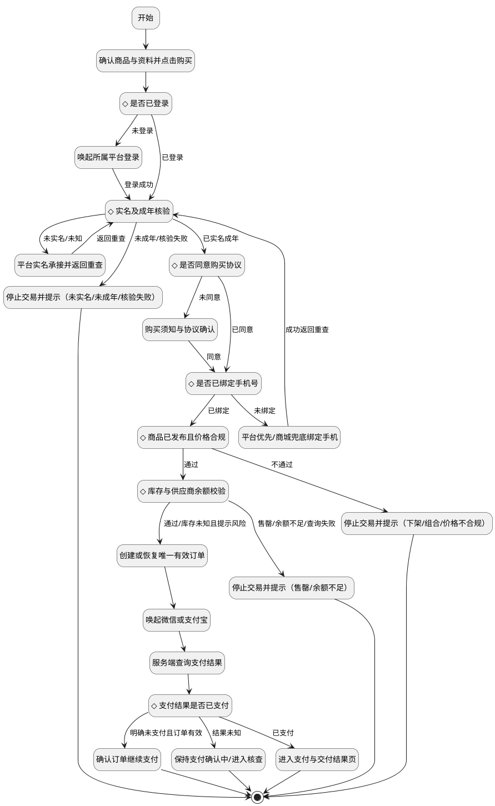

**节点表：**

| 节点ID | 执行角色/系统 | 输入/动作 | 判断条件与分支值 | 输出/状态变化 | 下一节点 | 异常与补偿 | 关联组件/API/TC |
| --- | --- | --- | --- | --- | --- | --- | --- |
| N01 | system | 确认商品与资料并点击购买 | — | 继续 | N02 | 见 §4 异常矩阵 | 见 01/03/05/07 |
| N02 | system | 是否已登录 | 见出边条件 | 继续 | N03（未登录）、N04（已登录） | 见 §4 异常矩阵 | 见 01/03/05/07 |
| N03 | platform | 唤起所属平台登录 | — | 继续 | N04（登录成功） | 见 §4 异常矩阵 | 见 01/03/05/07 |
| N04 | platform | 实名及成年核验 | 见出边条件 | 继续 | N05（未实名/未知）、N06（未成年/核验失败）、N07（已实名成年） | 见 §4 异常矩阵 | 见 01/03/05/07 |
| N05 | platform | 平台实名承接并返回重查 | — | 继续 | N04（返回重查） | 见 §4 异常矩阵 | 见 01/03/05/07 |
| N06 | system | 停止交易并提示（未实名/未成年/核验失败） | — | 结束 | 结束 | 见 §4 异常矩阵 | 见 01/03/05/07 |
| N07 | system | 是否同意购买协议 | 见出边条件 | 继续 | N08（未同意）、N09（已同意） | 见 §4 异常矩阵 | 见 01/03/05/07 |
| N08 | system | 购买须知与协议确认 | — | 继续 | N09（同意） | 见 §4 异常矩阵 | 见 01/03/05/07 |
| N09 | platform | 是否已绑定手机号 | 见出边条件 | 继续 | N10（未绑定）、N11（已绑定） | 见 §4 异常矩阵 | 见 01/03/05/07 |
| N10 | system | 平台优先/商城兜底绑定手机 | — | 继续 | N04（成功返回重查） | 见 §4 异常矩阵 | 见 01/03/05/07 |
| N11 | system | 商品已发布且价格合规 | 见出边条件 | 继续 | N12（不通过）、N13（通过） | 见 §4 异常矩阵 | 见 01/03/05/07 |
| N12 | system | 停止交易并提示（下架/组合/价格不合规） | — | 结束 | 结束 | 见 §4 异常矩阵 | 见 01/03/05/07 |
| N13 | system | 库存与供应商余额校验 | 见出边条件 | 继续 | N14（售罄/余额不足/查询失败）、N15（通过/库存未知且提示风险） | 见 §4 异常矩阵 | 见 01/03/05/07 |
| N14 | system | 停止交易并提示（售罄/余额不足） | — | 结束 | 结束 | 见 §4 异常矩阵 | 见 01/03/05/07 |
| N15 | system | 创建或恢复唯一有效订单 | — | 继续 | N16 | 见 §4 异常矩阵 | 见 01/03/05/07 |
| N16 | platform | 唤起微信或支付宝 | — | 继续 | N17 | 见 §4 异常矩阵 | 见 01/03/05/07 |
| N17 | system | 服务端查询支付结果 | — | 继续 | N19 | 见 §4 异常矩阵 | 见 01/03/05/07 |
| N18 | system | 进入支付与交付结果页 | — | 结束 | 结束 | 见 §4 异常矩阵 | 见 01/03/05/07 |
| N19 | system | 支付结果是否已支付 | 见出边条件 | 继续 | N18（已支付）、N20（明确未支付且订单有效）、N21（结果未知） | 见 §4 异常矩阵 | 见 01/03/05/07 |
| N20 | system | 确认订单继续支付 | — | 结束 | 结束 | 见 §4 异常矩阵 | 见 01/03/05/07 |
| N21 | system | 保持支付确认中/进入核查 | — | 结束 | 结束 | 见 §4 异常矩阵 | 见 01/03/05/07 |

**边表：**

| 起点 | 终点 | 判断条件 |
| --- | --- | --- |
| N01 | N02 | 无条件 |
| N02 | N03 | 未登录 |
| N02 | N04 | 已登录 |
| N03 | N04 | 登录成功 |
| N04 | N05 | 未实名/未知 |
| N05 | N04 | 返回重查 |
| N04 | N06 | 未成年/核验失败 |
| N04 | N07 | 已实名成年 |
| N07 | N08 | 未同意 |
| N08 | N09 | 同意 |
| N07 | N09 | 已同意 |
| N09 | N10 | 未绑定 |
| N10 | N04 | 成功返回重查 |
| N09 | N11 | 已绑定 |
| N11 | N12 | 不通过 |
| N11 | N13 | 通过 |
| N13 | N14 | 售罄/余额不足/查询失败 |
| N13 | N15 | 通过/库存未知且提示风险 |
| N15 | N16 | 无条件 |
| N16 | N17 | 无条件 |
| N17 | N19 | 无条件 |
| N19 | N18 | 已支付 |
| N19 | N20 | 明确未支付且订单有效 |
| N19 | N21 | 结果未知 |

### FL-CODE-001 口令码自动交付与 24 小时重试

需求来源：§6.1/6.2、BR-011、AC-10/11/55。参与角色/端：用户、商城服务端、平台、供应商、运营/财务（按节点）。

<!-- DIAGRAM:FL-CODE-001 -->
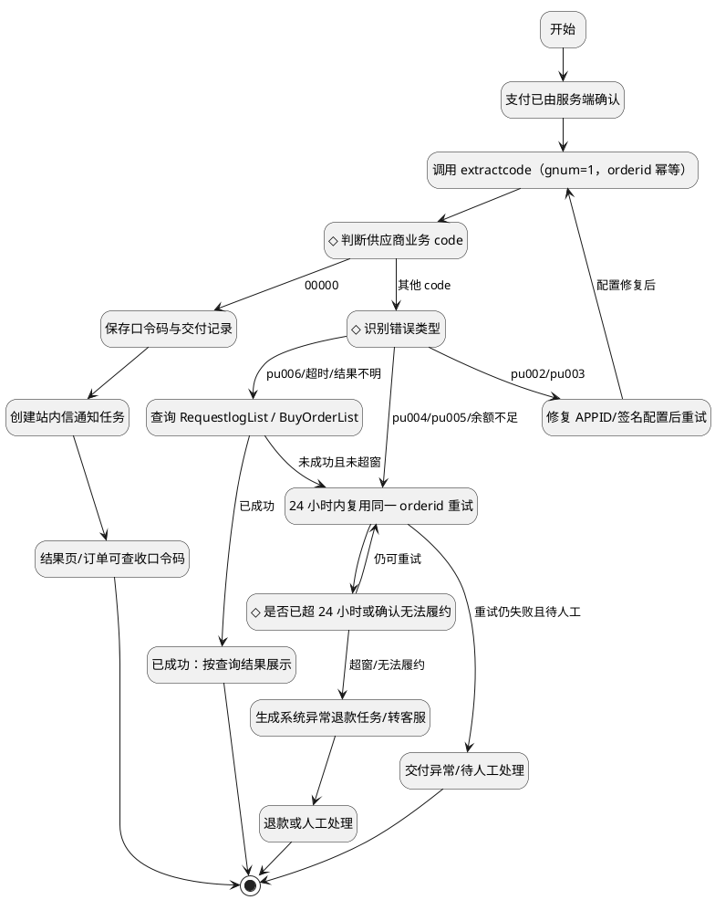

**节点表：**

| 节点ID | 执行角色/系统 | 输入/动作 | 判断条件与分支值 | 输出/状态变化 | 下一节点 | 异常与补偿 | 关联组件/API/TC |
| --- | --- | --- | --- | --- | --- | --- | --- |
| N01 | system | 支付已由服务端确认 | — | 继续 | N02 | 见 §4 异常矩阵 | 见 01/03/05/07 |
| N02 | system | 调用 extractcode（gnum=1，orderid 幂等） | — | 继续 | N03 | 见 §4 异常矩阵 | 见 01/03/05/07 |
| N03 | system | 判断供应商业务 code | 见出边条件 | 继续 | N04（00000）、N07（其他 code） | 见 §4 异常矩阵 | 见 01/03/05/07 |
| N04 | system | 保存口令码与交付记录 | — | 继续 | N05 | 见 §4 异常矩阵 | 见 01/03/05/07 |
| N05 | system | 创建站内信通知任务 | — | 继续 | N06 | 见 §4 异常矩阵 | 见 01/03/05/07 |
| N06 | system | 结果页/订单可查收口令码 | — | 结束 | 结束 | 见 §4 异常矩阵 | 见 01/03/05/07 |
| N07 | system | 识别错误类型 | 见出边条件 | 继续 | N08（pu006/超时/结果不明）、N10（pu004/pu005/余额不足）、N14（pu002/pu003） | 见 §4 异常矩阵 | 见 01/03/05/07 |
| N08 | system | 查询 RequestlogList / BuyOrderList | — | 继续 | N09（已成功）、N10（未成功且未超窗） | 见 §4 异常矩阵 | 见 01/03/05/07 |
| N09 | system | 已成功：按查询结果展示 | — | 结束 | 结束 | 见 §4 异常矩阵 | 见 01/03/05/07 |
| N10 | system | 24 小时内复用同一 orderid 重试 | — | 继续 | N11、N15（重试仍失败且待人工） | 见 §4 异常矩阵 | 见 01/03/05/07 |
| N11 | system | 是否已超 24 小时或确认无法履约 | 见出边条件 | 继续 | N12（超窗/无法履约）、N10（仍可重试） | 见 §4 异常矩阵 | 见 01/03/05/07 |
| N12 | system | 生成系统异常退款任务/转客服 | — | 继续 | N13 | 见 §4 异常矩阵 | 见 01/03/05/07 |
| N13 | system | 退款或人工处理 | — | 结束 | 结束 | 见 §4 异常矩阵 | 见 01/03/05/07 |
| N14 | system | 修复 APPID/签名配置后重试 | — | 继续 | N02（配置修复后） | 见 §4 异常矩阵 | 见 01/03/05/07 |
| N15 | system | 交付异常/待人工处理 | — | 结束 | 结束 | 见 §4 异常矩阵 | 见 01/03/05/07 |

**边表：**

| 起点 | 终点 | 判断条件 |
| --- | --- | --- |
| N01 | N02 | 无条件 |
| N02 | N03 | 无条件 |
| N03 | N04 | 00000 |
| N04 | N05 | 无条件 |
| N05 | N06 | 无条件 |
| N03 | N07 | 其他 code |
| N07 | N08 | pu006/超时/结果不明 |
| N08 | N09 | 已成功 |
| N08 | N10 | 未成功且未超窗 |
| N07 | N10 | pu004/pu005/余额不足 |
| N07 | N14 | pu002/pu003 |
| N14 | N02 | 配置修复后 |
| N10 | N11 | 无条件 |
| N11 | N12 | 超窗/无法履约 |
| N11 | N10 | 仍可重试 |
| N12 | N13 | 无条件 |
| N10 | N15 | 重试仍失败且待人工 |

### FL-GIFT-001 好友赠送人工交付

需求来源：§7.1～7.4、BR-007、D-27、AC-13/14/71。参与角色/端：用户、商城服务端、平台、供应商、运营/财务（按节点）。

<!-- DIAGRAM:FL-GIFT-001 -->
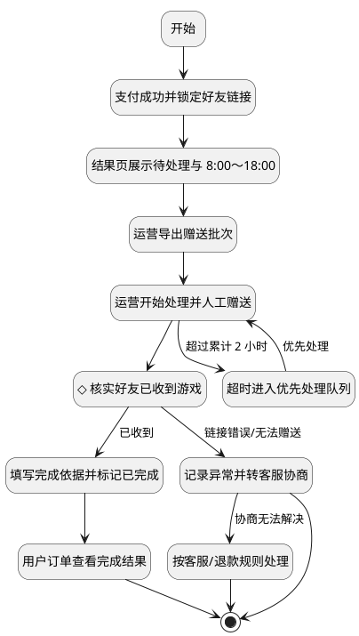

**节点表：**

| 节点ID | 执行角色/系统 | 输入/动作 | 判断条件与分支值 | 输出/状态变化 | 下一节点 | 异常与补偿 | 关联组件/API/TC |
| --- | --- | --- | --- | --- | --- | --- | --- |
| N01 | system | 支付成功并锁定好友链接 | — | 继续 | N02 | 见 §4 异常矩阵 | 见 01/03/05/07 |
| N02 | system | 结果页展示待处理与 8:00～18:00 | — | 继续 | N03 | 见 §4 异常矩阵 | 见 01/03/05/07 |
| N03 | operator | 运营导出赠送批次 | — | 继续 | N04 | 见 §4 异常矩阵 | 见 01/03/05/07 |
| N04 | operator | 运营开始处理并人工赠送 | — | 继续 | N05、N09（超过累计 2 小时） | 见 §4 异常矩阵 | 见 01/03/05/07 |
| N05 | operator | 核实好友已收到游戏 | 见出边条件 | 继续 | N06（已收到）、N08（链接错误/无法赠送） | 见 §4 异常矩阵 | 见 01/03/05/07 |
| N06 | operator | 填写完成依据并标记已完成 | — | 继续 | N07 | 见 §4 异常矩阵 | 见 01/03/05/07 |
| N07 | system | 用户订单查看完成结果 | — | 结束 | 结束 | 见 §4 异常矩阵 | 见 01/03/05/07 |
| N08 | system | 记录异常并转客服协商 | — | 结束 | N10（协商无法解决） | 见 §4 异常矩阵 | 见 01/03/05/07 |
| N09 | system | 超时进入优先处理队列 | — | 继续 | N04（优先处理） | 见 §4 异常矩阵 | 见 01/03/05/07 |
| N10 | system | 按客服/退款规则处理 | — | 结束 | 结束 | 见 §4 异常矩阵 | 见 01/03/05/07 |

**边表：**

| 起点 | 终点 | 判断条件 |
| --- | --- | --- |
| N01 | N02 | 无条件 |
| N02 | N03 | 无条件 |
| N03 | N04 | 无条件 |
| N04 | N05 | 无条件 |
| N05 | N06 | 已收到 |
| N06 | N07 | 无条件 |
| N05 | N08 | 链接错误/无法赠送 |
| N04 | N09 | 超过累计 2 小时 |
| N09 | N04 | 优先处理 |
| N08 | N10 | 协商无法解决 |

### FL-PAY-001 支付返回、确认中与晚到款

需求来源：§5.3/5.4/5.8/5.10、PAY-07～13、D-24、AC-25/26/30/46/47/67/68。参与角色/端：用户、商城服务端、平台、供应商、运营/财务（按节点）。

<!-- DIAGRAM:FL-PAY-001 -->
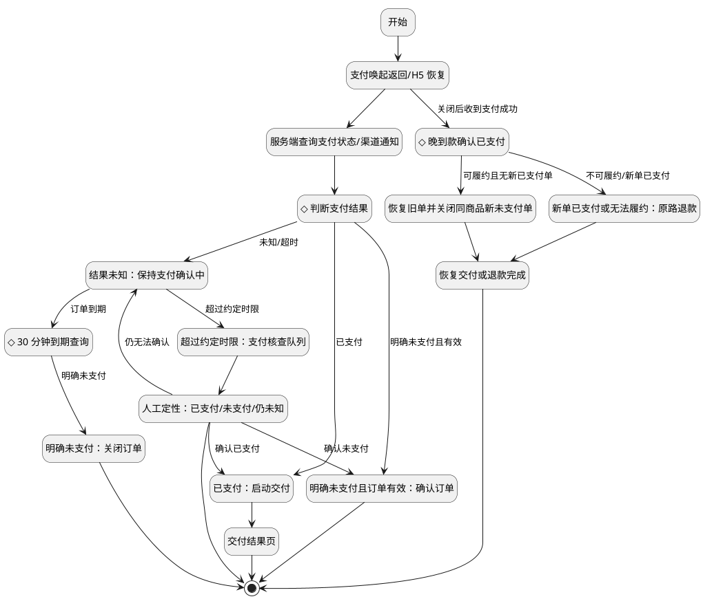

**节点表：**

| 节点ID | 执行角色/系统 | 输入/动作 | 判断条件与分支值 | 输出/状态变化 | 下一节点 | 异常与补偿 | 关联组件/API/TC |
| --- | --- | --- | --- | --- | --- | --- | --- |
| N01 | system | 支付唤起返回/H5 恢复 | — | 继续 | N02、N10（关闭后收到支付成功） | 见 §4 异常矩阵 | 见 01/03/05/07 |
| N02 | system | 服务端查询支付状态/渠道通知 | — | 继续 | N03 | 见 §4 异常矩阵 | 见 01/03/05/07 |
| N03 | system | 判断支付结果 | 见出边条件 | 继续 | N04（已支付）、N06（明确未支付且有效）、N07（未知/超时） | 见 §4 异常矩阵 | 见 01/03/05/07 |
| N04 | system | 已支付：启动交付 | — | 继续 | N05 | 见 §4 异常矩阵 | 见 01/03/05/07 |
| N05 | system | 交付结果页 | — | 结束 | 结束 | 见 §4 异常矩阵 | 见 01/03/05/07 |
| N06 | system | 明确未支付且订单有效：确认订单 | — | 结束 | 结束 | 见 §4 异常矩阵 | 见 01/03/05/07 |
| N07 | system | 结果未知：保持支付确认中 | — | 继续 | N08（超过约定时限）、N14（订单到期） | 见 §4 异常矩阵 | 见 01/03/05/07 |
| N08 | operator | 超过约定时限：支付核查队列 | — | 继续 | N09 | 见 §4 异常矩阵 | 见 01/03/05/07 |
| N09 | system | 人工定性：已支付/未支付/仍未知 | — | 结束 | N04（确认已支付）、N06（确认未支付）、N07（仍无法确认） | 见 §4 异常矩阵 | 见 01/03/05/07 |
| N10 | system | 晚到款确认已支付 | 见出边条件 | 继续 | N11（可履约且无新已支付单）、N12（不可履约/新单已支付） | 见 §4 异常矩阵 | 见 01/03/05/07 |
| N11 | system | 恢复旧单并关闭同商品新未支付单 | — | 继续 | N13 | 见 §4 异常矩阵 | 见 01/03/05/07 |
| N12 | system | 新单已支付或无法履约：原路退款 | — | 继续 | N13 | 见 §4 异常矩阵 | 见 01/03/05/07 |
| N13 | system | 恢复交付或退款完成 | — | 结束 | 结束 | 见 §4 异常矩阵 | 见 01/03/05/07 |
| N14 | system | 30 分钟到期查询 | 见出边条件 | 继续 | N15（明确未支付） | 见 §4 异常矩阵 | 见 01/03/05/07 |
| N15 | system | 明确未支付：关闭订单 | — | 结束 | 结束 | 见 §4 异常矩阵 | 见 01/03/05/07 |

**边表：**

| 起点 | 终点 | 判断条件 |
| --- | --- | --- |
| N01 | N02 | 无条件 |
| N02 | N03 | 无条件 |
| N03 | N04 | 已支付 |
| N04 | N05 | 无条件 |
| N03 | N06 | 明确未支付且有效 |
| N03 | N07 | 未知/超时 |
| N07 | N08 | 超过约定时限 |
| N08 | N09 | 无条件 |
| N09 | N04 | 确认已支付 |
| N09 | N06 | 确认未支付 |
| N09 | N07 | 仍无法确认 |
| N07 | N14 | 订单到期 |
| N14 | N15 | 明确未支付 |
| N01 | N10 | 关闭后收到支付成功 |
| N10 | N11 | 可履约且无新已支付单 |
| N10 | N12 | 不可履约/新单已支付 |
| N11 | N13 | 无条件 |
| N12 | N13 | 无条件 |

### FL-REFUND-001 退款闭环

需求来源：§8.3/8.4/8.5、BR-006、D-25、AC-16/48/59/69。参与角色/端：用户、商城服务端、平台、供应商、运营/财务（按节点）。

<!-- DIAGRAM:FL-REFUND-001 -->
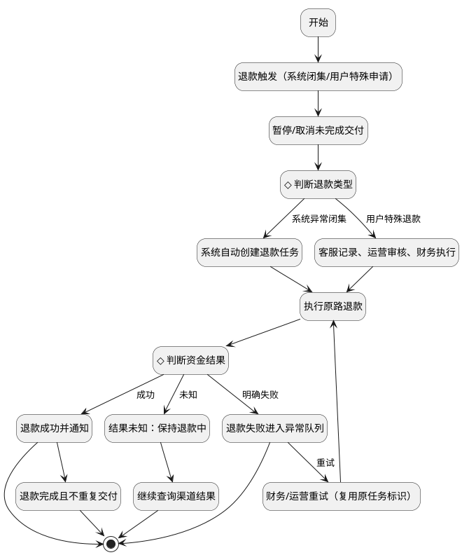

**节点表：**

| 节点ID | 执行角色/系统 | 输入/动作 | 判断条件与分支值 | 输出/状态变化 | 下一节点 | 异常与补偿 | 关联组件/API/TC |
| --- | --- | --- | --- | --- | --- | --- | --- |
| N01 | system | 退款触发（系统闭集/用户特殊申请） | — | 继续 | N12 | 见 §4 异常矩阵 | 见 01/03/05/07 |
| N02 | system | 判断退款类型 | 见出边条件 | 继续 | N03（系统异常闭集）、N04（用户特殊退款） | 见 §4 异常矩阵 | 见 01/03/05/07 |
| N03 | system | 系统自动创建退款任务 | — | 继续 | N05 | 见 §4 异常矩阵 | 见 01/03/05/07 |
| N04 | operator | 客服记录、运营审核、财务执行 | — | 继续 | N05 | 见 §4 异常矩阵 | 见 01/03/05/07 |
| N05 | system | 执行原路退款 | — | 继续 | N06 | 见 §4 异常矩阵 | 见 01/03/05/07 |
| N06 | system | 判断资金结果 | 见出边条件 | 继续 | N07（成功）、N08（明确失败）、N10（未知） | 见 §4 异常矩阵 | 见 01/03/05/07 |
| N07 | system | 退款成功并通知 | — | 结束 | N13 | 见 §4 异常矩阵 | 见 01/03/05/07 |
| N08 | system | 退款失败进入异常队列 | — | 结束 | N09（重试） | 见 §4 异常矩阵 | 见 01/03/05/07 |
| N09 | operator | 财务/运营重试（复用原任务标识） | — | 继续 | N05 | 见 §4 异常矩阵 | 见 01/03/05/07 |
| N10 | system | 结果未知：保持退款中 | — | 继续 | N11 | 见 §4 异常矩阵 | 见 01/03/05/07 |
| N11 | system | 继续查询渠道结果 | — | 结束 | 结束 | 见 §4 异常矩阵 | 见 01/03/05/07 |
| N12 | system | 暂停/取消未完成交付 | — | 继续 | N02 | 见 §4 异常矩阵 | 见 01/03/05/07 |
| N13 | system | 退款完成且不重复交付 | — | 结束 | 结束 | 见 §4 异常矩阵 | 见 01/03/05/07 |

**边表：**

| 起点 | 终点 | 判断条件 |
| --- | --- | --- |
| N01 | N12 | 无条件 |
| N12 | N02 | 无条件 |
| N02 | N03 | 系统异常闭集 |
| N02 | N04 | 用户特殊退款 |
| N03 | N05 | 无条件 |
| N04 | N05 | 无条件 |
| N05 | N06 | 无条件 |
| N06 | N07 | 成功 |
| N06 | N08 | 明确失败 |
| N06 | N10 | 未知 |
| N10 | N11 | 无条件 |
| N08 | N09 | 重试 |
| N09 | N05 | 无条件 |
| N07 | N13 | 无条件 |

### FL-AGREEMENT-001 协议版本变化处理

需求来源：§3.4、AGREEMENT-05、D-26、AC-70。参与角色/端：用户、商城服务端、平台、供应商、运营/财务（按节点）。

<!-- DIAGRAM:FL-AGREEMENT-001 -->
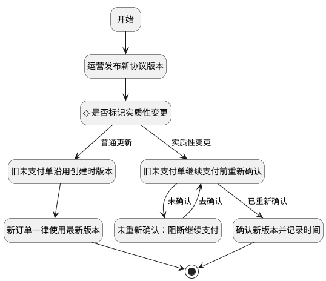

**节点表：**

| 节点ID | 执行角色/系统 | 输入/动作 | 判断条件与分支值 | 输出/状态变化 | 下一节点 | 异常与补偿 | 关联组件/API/TC |
| --- | --- | --- | --- | --- | --- | --- | --- |
| N01 | system | 运营发布新协议版本 | — | 继续 | N02 | 见 §4 异常矩阵 | 见 01/03/05/07 |
| N02 | operator | 是否标记实质性变更 | 见出边条件 | 继续 | N03（普通更新）、N04（实质性变更） | 见 §4 异常矩阵 | 见 01/03/05/07 |
| N03 | system | 旧未支付单沿用创建时版本 | — | 继续 | N05 | 见 §4 异常矩阵 | 见 01/03/05/07 |
| N04 | system | 旧未支付单继续支付前重新确认 | — | 继续 | N06（未确认）、N07（已重新确认） | 见 §4 异常矩阵 | 见 01/03/05/07 |
| N05 | system | 新订单一律使用最新版本 | — | 结束 | 结束 | 见 §4 异常矩阵 | 见 01/03/05/07 |
| N06 | system | 未重新确认：阻断继续支付 | — | 继续 | N04（去确认） | 见 §4 异常矩阵 | 见 01/03/05/07 |
| N07 | system | 确认新版本并记录时间 | — | 结束 | 结束 | 见 §4 异常矩阵 | 见 01/03/05/07 |

**边表：**

| 起点 | 终点 | 判断条件 |
| --- | --- | --- |
| N01 | N02 | 无条件 |
| N02 | N03 | 普通更新 |
| N02 | N04 | 实质性变更 |
| N03 | N05 | 无条件 |
| N04 | N06 | 未确认 |
| N04 | N07 | 已重新确认 |
| N06 | N04 | 去确认 |

### FL-ADMIN-PUBLISH-001 商品选品、定价与发布

需求来源：§2.5.3/2.5.4、ADM-02、D-21、AC-53/61/62。参与角色/端：用户、商城服务端、平台、供应商、运营/财务（按节点）。

<!-- DIAGRAM:FL-ADMIN-PUBLISH-001 -->
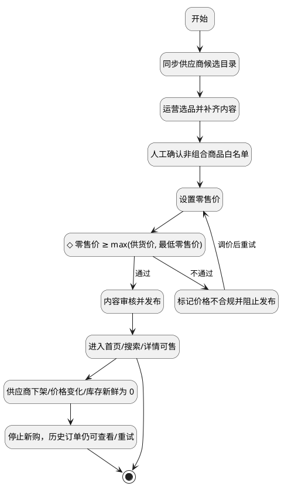

**节点表：**

| 节点ID | 执行角色/系统 | 输入/动作 | 判断条件与分支值 | 输出/状态变化 | 下一节点 | 异常与补偿 | 关联组件/API/TC |
| --- | --- | --- | --- | --- | --- | --- | --- |
| N01 | system | 同步供应商候选目录 | — | 继续 | N02 | 见 §4 异常矩阵 | 见 01/03/05/07 |
| N02 | operator | 运营选品并补齐内容 | — | 继续 | N03 | 见 §4 异常矩阵 | 见 01/03/05/07 |
| N03 | operator | 人工确认非组合商品白名单 | — | 继续 | N04 | 见 §4 异常矩阵 | 见 01/03/05/07 |
| N04 | operator | 设置零售价 | — | 继续 | N05 | 见 §4 异常矩阵 | 见 01/03/05/07 |
| N05 | system | 零售价 ≥ max(供货价, 最低零售价) | 见出边条件 | 继续 | N06（不通过）、N07（通过） | 见 §4 异常矩阵 | 见 01/03/05/07 |
| N06 | system | 标记价格不合规并阻止发布 | — | 继续 | N04（调价后重试） | 见 §4 异常矩阵 | 见 01/03/05/07 |
| N07 | operator | 内容审核并发布 | — | 继续 | N08 | 见 §4 异常矩阵 | 见 01/03/05/07 |
| N08 | system | 进入首页/搜索/详情可售 | — | 结束 | N09 | 见 §4 异常矩阵 | 见 01/03/05/07 |
| N09 | system | 供应商下架/价格变化/库存新鲜为 0 | — | 继续 | N10 | 见 §4 异常矩阵 | 见 01/03/05/07 |
| N10 | system | 停止新购，历史订单仍可查看/重试 | — | 结束 | 结束 | 见 §4 异常矩阵 | 见 01/03/05/07 |

**边表：**

| 起点 | 终点 | 判断条件 |
| --- | --- | --- |
| N01 | N02 | 无条件 |
| N02 | N03 | 无条件 |
| N03 | N04 | 无条件 |
| N04 | N05 | 无条件 |
| N05 | N06 | 不通过 |
| N06 | N04 | 调价后重试 |
| N05 | N07 | 通过 |
| N07 | N08 | 无条件 |
| N08 | N09 | 无条件 |
| N09 | N10 | 无条件 |

## 3. 业务对象状态机及迁移表

### SM-PAY-001 订单支付状态机

需求来源：§10.1、PAY、D-24。

<!-- DIAGRAM:SM-PAY-001 -->
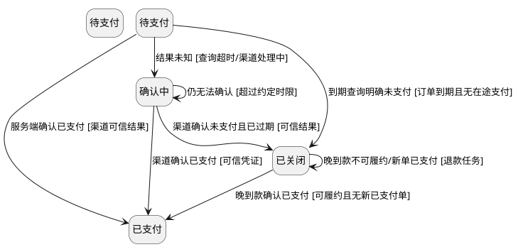

**状态字典：**

| 对象/状态码 | 中文名与业务含义 | 权威来源/写入方 | 进入条件 | 可执行动作 | 是否终态 | 各端显示 | 退出规则 |
| --- | --- | --- | --- | --- | --- | --- | --- |
| 待支付 | 待支付 | 商城服务端/支付渠道/供应商/运营（按对象） | 初始状态 | 服务端确认已支付；结果未知；到期查询明确未支付 | 否 | 按 §5.9/§9.11 映射 | 见迁移表 |
| 已支付 | 已支付 | 上游状态 | 服务端确认已支付；渠道确认已支付；晚到款确认已支付 | 无 | 是（或需人工终局） | 按 §5.9/§9.11 映射 | 终态/需明确恢复 |
| 确认中 | 确认中 | 商城服务端/支付渠道/供应商/运营（按对象） | 结果未知；仍无法确认 | 渠道确认已支付；渠道确认未支付且已过期；仍无法确认 | 否 | 按 §5.9/§9.11 映射 | 见迁移表 |
| 已关闭 | 已关闭 | 商城服务端/支付渠道/供应商/运营（按对象） | 到期查询明确未支付；渠道确认未支付且已过期；晚到款不可履约/新单已支付 | 晚到款确认已支付；晚到款不可履约/新单已支付 | 否 | 按 §5.9/§9.11 映射 | 见迁移表 |

**迁移表：**

| 迁移ID | 当前状态 | 触发事件/发起者 | 守卫条件 | 原子处理/数据变化 | 目标状态 | 通知及界面刷新 | 重复/乱序/超时处理 | 禁止迁移及反馈 | TC |
| --- | --- | --- | --- | --- | --- | --- | --- | --- | --- |
| TR-SM-PAY-001-01 | 待支付 | 服务端确认已支付 | 渠道可信结果 | 按对象服务原子写入并留痕 | 已支付 | 刷新订单/结果/后台；通知按 06/05 | 重复回调幂等；迟到结果不改已终态；未知保持原状态 | 无证据不得改变状态 | TC-SM-PAY-001 |
| TR-SM-PAY-001-02 | 待支付 | 结果未知 | 查询超时/渠道处理中 | 按对象服务原子写入并留痕 | 确认中 | 刷新订单/结果/后台；通知按 06/05 | 重复回调幂等；迟到结果不改已终态；未知保持原状态 | 无证据不得改变状态 | TC-SM-PAY-001 |
| TR-SM-PAY-001-03 | 待支付 | 到期查询明确未支付 | 订单到期且无在途支付 | 按对象服务原子写入并留痕 | 已关闭 | 刷新订单/结果/后台；通知按 06/05 | 重复回调幂等；迟到结果不改已终态；未知保持原状态 | 无证据不得改变状态 | TC-SM-PAY-001 |
| TR-SM-PAY-001-04 | 确认中 | 渠道确认已支付 | 可信凭证 | 按对象服务原子写入并留痕 | 已支付 | 刷新订单/结果/后台；通知按 06/05 | 重复回调幂等；迟到结果不改已终态；未知保持原状态 | 无证据不得改变状态 | TC-SM-PAY-001 |
| TR-SM-PAY-001-05 | 确认中 | 渠道确认未支付且已过期 | 可信结果 | 按对象服务原子写入并留痕 | 已关闭 | 刷新订单/结果/后台；通知按 06/05 | 重复回调幂等；迟到结果不改已终态；未知保持原状态 | 无证据不得改变状态 | TC-SM-PAY-001 |
| TR-SM-PAY-001-06 | 确认中 | 仍无法确认 | 超过约定时限 | 按对象服务原子写入并留痕 | 确认中 | 刷新订单/结果/后台；通知按 06/05 | 重复回调幂等；迟到结果不改已终态；未知保持原状态 | 无证据不得改变状态 | TC-SM-PAY-001 |
| TR-SM-PAY-001-07 | 已关闭 | 晚到款确认已支付 | 可履约且无新已支付单 | 按对象服务原子写入并留痕 | 已支付 | 刷新订单/结果/后台；通知按 06/05 | 重复回调幂等；迟到结果不改已终态；未知保持原状态 | 无证据不得改变状态 | TC-SM-PAY-001 |
| TR-SM-PAY-001-08 | 已关闭 | 晚到款不可履约/新单已支付 | 退款任务 | 按对象服务原子写入并留痕 | 已关闭 | 刷新订单/结果/后台；通知按 06/05 | 重复回调幂等；迟到结果不改已终态；未知保持原状态 | 无证据不得改变状态 | TC-SM-PAY-001 |

### SM-CODE-001 口令码交付状态机

需求来源：§6、§10.1、CODE-01～10。

<!-- DIAGRAM:SM-CODE-001 -->
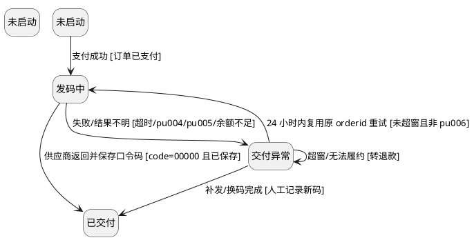

**状态字典：**

| 对象/状态码 | 中文名与业务含义 | 权威来源/写入方 | 进入条件 | 可执行动作 | 是否终态 | 各端显示 | 退出规则 |
| --- | --- | --- | --- | --- | --- | --- | --- |
| 未启动 | 未启动 | 商城服务端/支付渠道/供应商/运营（按对象） | 初始状态 | 支付成功 | 否 | 按 §5.9/§9.11 映射 | 见迁移表 |
| 发码中 | 发码中 | 商城服务端/支付渠道/供应商/运营（按对象） | 支付成功；24 小时内复用原 orderid 重试 | 供应商返回并保存口令码；失败/结果不明 | 否 | 按 §5.9/§9.11 映射 | 见迁移表 |
| 已交付 | 已交付 | 上游状态 | 供应商返回并保存口令码；补发/换码完成 | 无 | 是（或需人工终局） | 按 §5.9/§9.11 映射 | 终态/需明确恢复 |
| 交付异常 | 交付异常 | 商城服务端/支付渠道/供应商/运营（按对象） | 失败/结果不明；超窗/无法履约 | 24 小时内复用原 orderid 重试；补发/换码完成；超窗/无法履约 | 否 | 按 §5.9/§9.11 映射 | 见迁移表 |

**迁移表：**

| 迁移ID | 当前状态 | 触发事件/发起者 | 守卫条件 | 原子处理/数据变化 | 目标状态 | 通知及界面刷新 | 重复/乱序/超时处理 | 禁止迁移及反馈 | TC |
| --- | --- | --- | --- | --- | --- | --- | --- | --- | --- |
| TR-SM-CODE-001-01 | 未启动 | 支付成功 | 订单已支付 | 按对象服务原子写入并留痕 | 发码中 | 刷新订单/结果/后台；通知按 06/05 | 重复回调幂等；迟到结果不改已终态；未知保持原状态 | 无证据不得改变状态 | TC-SM-CODE-001 |
| TR-SM-CODE-001-02 | 发码中 | 供应商返回并保存口令码 | code=00000 且已保存 | 按对象服务原子写入并留痕 | 已交付 | 刷新订单/结果/后台；通知按 06/05 | 重复回调幂等；迟到结果不改已终态；未知保持原状态 | 无证据不得改变状态 | TC-SM-CODE-001 |
| TR-SM-CODE-001-03 | 发码中 | 失败/结果不明 | 超时/pu004/pu005/余额不足 | 按对象服务原子写入并留痕 | 交付异常 | 刷新订单/结果/后台；通知按 06/05 | 重复回调幂等；迟到结果不改已终态；未知保持原状态 | 无证据不得改变状态 | TC-SM-CODE-001 |
| TR-SM-CODE-001-04 | 交付异常 | 24 小时内复用原 orderid 重试 | 未超窗且非 pu006 | 按对象服务原子写入并留痕 | 发码中 | 刷新订单/结果/后台；通知按 06/05 | 重复回调幂等；迟到结果不改已终态；未知保持原状态 | 无证据不得改变状态 | TC-SM-CODE-001 |
| TR-SM-CODE-001-05 | 交付异常 | 补发/换码完成 | 人工记录新码 | 按对象服务原子写入并留痕 | 已交付 | 刷新订单/结果/后台；通知按 06/05 | 重复回调幂等；迟到结果不改已终态；未知保持原状态 | 无证据不得改变状态 | TC-SM-CODE-001 |
| TR-SM-CODE-001-06 | 交付异常 | 超窗/无法履约 | 转退款 | 按对象服务原子写入并留痕 | 交付异常 | 刷新订单/结果/后台；通知按 06/05 | 重复回调幂等；迟到结果不改已终态；未知保持原状态 | 无证据不得改变状态 | TC-SM-CODE-001 |

### SM-GIFT-001 好友赠送状态机

需求来源：§7.4、§10.1。

<!-- DIAGRAM:SM-GIFT-001 -->
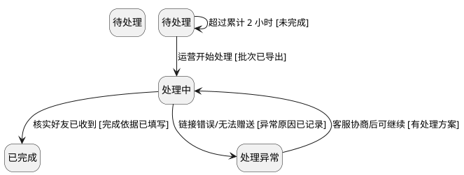

**状态字典：**

| 对象/状态码 | 中文名与业务含义 | 权威来源/写入方 | 进入条件 | 可执行动作 | 是否终态 | 各端显示 | 退出规则 |
| --- | --- | --- | --- | --- | --- | --- | --- |
| 待处理 | 待处理 | 商城服务端/支付渠道/供应商/运营（按对象） | 超过累计 2 小时 | 运营开始处理；超过累计 2 小时 | 否 | 按 §5.9/§9.11 映射 | 见迁移表 |
| 处理中 | 处理中 | 商城服务端/支付渠道/供应商/运营（按对象） | 运营开始处理；客服协商后可继续 | 核实好友已收到；链接错误/无法赠送 | 否 | 按 §5.9/§9.11 映射 | 见迁移表 |
| 已完成 | 已完成 | 上游状态 | 核实好友已收到 | 无 | 是（或需人工终局） | 按 §5.9/§9.11 映射 | 终态/需明确恢复 |
| 处理异常 | 处理异常 | 商城服务端/支付渠道/供应商/运营（按对象） | 链接错误/无法赠送 | 客服协商后可继续 | 否 | 按 §5.9/§9.11 映射 | 见迁移表 |

**迁移表：**

| 迁移ID | 当前状态 | 触发事件/发起者 | 守卫条件 | 原子处理/数据变化 | 目标状态 | 通知及界面刷新 | 重复/乱序/超时处理 | 禁止迁移及反馈 | TC |
| --- | --- | --- | --- | --- | --- | --- | --- | --- | --- |
| TR-SM-GIFT-001-01 | 待处理 | 运营开始处理 | 批次已导出 | 按对象服务原子写入并留痕 | 处理中 | 刷新订单/结果/后台；通知按 06/05 | 重复回调幂等；迟到结果不改已终态；未知保持原状态 | 无证据不得改变状态 | TC-SM-GIFT-001 |
| TR-SM-GIFT-001-02 | 处理中 | 核实好友已收到 | 完成依据已填写 | 按对象服务原子写入并留痕 | 已完成 | 刷新订单/结果/后台；通知按 06/05 | 重复回调幂等；迟到结果不改已终态；未知保持原状态 | 无证据不得改变状态 | TC-SM-GIFT-001 |
| TR-SM-GIFT-001-03 | 处理中 | 链接错误/无法赠送 | 异常原因已记录 | 按对象服务原子写入并留痕 | 处理异常 | 刷新订单/结果/后台；通知按 06/05 | 重复回调幂等；迟到结果不改已终态；未知保持原状态 | 无证据不得改变状态 | TC-SM-GIFT-001 |
| TR-SM-GIFT-001-04 | 待处理 | 超过累计 2 小时 | 未完成 | 按对象服务原子写入并留痕 | 待处理 | 刷新订单/结果/后台；通知按 06/05 | 重复回调幂等；迟到结果不改已终态；未知保持原状态 | 无证据不得改变状态 | TC-SM-GIFT-001 |
| TR-SM-GIFT-001-05 | 处理异常 | 客服协商后可继续 | 有处理方案 | 按对象服务原子写入并留痕 | 处理中 | 刷新订单/结果/后台；通知按 06/05 | 重复回调幂等；迟到结果不改已终态；未知保持原状态 | 无证据不得改变状态 | TC-SM-GIFT-001 |

### SM-REFUND-001 退款单状态机

需求来源：§8.3/8.5、§10.1、D-25。

<!-- DIAGRAM:SM-REFUND-001 -->
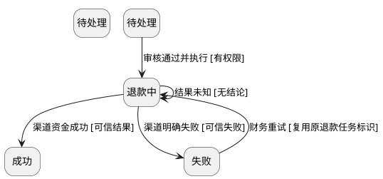

**状态字典：**

| 对象/状态码 | 中文名与业务含义 | 权威来源/写入方 | 进入条件 | 可执行动作 | 是否终态 | 各端显示 | 退出规则 |
| --- | --- | --- | --- | --- | --- | --- | --- |
| 待处理 | 待处理 | 商城服务端/支付渠道/供应商/运营（按对象） | 初始状态 | 审核通过并执行 | 否 | 按 §5.9/§9.11 映射 | 见迁移表 |
| 退款中 | 退款中 | 商城服务端/支付渠道/供应商/运营（按对象） | 审核通过并执行；结果未知；财务重试 | 渠道资金成功；渠道明确失败；结果未知 | 否 | 按 §5.9/§9.11 映射 | 见迁移表 |
| 成功 | 成功 | 上游状态 | 渠道资金成功 | 无 | 是（或需人工终局） | 按 §5.9/§9.11 映射 | 终态/需明确恢复 |
| 失败 | 失败 | 商城服务端/支付渠道/供应商/运营（按对象） | 渠道明确失败 | 财务重试 | 否 | 按 §5.9/§9.11 映射 | 见迁移表 |

**迁移表：**

| 迁移ID | 当前状态 | 触发事件/发起者 | 守卫条件 | 原子处理/数据变化 | 目标状态 | 通知及界面刷新 | 重复/乱序/超时处理 | 禁止迁移及反馈 | TC |
| --- | --- | --- | --- | --- | --- | --- | --- | --- | --- |
| TR-SM-REFUND-001-01 | 待处理 | 审核通过并执行 | 有权限 | 按对象服务原子写入并留痕 | 退款中 | 刷新订单/结果/后台；通知按 06/05 | 重复回调幂等；迟到结果不改已终态；未知保持原状态 | 无证据不得改变状态 | TC-SM-REFUND-001 |
| TR-SM-REFUND-001-02 | 退款中 | 渠道资金成功 | 可信结果 | 按对象服务原子写入并留痕 | 成功 | 刷新订单/结果/后台；通知按 06/05 | 重复回调幂等；迟到结果不改已终态；未知保持原状态 | 无证据不得改变状态 | TC-SM-REFUND-001 |
| TR-SM-REFUND-001-03 | 退款中 | 渠道明确失败 | 可信失败 | 按对象服务原子写入并留痕 | 失败 | 刷新订单/结果/后台；通知按 06/05 | 重复回调幂等；迟到结果不改已终态；未知保持原状态 | 无证据不得改变状态 | TC-SM-REFUND-001 |
| TR-SM-REFUND-001-04 | 退款中 | 结果未知 | 无结论 | 按对象服务原子写入并留痕 | 退款中 | 刷新订单/结果/后台；通知按 06/05 | 重复回调幂等；迟到结果不改已终态；未知保持原状态 | 无证据不得改变状态 | TC-SM-REFUND-001 |
| TR-SM-REFUND-001-05 | 失败 | 财务重试 | 复用原退款任务标识 | 按对象服务原子写入并留痕 | 退款中 | 刷新订单/结果/后台；通知按 06/05 | 重复回调幂等；迟到结果不改已终态；未知保持原状态 | 无证据不得改变状态 | TC-SM-REFUND-001 |

### SM-NOTIFY-001 站内信任务状态机

需求来源：§6.4/6.5、NOTIFY-06～08。

<!-- DIAGRAM:SM-NOTIFY-001 -->
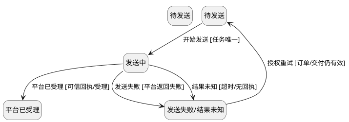

**状态字典：**

| 对象/状态码 | 中文名与业务含义 | 权威来源/写入方 | 进入条件 | 可执行动作 | 是否终态 | 各端显示 | 退出规则 |
| --- | --- | --- | --- | --- | --- | --- | --- |
| 待发送 | 待发送 | 商城服务端/支付渠道/供应商/运营（按对象） | 授权重试 | 开始发送 | 否 | 按 §5.9/§9.11 映射 | 见迁移表 |
| 发送中 | 发送中 | 商城服务端/支付渠道/供应商/运营（按对象） | 开始发送 | 平台已受理；发送失败；结果未知 | 否 | 按 §5.9/§9.11 映射 | 见迁移表 |
| 平台已受理 | 平台已受理 | 上游状态 | 平台已受理 | 无 | 是（或需人工终局） | 按 §5.9/§9.11 映射 | 终态/需明确恢复 |
| 发送失败/结果未知 | 发送失败/结果未知 | 商城服务端/支付渠道/供应商/运营（按对象） | 发送失败；结果未知 | 授权重试 | 否 | 按 §5.9/§9.11 映射 | 见迁移表 |

**迁移表：**

| 迁移ID | 当前状态 | 触发事件/发起者 | 守卫条件 | 原子处理/数据变化 | 目标状态 | 通知及界面刷新 | 重复/乱序/超时处理 | 禁止迁移及反馈 | TC |
| --- | --- | --- | --- | --- | --- | --- | --- | --- | --- |
| TR-SM-NOTIFY-001-01 | 待发送 | 开始发送 | 任务唯一 | 按对象服务原子写入并留痕 | 发送中 | 刷新订单/结果/后台；通知按 06/05 | 重复回调幂等；迟到结果不改已终态；未知保持原状态 | 无证据不得改变状态 | TC-SM-NOTIFY-001 |
| TR-SM-NOTIFY-001-02 | 发送中 | 平台已受理 | 可信回执/受理 | 按对象服务原子写入并留痕 | 平台已受理 | 刷新订单/结果/后台；通知按 06/05 | 重复回调幂等；迟到结果不改已终态；未知保持原状态 | 无证据不得改变状态 | TC-SM-NOTIFY-001 |
| TR-SM-NOTIFY-001-03 | 发送中 | 发送失败 | 平台返回失败 | 按对象服务原子写入并留痕 | 发送失败/结果未知 | 刷新订单/结果/后台；通知按 06/05 | 重复回调幂等；迟到结果不改已终态；未知保持原状态 | 无证据不得改变状态 | TC-SM-NOTIFY-001 |
| TR-SM-NOTIFY-001-04 | 发送中 | 结果未知 | 超时/无回执 | 按对象服务原子写入并留痕 | 发送失败/结果未知 | 刷新订单/结果/后台；通知按 06/05 | 重复回调幂等；迟到结果不改已终态；未知保持原状态 | 无证据不得改变状态 | TC-SM-NOTIFY-001 |
| TR-SM-NOTIFY-001-05 | 发送失败/结果未知 | 授权重试 | 订单/交付仍有效 | 按对象服务原子写入并留痕 | 待发送 | 刷新订单/结果/后台；通知按 06/05 | 重复回调幂等；迟到结果不改已终态；未知保持原状态 | 无证据不得改变状态 | TC-SM-NOTIFY-001 |

### SM-PRODUCT-001 商品选品与发布状态机

需求来源：§2.5.3、§9.6、ADM-02、D-21。

<!-- DIAGRAM:SM-PRODUCT-001 -->
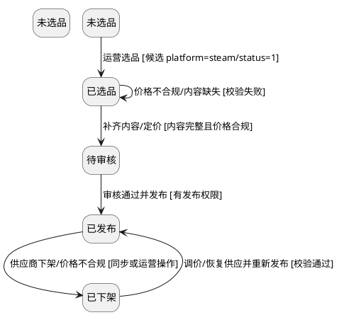

**状态字典：**

| 对象/状态码 | 中文名与业务含义 | 权威来源/写入方 | 进入条件 | 可执行动作 | 是否终态 | 各端显示 | 退出规则 |
| --- | --- | --- | --- | --- | --- | --- | --- |
| 未选品 | 未选品 | 商城服务端/支付渠道/供应商/运营（按对象） | 初始状态 | 运营选品 | 否 | 按 §5.9/§9.11 映射 | 见迁移表 |
| 已选品 | 已选品 | 商城服务端/支付渠道/供应商/运营（按对象） | 运营选品；价格不合规/内容缺失 | 补齐内容/定价；价格不合规/内容缺失 | 否 | 按 §5.9/§9.11 映射 | 见迁移表 |
| 待审核 | 待审核 | 商城服务端/支付渠道/供应商/运营（按对象） | 补齐内容/定价 | 审核通过并发布 | 否 | 按 §5.9/§9.11 映射 | 见迁移表 |
| 已发布 | 已发布 | 商城服务端/支付渠道/供应商/运营（按对象） | 审核通过并发布；调价/恢复供应并重新发布 | 供应商下架/价格不合规 | 否 | 按 §5.9/§9.11 映射 | 见迁移表 |
| 已下架 | 已下架 | 商城服务端/支付渠道/供应商/运营（按对象） | 供应商下架/价格不合规 | 调价/恢复供应并重新发布 | 否 | 按 §5.9/§9.11 映射 | 见迁移表 |

**迁移表：**

| 迁移ID | 当前状态 | 触发事件/发起者 | 守卫条件 | 原子处理/数据变化 | 目标状态 | 通知及界面刷新 | 重复/乱序/超时处理 | 禁止迁移及反馈 | TC |
| --- | --- | --- | --- | --- | --- | --- | --- | --- | --- |
| TR-SM-PRODUCT-001-01 | 未选品 | 运营选品 | 候选 platform=steam/status=1 | 按对象服务原子写入并留痕 | 已选品 | 刷新订单/结果/后台；通知按 06/05 | 重复回调幂等；迟到结果不改已终态；未知保持原状态 | 无证据不得改变状态 | TC-SM-PRODUCT-001 |
| TR-SM-PRODUCT-001-02 | 已选品 | 补齐内容/定价 | 内容完整且价格合规 | 按对象服务原子写入并留痕 | 待审核 | 刷新订单/结果/后台；通知按 06/05 | 重复回调幂等；迟到结果不改已终态；未知保持原状态 | 无证据不得改变状态 | TC-SM-PRODUCT-001 |
| TR-SM-PRODUCT-001-03 | 待审核 | 审核通过并发布 | 有发布权限 | 按对象服务原子写入并留痕 | 已发布 | 刷新订单/结果/后台；通知按 06/05 | 重复回调幂等；迟到结果不改已终态；未知保持原状态 | 无证据不得改变状态 | TC-SM-PRODUCT-001 |
| TR-SM-PRODUCT-001-04 | 已选品 | 价格不合规/内容缺失 | 校验失败 | 按对象服务原子写入并留痕 | 已选品 | 刷新订单/结果/后台；通知按 06/05 | 重复回调幂等；迟到结果不改已终态；未知保持原状态 | 无证据不得改变状态 | TC-SM-PRODUCT-001 |
| TR-SM-PRODUCT-001-05 | 已发布 | 供应商下架/价格不合规 | 同步或运营操作 | 按对象服务原子写入并留痕 | 已下架 | 刷新订单/结果/后台；通知按 06/05 | 重复回调幂等；迟到结果不改已终态；未知保持原状态 | 无证据不得改变状态 | TC-SM-PRODUCT-001 |
| TR-SM-PRODUCT-001-06 | 已下架 | 调价/恢复供应并重新发布 | 校验通过 | 按对象服务原子写入并留痕 | 已发布 | 刷新订单/结果/后台；通知按 06/05 | 重复回调幂等；迟到结果不改已终态；未知保持原状态 | 无证据不得改变状态 | TC-SM-PRODUCT-001 |

### SM-PAYCHECK-001 支付核查状态机

需求来源：§5.10、ADM-15、PAY-13。

<!-- DIAGRAM:SM-PAYCHECK-001 -->
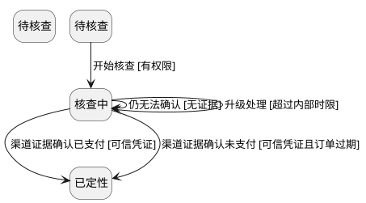

**状态字典：**

| 对象/状态码 | 中文名与业务含义 | 权威来源/写入方 | 进入条件 | 可执行动作 | 是否终态 | 各端显示 | 退出规则 |
| --- | --- | --- | --- | --- | --- | --- | --- |
| 待核查 | 待核查 | 商城服务端/支付渠道/供应商/运营（按对象） | 初始状态 | 开始核查 | 否 | 按 §5.9/§9.11 映射 | 见迁移表 |
| 核查中 | 核查中 | 商城服务端/支付渠道/供应商/运营（按对象） | 开始核查；仍无法确认；升级处理 | 渠道证据确认已支付；渠道证据确认未支付；仍无法确认；升级处理 | 否 | 按 §5.9/§9.11 映射 | 见迁移表 |
| 已定性 | 已定性 | 上游状态 | 渠道证据确认已支付；渠道证据确认未支付 | 无 | 是（或需人工终局） | 按 §5.9/§9.11 映射 | 终态/需明确恢复 |

**迁移表：**

| 迁移ID | 当前状态 | 触发事件/发起者 | 守卫条件 | 原子处理/数据变化 | 目标状态 | 通知及界面刷新 | 重复/乱序/超时处理 | 禁止迁移及反馈 | TC |
| --- | --- | --- | --- | --- | --- | --- | --- | --- | --- |
| TR-SM-PAYCHECK-001-01 | 待核查 | 开始核查 | 有权限 | 按对象服务原子写入并留痕 | 核查中 | 刷新订单/结果/后台；通知按 06/05 | 重复回调幂等；迟到结果不改已终态；未知保持原状态 | 无证据不得改变状态 | TC-SM-PAYCHECK-001 |
| TR-SM-PAYCHECK-001-02 | 核查中 | 渠道证据确认已支付 | 可信凭证 | 按对象服务原子写入并留痕 | 已定性 | 刷新订单/结果/后台；通知按 06/05 | 重复回调幂等；迟到结果不改已终态；未知保持原状态 | 无证据不得改变状态 | TC-SM-PAYCHECK-001 |
| TR-SM-PAYCHECK-001-03 | 核查中 | 渠道证据确认未支付 | 可信凭证且订单过期 | 按对象服务原子写入并留痕 | 已定性 | 刷新订单/结果/后台；通知按 06/05 | 重复回调幂等；迟到结果不改已终态；未知保持原状态 | 无证据不得改变状态 | TC-SM-PAYCHECK-001 |
| TR-SM-PAYCHECK-001-04 | 核查中 | 仍无法确认 | 无证据 | 按对象服务原子写入并留痕 | 核查中 | 刷新订单/结果/后台；通知按 06/05 | 重复回调幂等；迟到结果不改已终态；未知保持原状态 | 无证据不得改变状态 | TC-SM-PAYCHECK-001 |
| TR-SM-PAYCHECK-001-05 | 核查中 | 升级处理 | 超过内部时限 | 按对象服务原子写入并留痕 | 核查中 | 刷新订单/结果/后台；通知按 06/05 | 重复回调幂等；迟到结果不改已终态；未知保持原状态 | 无证据不得改变状态 | TC-SM-PAYCHECK-001 |

## 4. 异常处理矩阵

| EX编号 | 需求/页面/组件 | 场景与触发 | 识别来源/信号 | 当前状态 | 用户文案及位置 | 允许/禁止操作 | 数据保留/清理 | 恢复/重试/停止 | 后台/人工处理 | 目标状态 | API/事件/TC |
| --- | --- | --- | --- | --- | --- | --- | --- | --- | --- | --- | --- |
| EX-AUTH-001 | AUTH-01/09 | 平台登录取消/失败/返回参数缺失 | 平台返回/接口 | 未登录 | 请先登录后购买 | 保留浏览与购买现场 | 商品/规格/好友链接 | 可重试；不建单 | 无 | 未登录 | API-AUTH-003 | TC-AUTH-001 |
| EX-AUTH-002 | AUTH-02/03 | 未实名/未成年/核验失败 | 平台可信结果 | 未实名/未成年 | 购买前需完成实名认证 / 暂不可购买 | 去认证/继续浏览 | 现场保留 | 失败/取消不放行 | 客服不代办 | 未实名/未成年 | API-AUTH-002 | TC-AUTH-003 |
| EX-AUTH-003 | AUTH-06 | 实名状态未知/游客 | 平台无结果 | 未知 | 不展示状态提醒 | 保持浏览 | 无 | 购买时再校验 | 无 | 未知 | API-AUTH-002 | TC-AUTH-002 |
| EX-CHECKOUT-001 | CHECKOUT-06 | 30 分钟到期 | 服务端时间 | 待支付 | 订单已关闭，请重新购买 | 重新购买 | 保留快照 | 查询未知不关闭 | 支付核查 | 已关闭/确认中 | API-ORDER-004 | TC-CHECKOUT-002 |
| EX-CHECKOUT-002 | PENDING-06 | 商品下架/售罄/价格不合规 | 服务端校验 | 待支付 | 商品暂不可购买，订单已关闭 | 返回商品/重新购买 | 保留历史订单 | 不扣款 | 运营处理 | 已关闭 | API-PRODUCT-001 | TC-CHECKOUT-003 |
| EX-CHECKOUT-003 | CHECKOUT-10 | 同商品存在有效未支付/确认中订单 | 订单服务 | 待支付/确认中 | 您有一笔订单处理中 | 恢复旧单 | 不新建 | 确认中不关闭 | 客服 | 恢复旧单 | API-ORDER-003 | TC-BUY-008 |
| EX-BUY-001 | PRODUCT-12/BR-015 | 供应商余额不足/查询失败 | 钱包接口 | 商品可售 | 补货中/暂不可购买 | 稍后重试 | 面板内容保留 | 不创建可支付订单 | 运营充值 | 停售 | API-SUPPLIER-002 | TC-BUY-009 |
| EX-BUY-002 | PRODUCT-11 | 库存缓存过期/同步失败/未知 | 库存缓存 | 可售 | 以付款后供应商结果为准，失败自动退款/补货 | 允许下单 | 保留选择 | 不承诺有货 | 运营同步 | 允许下单 | API-SUPPLIER-003 | TC-BUY-010 |
| EX-BUY-003 | AGREEMENT-02 | 未勾选协议 | 前端/服务端 | 购买面板 | 购买须知 | 取消/查看/同意并继续 | 勾选与版本 | 同意后仍校验手机号 | 无 | 继续校验 | API-AGREEMENT-001 | TC-BUY-004 |
| EX-BUY-004 | PHONE-05 | 验证码错误/过期/频控 | 短信服务 | 手机号绑定 | 验证码不正确/操作过于频繁 | 重新输入/稍后重试 | 手机号保留 | 不唤起支付 | 客服 | 未绑定 | API-SMS-001 | TC-PHONE-003 |
| EX-PAY-001 | PAY-04/10 | 支付结果未知/查询超时 | 支付渠道 | 确认中 | 支付结果确认中，请勿重复支付 | 重新查询/客服 | 订单与支付尝试保留 | 不判失败、不新建单 | 支付核查 | 确认中 | API-PAY-003 | TC-PAY-003 |
| EX-PAY-002 | PAY-08/09 | 用户选择与真实结果相反 | 服务端查询 | 查询中 | 按真实结果提示 | 按结果跳转 | 不按自述改状态 | 只以服务端为准 | 无 | 按真实结果 | API-PAY-003 | TC-PAY-002 |
| EX-PAY-003 | PAY-11 | 关闭后晚到款 | 渠道通知/查询 | 已关闭 | 支付已到账，正在恢复交付 | 查看订单 | 恢复旧单并关闭新未支付单 | 重复回调幂等 | 客服 | 已支付 | API-PAY-003 | TC-PAY-004 |
| EX-PAY-004 | PAY-12 | 晚到款不可履约/新单已支付 | 供应商/订单 | 已关闭 | 将为该笔支付退款 | 查看退款进度 | 不重复交付 | 原路退款 | 财务 | 退款中 | API-REFUND-001 | TC-PAY-005 |
| EX-CODE-001 | CODE-01/02 | 取码超时/返回不明 | 供应商 | 发码中 | 正在确认交付结果 | 查看订单/客服 | 保留请求 | 先查日志/采购单，未成功同 orderid 重试 | 运营 | 发码中/交付异常 | API-SUPPLIER-004 | TC-CODE-001 |
| EX-CODE-002 | CODE-02 | pu004 库存不足 | 供应商 | 发码中 | 商品补货中，将自动重试 | 查看订单/客服 | 不扣款 | 24h 内同 orderid 重试；超窗退款 | 运营补货 | 交付异常/退款 | API-SUPPLIER-004 | TC-CODE-002 |
| EX-CODE-003 | CODE-02 | pu005 出库失败 | 供应商 | 发码中 | 交付异常，正在处理 | 客服 | 不扣款 | 24h 内重试；无法解决退款 | 运营 | 交付异常/退款 | API-SUPPLIER-004 | TC-CODE-003 |
| EX-CODE-004 | CODE-02 | pu006 订单已处理 | 供应商 | 发码中 | 正在查询交付结果 | 查看订单 | 保留请求 | 禁止重复请求，先查日志/采购单 | 运营 | 已交付/退款 | API-SUPPLIER-005 | TC-CODE-004 |
| EX-CODE-005 | CODE-02 | pu002/pu003 配置/签名错误 | 供应商 | 发码中 | 交付配置异常，请联系客服 | 客服 | 保留请求 | 修复配置后重试，不靠次数解决 | 研发 | 交付异常 | API-SUPPLIER-004 | TC-CODE-005 |
| EX-CODE-006 | CODE-08 | 口令码权限不足/越权 | 服务端 | 详情/后台 | 无权查看该口令码 | 返回 | 不展示 | 服务端拒绝并审计 | 管理员 | 无权限 | API-CODE-002 | TC-CODE-006 |
| EX-GIFT-001 | GIFT-05 | 好友链接错误/无法赠送 | 运营核实 | 赠送处理中 | 好友链接无法完成赠送，请联系客服 | 客服 | 不展示口令码 | 不静默改链接；协商处理 | 客服/运营 | 处理异常 | API-ADM-GIFT-002 | TC-GIFT-002 |
| EX-GIFT-002 | §7.3 | 超过累计 2 小时 | 计时/运营 | 处理中 | 处理中，已进入优先队列 | 客服 | 保留订单 | 不自动违约/补偿 | 运营 | 待处理/处理中 | API-ADM-GIFT-001 | TC-GIFT-003 |
| EX-REFUND-001 | §8.5 | 退款渠道明确失败 | 支付渠道 | 退款中 | 退款失败，请联系客服 | 客服/重试 | 保留退款记录 | 重试复用原任务标识 | 财务 | 失败 | API-REFUND-002 | TC-REFUND-002 |
| EX-REFUND-002 | §8.5 | 退款结果未知 | 支付渠道 | 退款中 | 退款处理中，请稍后查询 | 重新查询 | 保留记录 | 不标失败、不重复退款 | 财务 | 退款中 | API-REFUND-002 | TC-REFUND-003 |
| EX-REFUND-003 | §8.4 | 退款与交付并发 | 交付任务 | 退款中/发码中 | 退款处理中，相关交付已暂停 | 客服 | 保留交付记录 | 暂停/取消后续自动交付 | 运营 | 退款中 | API-ORDER-005 | TC-REFUND-004 |
| EX-ORDER-001 | ORDER-05 | 会话失效 | 服务端 | 任意 | 登录已失效，请重新登录 | 重新登录 | 清旧数据 | 不展示旧账号订单 | 无 | SESSION_EXPIRED | API-AUTH-001 | TC-ORDER-004 |
| EX-ORDER-002 | ORDER-04 | 订单不属于当前账号 | 服务端 | 任意 | 订单不存在或无权查看 | 返回列表 | 不展示 | 服务端拒绝 | 客服 | 无权限 | API-ORDER-004 | TC-ORDER-005 |
| EX-SEARCH-001 | SEARCH-02 | 搜索失败/无结果 | 搜索服务 | 搜索结果 | 搜索失败，请重试 / 没有找到相关商品 | 重试/修改关键词 | 保留关键词 | 失败不显示 0 条 | 无 | ERROR/EMPTY | API-SEARCH-001 | TC-SEARCH-004 |
| EX-HOME-001 | HOME-04 | 首页配置加载失败 | 首页服务 | 首页 | 首页加载失败，请重试 | 重试 | 保留标题/搜索 | 不显示假内容 | 运营 | ERROR | API-HOME-001 | TC-HOME-004 |
| EX-ADM-001 | §12.4 | 筛选查询失败 | 后台服务 | 列表 | 查询失败，请重试 | 重试/重置 | 保留条件 | 失败不冒充 0 条 | 研发 | ERROR | API-ADM-* | TC-ADM-FILTER-001 |
| EX-ADM-002 | §12.9 | 记录不存在/不可访问 | 后台服务 | 弹窗 | 记录不存在或无权访问 | 关闭/刷新 | 不替换目标 | 不回退第一条 | 管理员 | ERROR | API-ADM-* | TC-ADM-DRAWER-001 |
| EX-ADM-003 | §12.13 | 权限不足/撤销 | 服务端 | 任意后台 | 当前角色无权执行该操作 | 返回/申请 | 不写业务数据 | 执行时再次校验 | 管理员 | NO_PERM | API-ADMIN-001 | TC-ADM-RBAC-001 |
| EX-ADM-004 | §12.4 | 凌晨响应覆盖新条件 | 请求乱序 | 列表 | 不提示旧结果 | 无 | 旧回调作废 | 请求版本隔离 | 研发 | 保持新状态 | API-ADM-* | TC-ADM-FILTER-002 |
| EX-ADM-005 | §12.10 | 高影响动作未确认 | 操作入口 | 列表/弹窗 | 请确认后再执行 | 确认/取消 | 取消不改数据 | 统一确认引擎 | 管理员 | 保持原状态 | API-ADM-* | TC-ADM-CONFIRM-001 |
| EX-ADM-006 | ADM-13 | 协议发布失败 | 后台服务 | 协议编辑 | 协议发布失败，旧版本继续有效 | 重试 | 保留草稿 | 不提前生效 | 管理员 | ERROR | API-ADM-AGREEMENT-002 | TC-ADM-AGREEMENT-002 |
| EX-ADM-007 | ADM-17 | 余额查询失败 | 供应商钱包 | 钱包/商品 | 余额查询失败，暂按不可用处理 | 重试 | 保留上次快照 | 停止新口令码订单；已支付继续重试 | 运营 | 未知 | API-SUPPLIER-006 | TC-ADM-WALLET-002 |
| EX-ADM-008 | ADM-15 | 无渠道证据改支付状态 | 人工操作 | 核查 | 请先附渠道查询结果或支付凭证 | 取消 | 不改变支付状态 | 保持确认中 | 支付/财务 | 确认中 | API-ADM-PAYCHECK-001 | TC-ADM-PAYCHECK-002 |

## 5. 恢复、补偿与人工介入

| 场景 | 触发条件 | 用户可见 | 系统自动处理 | 后台/人工动作 | 结果回写 | 用户反馈 | 待确认 |
| --- | --- | --- | --- | --- | --- | --- | --- |
| 支付确认中 | 支付结果未知超时限 | 支付确认中，请勿重复支付 | 保持状态、继续查询 | 支付核查队列，凭渠道证据定性 | 更新支付事实并留痕 | 订单/结果页刷新 | 核查时限 TBD-31 |
| 晚到款 | 关闭后收到支付成功 | 支付已到账，正在恢复交付 | 核验渠道/金额/订单，恢复旧单并关闭新未支付单 | 不可履约时退款 | 恢复支付事实、退款单 | 站内信/订单状态 | 可履约判断 |
| 发码失败 | 超时/pu004/pu005/余额不足 | 交付异常/补货中 | 保留请求，24h 内同 orderid 重试 | 运营充值/补货/补发/换码/转退款 | 交付记录与订单状态 | 订单/结果页 | 起算点 TBD-33 |
| 退款失败 | 渠道明确失败 | 退款失败，请联系客服 | 进入异常队列，不重复退款 | 财务重试、客服承接 | 退款单/订单状态 | 客服联系 | 重试时限 TBD-08 |
| 好友赠送超时 | 超过累计 2 小时 | 处理中，已进入优先队列 | 标记超时、按付款顺序排队 | 运营排班处理 | 处理状态/完成依据 | 订单状态 | 补偿 TBD-02 |
| 通知失败 | 平台失败/未知 | 无（不影响订单） | 记录任务、授权重试 | 后台核查/重试 | 通知任务状态 | 用户仍可从订单查收 | 重试策略 TBD-16 |
| 协议实质性变更 | 旧未支付单继续支付 | 需重新确认协议 | 阻断继续支付 | 运营发布时标记 | 记录新版本/时间 | 协议页/确认订单 | 判定标准 TBD-12 |
| 权限拒绝 | 角色不足/撤权 | 无权执行该操作 | 服务端拒绝 | 管理员授权 | 审计（按 05） | 不写业务数据 | 人员分配 |

不得用“联系客服”代替完整恢复路径；每条异常均有界面表现、数据处置、恢复动作与 TC。未确认的时限/阈值不作为既定规则。

## 6. 适用性与待确认项

- 适用端：APP/WEB 共享购买、支付、交付、退款主流程；ADM 覆盖选品发布、订单、赠送、口令码、退款、支付核查、通知、钱包。
- 不在本期：发票、统计报表、购物车、优惠券、会员、评价、多件购买、部分交付/退款、前台自助退款/换码/补发、交付短信、供应商全量自动上架。
- 外部依赖：平台登录/实名/支付/站内信/手机号、供应商取码/日志/钱包、短信服务；原型均为模拟，未联调。
- 待确认：好友链接格式 TBD-06、支付核查时限 TBD-31、库存新鲜度 TBD-32、余额阈值 TBD-25、24h 起算 TBD-33、协议文本 TBD-12、通知接入 TBD-16、导出细则 TBD-26、数据保留 TBD-27。
- 流程/状态图均由结构模型生成并经 lint：空标签、悬空边、孤立节点、重复 ID、不可达终态为 0；SVG 实际文本与几何检查结果见 08。

> 本文件不宣称任何流程已在真实平台/支付/供应商环境通过；原型仅验证结构与交互模拟。