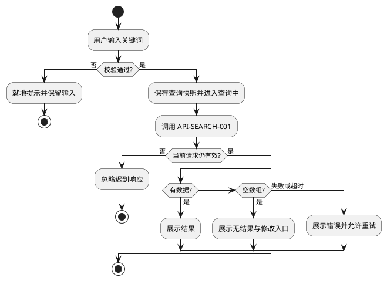

# 参考实现与贯通示例

规则基线：V3.0；结构修订：split-draft-1（待确认）。

这是历史入口或参考示例，不是当前任务的默认指令入口；示例业务不构成 PRD。

原文中的跨章引用请按 [章节索引](../docs/CHAPTER-INDEX.md) 找到权威文件；不要把缺失上下文当作不适用。

<!-- SOURCE-SECTION: H -->

## 附录 H：参考实现结构（非强制）

本项目最新交付（41 页面、152 状态、192 组件定义、178 实例、45 客户端事件、35 张图、58 个接口、293 条用例、426 项检查）已验证以下结构可行：

| 模块 | 参考文件 | 职责 |
| --- | --- | --- |
| 样式 | `01-head.html` | 令牌、评审外壳、客户端/后台、阅读器、图示、弹窗 |
| 外壳 | `02-shell.html` | 标题、控制区、模拟身份、状态块、画布、说明、图示/阅读器入口 |
| 核心 | `03-core.js` | DOM/转义/金额/Markdown/安全 URL/图示查表 |
| 客户端 A | `04-client-a.js` | 首页、提醒、搜索、详情、购买面板、协议 |
| 客户端 B | `05-client-b.js` | 手机绑定、结算、支付返回、结果、订单、我的、客服 |
| 桌面 Web | `06-web.js` | 首页、搜索、详情、扫码、结算、结果、订单、我的 |
| 后台数据 | `07-admin-data.js` | 菜单、订单、商品、通知、协议、角色、字典 |
| 后台运行时 | `08-admin.js` | ADM_RT、筛选、通用函数、第一组页面配置 |
| 后台配置 B | `09-admin-b.js` | 第二组页面配置与专属渲染 |
| 后台渲染 | `10-admin-render.js` | 菜单、筛选、页签、表格、分页、弹窗、确认、toast |
| 启动 | `11-boot.js` | PAGES、路由、评审控制、动作分发、输入监听、boot |
| 构建 | `build.mjs` | 拼接、解析 03、渲染图示、内嵌文档、注入数据 |

该结构不是唯一实现；但分片职责、注册表集中、通用渲染与数据分离、构建期注入的原则应保留。

<!-- SOURCE-SECTION: I -->

## 附录 I：贯通填写示例（关键词查询）

以下示例只说明跨文档写法，不要求所有项目实现搜索。示例规则：关键词去首尾空格后 1～30 字；点击查询后提交；离开页面后旧响应作废。真实项目以 PRD 为准。

### I.1 关联链

| 对象 | 编号 | 说明 |
| --- | --- | --- |
| 需求 | REQ-SEARCH-001 | 用户按关键词查询商品；PRD 3.2 |
| 页面 | APP-SEARCH-01 / APP-SEARCH-02 | 搜索默认页 / 结果页 |
| 组件 | APP-SEARCH-01-C01（输入框）、C02（查询按钮） | 共享输入与提交动作 |
| 模式 | PAT-INPUT-01、PAT-ACTION-01 | 普通输入、主按钮 |
| 流程 | FL-SEARCH-001 | 输入→校验→查询→结果/空/失败 |
| 接口 | API-SEARCH-001 | `GET /items/search`；建议契约 |
| 异常 | EX-SEARCH-001 | 查询超时 |
| 时序 | SEQ-SEARCH-001 | 客户端→查询服务；归 05 |
| 事件 | SearchResultEvent | 结果与条数；不采集关键词 |
| 用例 | TC-SEARCH-001～003 | 成功、空、超时 |
| 检查 | CHK-SEARCH-001 | 实际浏览器验证 |

### I.2 状态矩阵（节选）

| 页面ID | 状态ID | 名称 | 适用 | 依据 | 原型入口 |
| --- | --- | --- | --- | --- | --- |
| APP-SEARCH-01 | DEFAULT | 默认 | 适用 | 首次进入，无查询 | 页面默认 |
| APP-SEARCH-01 | EDITING | 输入中 | 适用 | 输入未提交 | 输入框输入 |
| APP-SEARCH-01 | EMPTY | 内容为空 | 适用 | 搜索发现/热门为空 | 模拟结果=空数据 |
| APP-SEARCH-02 | RESULTS | 有结果 | 适用 | 查询成功且数组非空 | 提交合法关键词 |
| APP-SEARCH-02 | EMPTY | 无结果 | 适用 | 查询成功且数组为空 | 提交无匹配词 |
| APP-SEARCH-02 | ERROR | 失败 | 适用 | 网络/服务失败 | 模拟结果=请求失败 |

### I.3 组件十节示例：APP-SEARCH-01-C02 查询按钮

**1. 功能/组件名称：** APP-SEARCH-01-C02，查询按钮；所属页面 APP-SEARCH-01；需求来源 REQ-SEARCH-001；业务目的为校验关键词并发起查询；模式 PAT-ACTION-01；适用端 APP；职责范围仅提交查询，不承担输入编辑、历史管理或结果渲染。

**2. 数据来源：**

| 字段/对象 | 类型与格式 | 来源及字段路径 | 获取/刷新时机 | 必填/可编辑 | 默认与空值 | 校验/过期 | 脱敏/权限 | 字典引用 |
| --- | --- | --- | --- | --- | --- | --- | --- | --- |
| keyword | string，1～30 字 | 用户输入；APP-SEARCH-01-C01.value，去首尾空格 | 点击查询时 | 必填，可编辑 | 空串→不提交 | 空/超长→就地错误 | 不采集原文；仅用于本次查询 | 05 keyword |
| loading | bool | 本次请求状态 | 请求开始/结束 | — | false | 新请求使旧响应失效 | — | 05 request_state |
| result_count | integer | API-SEARCH-001；data.items.length | 响应到达 | — | 失败/超时为 null | 成功时 ≥0 | 低 | 05 result_count |

**3. 功能交互逻辑：**

| 操作/触发 | 前置与校验 | 系统处理/接口 | 数据及状态变化 | 成功/失败去向 | 幂等、重复或取消规则 |
| --- | --- | --- | --- | --- | --- |
| 点击查询 | 输入非空、≤30 字 | 保存查询快照；调用 API-SEARCH-001 | 进入 LOADING；记录请求版本 | 有结果→RESULTS；无结果→EMPTY；失败→ERROR | 处理中禁用按钮；新查询使旧回调作废；离页后不更新 |

**4. 界面反馈与体验表现：**

| 状态/场景 | 具体文案 | 展示位置/形式 | 可操作项 | 禁用项及提示原因 | 焦点/键盘/滚动/关闭 | 恢复或下一步 |
| --- | --- | --- | --- | --- | --- | --- |
| 空输入 | 请输入关键词 | 输入框下方行内 | 修改输入 | 查询按钮禁用 | 焦点留在输入框 | 输入后恢复 |
| 查询中 | 查询中… | 按钮文案 | 无 | 按钮禁用 | 保持焦点与滚动 | 响应后恢复 |
| 失败 | 查询失败，请重试 | 结果区行内 | 重试 | — | 保留关键词 | 点击重试 |
| 无结果 | 未找到匹配内容，请修改关键词 | 结果区空态 | 修改关键词 | — | — | 返回输入 |

**5. 组件样式：** 深灰主按钮、白字、矩形、最小高 44px；处理中浅灰禁用；与输入框同一行，间距 8px；手机画布内不收缩文字；热区≥44×44；键盘聚焦显示 2px 焦点环。

**6. 状态变更：**

| 当前状态 | 触发事件 | 守卫条件 | 目标状态 | 界面变化 | 数据变化 | 禁止操作 | 关联01/04 |
| --- | --- | --- | --- | --- | --- | --- | --- |
| IDLE | 点击查询 | 输入合法 | LOADING | 按钮“查询中…”并禁用 | 保存查询快照、版本+1 | 再次提交 | 01::EDITING |
| LOADING | 成功有结果 | 当前版本 | RESULTS | 展示结果与条数 | 结果列表更新 | 旧请求写入 | FL-SEARCH-001 |
| LOADING | 成功空数组 | 当前版本 | EMPTY | 空态与修改入口 | 结果为空 | 显示旧结果 | FL-SEARCH-001 |
| LOADING | 失败/超时 | 当前版本 | ERROR | 行内错误与重试 | 保留关键词 | 判定服务端失败 | EX-SEARCH-001 |

**7. 数据流转与接口：** API-SEARCH-001，建议 `GET /items/search?keyword=...`；keyword 来自本次输入快照；响应 `items[]` 映射为结果列表，`items.length` 映射 result_count；失败/超时映射 EX-SEARCH-001；路径与超时阈值待技术确认；不做本地缓存；无鉴权例外时按 05 角色校验；重试仅重发当前查询，不重复写操作。

**8. 埋点和日志：** 该组件产生 SearchResultEvent。

| 事件英文变量名 | 事件显示名 | 属性英文变量名 | 属性显示名 | 数据类型 | 属性值示例或说明 | 触发时机 |
| --- | --- | --- | --- | --- | --- | --- |
| SearchResultEvent | 查询结果 | request_result | 请求结果 | enum（string） | SUCCESS（有结果）、EMPTY（无结果）、ERROR（失败）、TIMEOUT（超时）；EMPTY 是成功但为空 | 当前有效查询完成或判定超时时；同次请求仅一次 |
| SearchResultEvent | 查询结果 | result_count | 结果条数 | integer | 成功时为 items 长度，无结果为 0；失败/超时省略 | 同上 |

诊断日志只记错误类别，不记关键词。

**9. 测试与验收条件：** 关联 TC-SEARCH-001～003；覆盖 0/1/30/31 字、无结果、超时、重复点击、离页后迟到响应、事件去重；未实测不写通过。

**10. 待确认项：** DEC-SEARCH-001 接口路径与超时阈值；DEC-SEARCH-002 失败时 result_count 是否省略；DEC-SEARCH-003 新查询是否清空旧结果。

### I.4 一条可执行用例

| 字段 | 内容 |
| --- | --- |
| 用例编号/标题 | TC-SEARCH-001 / 查询成功展示结果 |
| 模块/依据 | SEARCH；REQ-SEARCH-001；APP-SEARCH-01-C02；API-SEARCH-001；SearchResultEvent |
| 优先级/类型/阶段 | P0 / 正常 / 原型模拟 |
| 前置条件 | 打开 APP-SEARCH-01；输入为空；模拟接口可返回 3 条结果 |
| 测试数据 | keyword=“资料”；items 含 3 个唯一 ID 与名称 |
| 操作步骤 | 1）输入关键词；2）点击查询，响应前再次点击；3）返回成功结果 |
| 预期结果 | 1）查询按钮可用；2）仅发起一次模拟请求，按钮“查询中…”且禁用；3）展示 3 条结果与条数，恢复按钮，无错误提示 |
| 依赖/待确认 | 不依赖未定超时阈值；正式接口待评审 |
| 执行状态 | 未执行 |
| 实际结果 | |
| 环境/版本/人/日期 | |
| 缺陷/证据 | |

### I.5 PlantUML 流程片源

实际交付须为图示提供离线 SVG、入口、缩放与图源折叠，并与节点表一致。

---

**文档结束**
